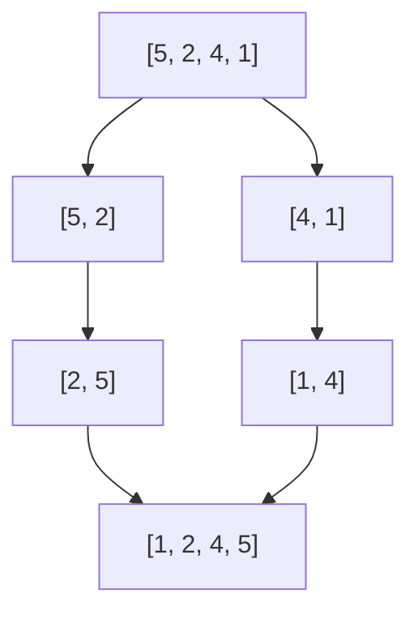

# Algorithmes de tri

Suite du [[Chapitre 1 - Complexité]].

## Tri par insertion

On insère chaque élément à sa place dans la partie déjà triée.

```c
void tri_insertion(int t[], int n) {
    for (int i = 1; i < n; i++) {
        int x = t[i], j = i - 1;
        while (j >= 0 && t[j] > x) {
            t[j + 1] = t[j];
            j--;
        }
        t[j + 1] = x;
    }
}
```

## Tri fusion



> [!info] Complexités
> | Tri | Meilleur | Pire |
> |---|---|---|
> | Insertion | $O(n)$ | $O(n^2)$ |
> | Fusion | $O(n \log n)$ | $O(n \log n)$ |

À mettre en pratique : [[TP 1 - Tri par insertion]].
