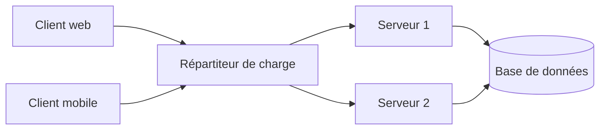

# Introduction aux systèmes répartis

Un **système réparti** est un ensemble de machines indépendantes qui communiquent par le réseau et apparaissent à l'utilisateur comme un seul système cohérent.

> [!definition] Système réparti
> Ensemble de processus qui s'exécutent sur des machines distinctes, ne partagent pas de mémoire et coopèrent uniquement en **échangeant des messages**.

## Pourquoi répartir ?

- **Partage de ressources** : données, fichiers, puissance de calcul.
- **Disponibilité** : si une machine tombe, une autre prend le relais.
- **Passage à l'échelle** : on ajoute des machines plutôt que d'en acheter une plus grosse.
- **Distribution géographique** : les utilisateurs sont partout.

## Les transparences

| Transparence | Ce que l'utilisateur ne voit pas |
|---|---|
| Accès | la différence entre ressource locale et distante |
| Localisation | où se trouve la ressource |
| Migration | qu'une ressource a changé de machine |
| Réplication | qu'il existe plusieurs copies |
| Panne | qu'un composant est tombé puis a été remplacé |
| Concurrence | que d'autres utilisateurs partagent la ressource |

> [!warning] Les 8 illusions du réparti (Peter Deutsch)
> Le réseau est fiable · la latence est nulle · la bande passante est infinie · le réseau est sûr · la topologie ne change pas · il y a un seul administrateur · le transport ne coûte rien · le réseau est homogène. **Toutes sont fausses** — et chaque bug réparti vient d'en avoir oublié une.

## Modèles d'architecture

- **Client-serveur** : un serveur offre un service, des clients l'appellent (web, bases de données).
- **Multi-niveaux (n-tiers)** : présentation → logique métier → données.
- **Pair-à-pair (P2P)** : chaque nœud est à la fois client et serveur (BitTorrent).
- **Microservices** : petits services indépendants qui communiquent par API — voir [[Chapitre 1 - SOA, SOAP et REST]].



## Communication par sockets

Une **socket** est l'extrémité d'une connexion réseau, identifiée par une adresse IP et un port.

| | TCP (`Socket`) | UDP (`DatagramSocket`) |
|---|---|---|
| Connexion | oui (poignée de main en 3 temps) | non |
| Fiabilité | ordre et livraison garantis | aucune garantie |
| Usage | web, chat, transfert de fichiers | streaming, jeux, DNS |

Serveur TCP minimal en Java :

```java
try (ServerSocket server = new ServerSocket(5000)) {
    while (true) {
        Socket client = server.accept();             // bloque jusqu'à une connexion
        new Thread(() -> handle(client)).start();     // un thread par client
    }
}

static void handle(Socket s) {
    try (s; var in = new BufferedReader(new InputStreamReader(s.getInputStream()));
         var out = new PrintWriter(s.getOutputStream(), true)) {
        String line;
        while ((line = in.readLine()) != null) out.println("echo: " + line);
    } catch (IOException e) {
        e.printStackTrace();
    }
}
```

> [!remarque] Un thread par client
> Simple mais coûteux au-delà de quelques milliers de clients. On utilise alors un **pool de threads** (`ExecutorService`) ou des entrées/sorties non bloquantes (Java NIO, Netty).

## Appel de procédure à distance (RPC)

Le **RPC** cache le réseau : on appelle une méthode distante comme une méthode locale.

1. Le client appelle le **stub** (talon) local.
2. Le stub **sérialise** les paramètres (*marshalling*) et envoie la requête.
3. Le **skeleton** côté serveur désérialise et appelle la vraie méthode.
4. Le résultat fait le chemin inverse.

### Java RMI

```java
public interface Calculatrice extends Remote {
    int additionner(int a, int b) throws RemoteException;
}
```

Le serveur enregistre l'objet dans le **registre RMI** (`LocateRegistry.createRegistry(1099)` puis `registry.rebind("calc", stub)`), le client le récupère avec `registry.lookup("calc")`.

### gRPC

La version moderne et multi-langage : le contrat est écrit en **Protocol Buffers**, le transport est HTTP/2.

```protobuf
service Calculatrice {
  rpc Additionner (Paire) returns (Resultat);
}
message Paire { int32 a = 1; int32 b = 2; }
message Resultat { int32 somme = 1; }
```

## Middleware orienté messages (MOM)

Au lieu d'appeler directement, on **dépose un message** dans une file ; le destinataire le lit quand il est prêt. La communication devient **asynchrone** et les deux côtés sont **découplés**.

- **Point à point** (*queue*) : un message est consommé par un seul destinataire.
- **Publish/subscribe** (*topic*) : un message est reçu par tous les abonnés.
- Outils : RabbitMQ, Apache Kafka, ActiveMQ (JMS). Le même modèle sert en IoT avec MQTT — voir [[Chapitre 1 - Architecture et protocoles IoT]].

## Théorème CAP

> [!theoreme] CAP (Brewer)
> En cas de **partition** réseau (P), un système réparti doit choisir entre **cohérence** (C : tout le monde lit la dernière valeur écrite) et **disponibilité** (A : toute requête reçoit une réponse).

- Plutôt CP : HBase, ZooKeeper, bases SQL distribuées.
- Plutôt AP : Cassandra, DynamoDB, CouchDB.

> [!abstract] À retenir
> Communiquer = échanger des messages. Sockets (bas niveau) → RPC, RMI, gRPC (appel synchrone) → MOM (asynchrone, découplé). Fiche : [[Résumé - Applications réparties]].
