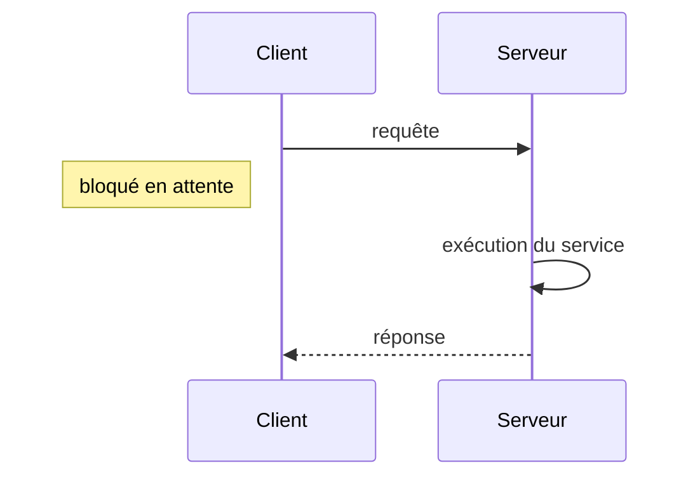
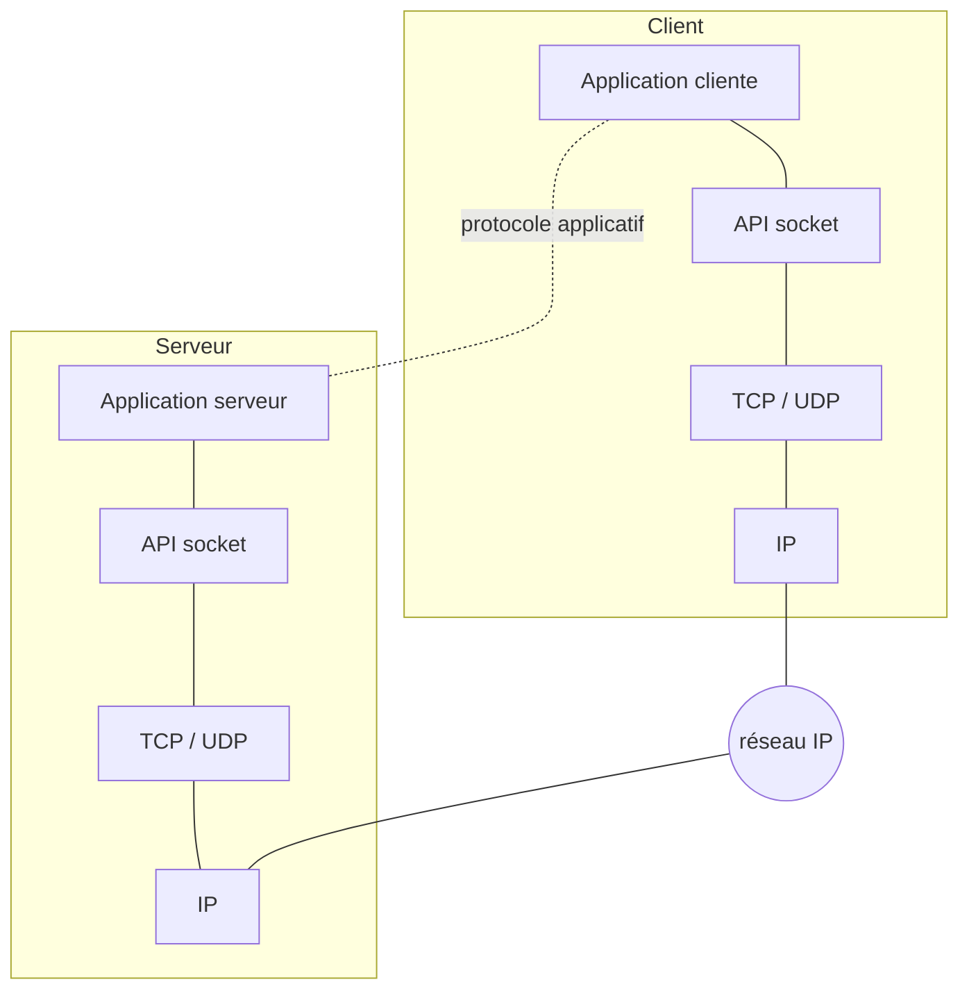

# Résumé — Séance 2 : Les sockets (1)

Support : [[Séance 2 - Chapitre 1 - Sockets (1).pdf]] · séance du 02/10/2026 · précédente : [[Résumé - Séance 1 - Introduction]] · suite : [[Résumé - Séance 3 - Sockets (2)]]

## 1. Rappel : le modèle client/serveur

- Le **client** demande l'exécution d'un service.
- Le **serveur** réalise le service.
- Les deux sont en général sur **deux machines distinctes** (parfois la même).
- Ils communiquent par **messages** :
  - la **requête** : paramètres d'appel, spécification du service demandé ;
  - la **réponse** : résultats, indicateur éventuel d'exécution ou d'erreur.
- Dans le modèle de base, la communication est **synchrone** : le client est **bloqué** en attendant la réponse.



### Exemple : un serveur de fichiers

Des clients demandent des fichiers à un serveur. Trois questions se posent :

| Question | Réponse proposée |
|---|---|
| **Concurrence** : comment servir plusieurs clients ? | un processus serveur ⇔ un client servi ; plusieurs clients ⇒ plusieurs processus serveur |
| **Protocole** : quelles règles d'échange ? | le client envoie le nom du fichier ; le serveur renvoie la taille, puis les données |
| **Erreurs** : que faire quand ça se passe mal ? | fichier inexistant → message d'erreur (comme « 404 Not Found » en HTTP) ; problème de droits d'accès → code d'erreur ; problème réseau → reconnexion ou message clair |

> [!definition] Protocole
> Un **ensemble de règles** qui régissent les **échanges de données** entre le client et le serveur, pour qu'ils se comprennent.

## 2. Mettre en œuvre le client/serveur

Il faut un support pour transporter l'information entre le client et le serveur :

- **bas niveau** : utiliser directement la couche transport, avec les **sockets** (construites sur TCP ou UDP) — *ce chapitre* ;
- **haut niveau** : intégrer l'appel distant dans le langage de programmation, avec le **RPC** (*Remote Procedure Call*), construit au-dessus des sockets — *chapitres suivants*.

Dans les deux cas, il faut établir un **protocole** entre le client et le serveur.

## 3. Les sockets

> [!definition] Socket
> *Socket* signifie « douille, prise femelle » : ce sur quoi on branche quelque chose. C'est un **mécanisme de communication** qui permet d'utiliser l'interface de transport (**TCP** ou **UDP**).

L'**API Socket** :

- permet aux programmes d'**échanger des données** ;
- les applications client/serveur ne voient les couches de communication **qu'à travers elle** (abstraction) ;
- une socket est **liée localement à un port** et permet de communiquer avec un port distant sur une machine distante, c'est-à-dire avec une **application distante**.

Le mode de transport dépend du protocole sous-jacent : une **socket TCP** utilise les mécanismes de TCP, une **socket UDP** envoie les données selon les règles d'UDP.



## 4. Mode connecté (TCP) et mode non connecté (UDP)

| | Mode connecté — **TCP** | Mode non connecté — **UDP** |
|---|---|---|
| Image | un « **service téléphonique** » | un « **service postal** » |
| Déroulement | ouverture d'une liaison → suite d'échanges → fermeture | requêtes successives **indépendantes** |
| État | le serveur **préserve son état** entre deux requêtes | **pas** de préservation de l'état |
| Adresse du client | connue grâce à la liaison | indiquée **à chaque requête** (pas de liaison permanente) |
| Garanties | **ordre**, **contrôle de flux**, **fiabilité** | aucune : arrivée dans l'ordre non garantie, transmissions non fiables |
| Adapté à | des échanges qui durent (plusieurs messages) | des échanges brefs (réponse en un message) |
| Vitesse | transmissions plus **lentes** | transmissions **rapides** |
| Exemples | email, transfert de fichiers | audio / vidéo, streaming, jeux en ligne |

**Points communs aux deux modes :**

- le **client** a l'initiative de la communication : le serveur doit être **à l'écoute** ;
- le client doit connaître la **référence du serveur** `[adresse IP, numéro de port]` : il la trouve dans un **annuaire** (si le serveur s'y est enregistré) ou la connaît **par convention** (numéros de port pré-affectés) ;
- le serveur peut servir **plusieurs clients** (un thread unique, ou un thread par client).

## 5. Les sockets TCP : principe

En mode connecté, les données sont envoyées dans un « **tuyau** » et non par paquets : c'est un **flux de données**. Une socket est **un des deux bouts du tuyau**, et chaque application a sa socket locale. Le tuyau est un canal **bidirectionnel et fiable**.

| Serveur | Client |
|---|---|
| 1. Crée une socket | 1. Crée une socket |
| 2. Lie une **socket d'écoute** à un port bien précis | 2. Se connecte au serveur en donnant l'adresse de la socket distante : **adresse IP du serveur + numéro de port du service** |
| 3. Se met **à l'écoute** des connexions entrantes | 3. Le système d'exploitation attribue automatiquement un **port local** au client pour cette connexion |
| 4. Pour chaque connexion entrante : **accepte** la connexion (une nouvelle **socket de service** est créée, ce qui permet de lancer un thread ou un processus fils pour dialoguer avec le client), puis lit et / ou écrit sur cette socket | 4. Lit et / ou écrit (envoie et reçoit des messages) sur la socket |
| 5. Ferme la socket | 5. Ferme la socket |

> [!remarque] Deux sockets côté serveur
> La **socket d'écoute** (`ServerSocket`) sert seulement à accepter les connexions. Chaque `accept()` renvoie une **socket de service** (`Socket`) dédiée à un client.

## 6. Le package `java.net`

| Classe | Rôle |
|---|---|
| `InetAddress` (sous-classes `Inet4Address`, `Inet6Address`) | une adresse IP |
| `InetSocketAddress` (hérite de `SocketAddress`) | un couple adresse IP + port |
| `Socket` | une socket en mode connecté (TCP) |
| `ServerSocket` | une socket d'attente de connexion, côté serveur (TCP) |
| `DatagramSocket` | une socket en mode non connecté (UDP) |
| `DatagramPacket` | un paquet de données (UDP) |

Pour TCP, on utilise **`InetAddress`**, **`Socket`** et **`ServerSocket`**.

### `InetAddress` — les adresses IP

Pas de constructeur : on passe par des **méthodes statiques**.

| Méthode | Rôle |
|---|---|
| `static InetAddress getByName(String host)` | crée l'objet qui identifie la machine nommée `host` ; lève `UnknownHostException` si le service de noms (DNS…) ne trouve pas la machine |
| `static InetAddress getLocalHost()` | renvoie l'adresse IP de la machine locale (lève aussi `UnknownHostException`) |
| `String getHostName()` | renvoie le nom de la machine dont l'adresse est codée par l'objet |

### `Socket` — la socket en mode connecté

| Élément | Rôle |
|---|---|
| `Socket(InetAddress address, int port)` | crée une socket locale et la **connecte** au port distant de la machine identifiée par `address` / `port` ; lève `IOException` |
| `Socket(String name, int port)` | idem avec le **nom** de la machine ; lève aussi `UnknownHostException` si le nom est introuvable |
| `int getPort()` | le port **distant** auquel la socket est connectée |
| `InetAddress getInetAddress()` | l'adresse IP de la machine **distante** |
| `int getLocalPort()` | le port **local** auquel la socket est liée |
| `OutputStream getOutputStream()` | le flux de sortie, pour **envoyer** des données |
| `InputStream getInputStream()` | le flux d'entrée, pour **recevoir** des données |
| `void close()` | ferme la socket et rompt la connexion |

> [!warning] Nom exact de la méthode
> La diapositive écrit `getAddress()` pour obtenir l'adresse distante. Dans l'API Java, la méthode de `Socket` s'appelle **`getInetAddress()`** ; `getAddress()` existe pour `DatagramPacket` et `InetSocketAddress` (séance 4).

### `ServerSocket` — la socket d'écoute

| Élément | Rôle |
|---|---|
| `ServerSocket(int port)` | crée une socket d'écoute liée au port donné ; lève `IOException`, notamment si le port est déjà utilisé |
| `Socket accept()` | **attend** la connexion d'un client ; quand elle arrive, renvoie la **socket de service** qui permet de dialoguer avec lui |

## 7. Première application client/serveur TCP

Le client envoie un nombre, le serveur renvoie son double.

```java
// Serveur.java
import java.io.*;
import java.net.*;

public class Serveur {
    public static void main(String[] args) throws IOException {
        ServerSocket ss = new ServerSocket(2026);   // 1. création de la ServerSocket
        Socket s = ss.accept();                      // 2. attente d'un client → socket de service
        System.out.println("un client est connecté");

        InputStream is = s.getInputStream();         // 3. échange des données
        int nb = is.read();                          //    lit l'octet envoyé par le client
        int res = nb * 2;
        OutputStream os = s.getOutputStream();
        os.write(res);                               //    renvoie le résultat

        s.close();                                   // 4. fermeture
        ss.close();
    }
}
```

```java
// Client.java
import java.io.*;
import java.net.*;

public class Client {
    public static void main(String[] args) throws IOException {
        Socket s = new Socket("localhost", 2026);    // 1. demande de connexion
        System.out.println("je suis un client connecté");

        OutputStream os = s.getOutputStream();        // 2. échange des données
        os.write(27);                                 //    envoie 27
        InputStream is = s.getInputStream();
        int res = is.read();                          //    reçoit 54
        System.out.println("le résultat reçu est " + res);

        s.close();                                    // 3. fermeture
    }
}
```

> [!methode] Pour tester
> Lancer **d'abord le serveur** (il bloque sur `accept()`), puis le client. Le `write` de l'un correspond au `read` de l'autre : le flux de sortie du client est relié au flux d'entrée du serveur, et inversement.

> [!warning] La limite de cet exemple
> `read()` et `write(int)` ne transportent **qu'un seul octet** (une valeur de 0 à 255). Si le client envoyait 200, le serveur calculerait 400, qui ne tient pas dans un octet : le client recevrait 144 (400 modulo 256). La séance 3 montre comment envoyer des chaînes et des objets.

## Questions de révision

1. Que signifie « communication synchrone » dans le modèle client/serveur ?
2. Quelle est la différence entre un protocole et une socket ?
3. Citer trois différences entre TCP et UDP, et l'image associée à chacun.
4. Que contient la référence d'un serveur, et comment le client peut-il la connaître ?
5. Côté serveur, quelles sont les deux sockets utilisées en TCP, et à quoi sert chacune ?

> [!question]- Réponses
> 1. Le client envoie sa requête puis reste **bloqué** jusqu'à la réponse du serveur.
> 2. Le protocole est l'ensemble des **règles** de l'échange (qui envoie quoi, dans quel ordre) ; la socket est le **mécanisme** qui transporte les données.
> 3. TCP : connecté, fiable, ordonné, plus lent → téléphone. UDP : sans connexion, non fiable, ordre non garanti, rapide → poste.
> 4. Le couple `[adresse IP, numéro de port]`, trouvé dans un annuaire ou connu par convention (ports pré-affectés).
> 5. La `ServerSocket` (écoute et accepte les connexions) et la `Socket` de service renvoyée par `accept()` (dialogue avec un client).
