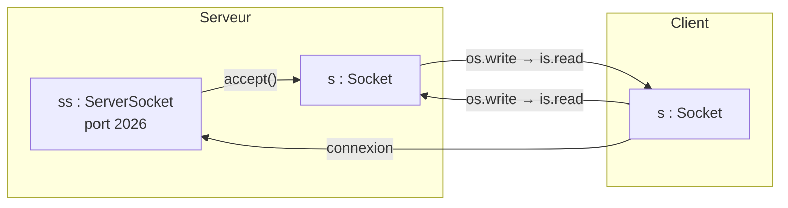
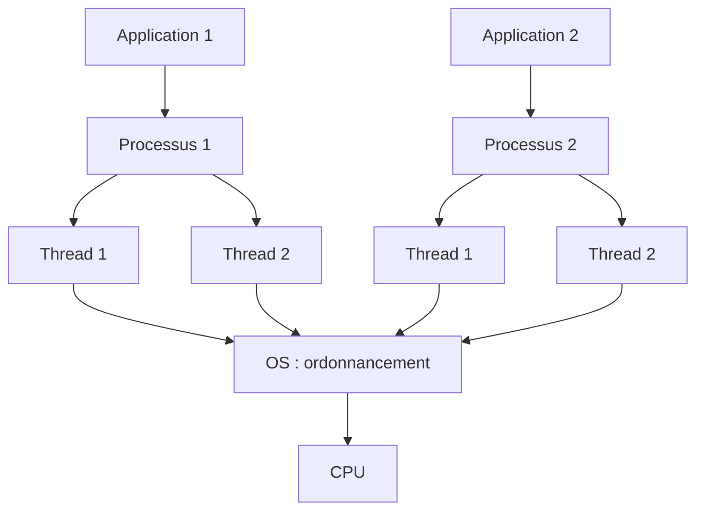
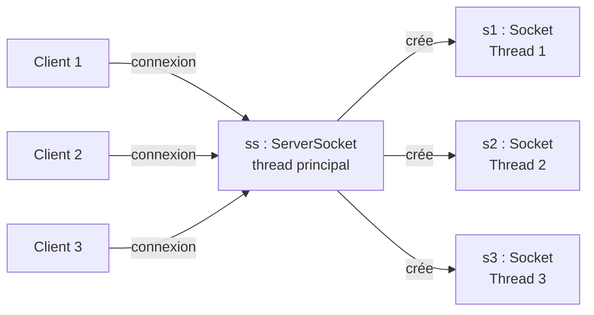

# Résumé — Séance 3 : Les sockets (2)

Support : [[Séance 3 - Chapitre 1 - Sockets (2).pdf]] · séance du 09/10/2026 · précédente : [[Résumé - Séance 2 - Sockets (1)]] · suite : [[Résumé - Séance 4 - Sockets (3)]]

> [!remarque] Notation
> Sur les diapositives, `S.o.p(...)` est l'abréviation de `System.out.println(...)`.

## 1. Retour sur le principe TCP



- Le serveur crée `ss = new ServerSocket(2026)`, puis obtient `s = ss.accept()`.
- Le client crée `s = new Socket("localhost", 2026)`, ce qui établit la **connexion**.
- Chaque côté récupère son flux de sortie `os` (`getOutputStream()`) et son flux d'entrée `is` (`getInputStream()`) : ce que l'un **écrit** sur `os`, l'autre le **lit** sur `is`.

> [!warning] Le problème
> Avec les flux bruts `InputStream` / `OutputStream`, `read()` et `write()` ne manipulent **qu'un seul octet**. Pour échanger du texte ou des objets, on **enveloppe** ces flux dans des flux plus riches.

## 2. Flux de communication et flux de traitement

| Type de flux | Classes |
|---|---|
| **Flux de communication** (fourni par la socket) | `InputStream`, `OutputStream` |
| **Flux de traitement** (posé par-dessus) | texte : `InputStreamReader` + `BufferedReader`, `PrintWriter` · objets : `ObjectInputStream`, `ObjectOutputStream` |

## 3. Échanger une chaîne de caractères

Le client envoie une chaîne, le serveur la lit.

```java
// Côté serveur : lire une chaîne envoyée par le client
InputStream is = s.getInputStream();                  // flux de communication
InputStreamReader isr = new InputStreamReader(is);    // flux de traitement : octets → caractères
BufferedReader br = new BufferedReader(isr);          // lecture ligne par ligne
String msg = br.readLine();
```

```java
// Côté client : envoyer une chaîne
OutputStream os = s.getOutputStream();                // flux de communication
PrintWriter pw = new PrintWriter(os, true);           // flux de traitement ; true = envoi immédiat (autoflush)
pw.println("Bonjour je suis un client");
```

> [!tip] Pourquoi `println` avec `readLine` ?
> `readLine()` lit jusqu'au **retour à la ligne**. Il faut donc envoyer avec `println()` et non `print()`, sinon le serveur reste bloqué. Le `true` du `PrintWriter` envoie les données à chaque `println`, sans attendre que le tampon soit plein.

## 4. Échanger des objets : la sérialisation

> [!definition] Sérialisation
> Transformer un objet en **flux d'octets**. En Java, sérialiser un objet, c'est le convertir en un tableau d'octets qu'on peut écrire dans un fichier ou envoyer sur le réseau (à travers une socket). La **désérialisation** est le processus inverse.

Les règles en Java :

- la classe de l'objet doit implémenter l'interface **`java.io.Serializable`** ;
- **`ObjectOutputStream(OutputStream os)`** crée un flux qui écrit le résultat de la sérialisation dans `os` ; sa méthode **`void writeObject(Object obj)`** sérialise l'objet ;
- **`ObjectInputStream(InputStream is)`** crée un flux qui lit l'objet sérialisé depuis `is` ; sa méthode **`Object readObject()`** reconstitue l'objet (il faut ensuite le **caster**).

```java
// Etudiant.java — présente côté client ET côté serveur
import java.io.Serializable;

public class Etudiant implements Serializable {
    String nom, prenom;
    public Etudiant(String n, String p) {
        nom = n;
        prenom = p;
    }
}
```

```java
// Client : envoyer un objet Etudiant
OutputStream os = s.getOutputStream();                       // flux de communication
ObjectOutputStream oos = new ObjectOutputStream(os);         // flux de traitement
Etudiant e1 = new Etudiant("Ben Mouelli", "Hassen");
oos.writeObject(e1);
```

```java
// Serveur : lire l'objet envoyé par le client
InputStream is = s.getInputStream();                         // flux de communication
ObjectInputStream ois = new ObjectInputStream(is);           // flux de traitement
Etudiant v = (Etudiant) ois.readObject();                    // peut lever ClassNotFoundException
System.out.println(v.nom + " " + v.prenom);
```

> [!warning] Le serveur doit connaître la classe
> Pour désérialiser, le serveur doit **impérativement** avoir la classe de l'objet (`Etudiant`, avec le même nom et le même package). Sinon `readObject()` lève une `ClassNotFoundException`.

## 5. Les threads

- Pour chaque application démarrée, le système d'exploitation lance un **processus**.
- Pour exécuter **plusieurs tâches indépendantes en parallèle**, le seul moyen est d'utiliser des **threads**.
- En réalité il n'y a pas de vrai parallélisme : les threads sont placés dans une **file d'attente** et l'OS gère leur **ordonnancement**, car ils ont tous besoin du même CPU.



Deux techniques pour créer un thread en Java :

| Technique | Code |
|---|---|
| **Hériter** de `java.lang.Thread` | `class Conversation extends Thread { public void run() { … } }`, puis `new Conversation().start();` |
| **Implémenter** `java.lang.Runnable` | `class Tache implements Runnable { public void run() { … } }`, puis `new Thread(new Tache()).start();` |

> [!warning] `start()`, pas `run()`
> `start()` crée un nouveau thread qui exécute `run()`. Appeler `run()` directement exécute le code dans le thread courant, donc sans parallélisme.

## 6. Le serveur multithread

Un serveur simple ne sert qu'**un client à la fois** : tant qu'il dialogue avec le premier, il n'appelle plus `accept()`.

Pour qu'un serveur communique avec **plusieurs clients en même temps**, il faut que :

1. le serveur puisse **attendre une connexion à tout moment** ;
2. pour chaque connexion, il crée un **nouveau thread** associé à la socket de service, puis **attende une nouvelle connexion** ;
3. ce thread s'occupe des **entrées / sorties** (`read` / `write`) avec son client, **indépendamment** des autres activités du serveur.



```java
// Server.java — le thread qui accepte les connexions
import java.io.IOException;
import java.net.*;

public class Server extends Thread {
    @Override
    public void run() {
        try (ServerSocket ss = new ServerSocket(2026)) {      // 1. création de la ServerSocket
            while (true) {                                      // 2. attente de plusieurs clients
                Socket s = ss.accept();
                System.out.println("un client est connecté");
                new Conversation(s).start();                    //    un thread par client
            }
        } catch (IOException e) {
            e.printStackTrace();
        }
    }

    public static void main(String[] args) {
        new Server().start();                                   // création du thread serveur
    }
}
```

```java
// Conversation.java — le thread qui dialogue avec UN client
import java.io.IOException;
import java.net.Socket;

public class Conversation extends Thread {
    private final Socket s;

    public Conversation(Socket socket) {
        super();
        this.s = socket;
    }

    @Override
    public void run() {
        System.out.println("un client est connecté");
        // traitement : échange des données avec ce client (read / write sur s)
        try {
            s.close();                                          // dernière étape : fermer la socket
        } catch (IOException e) {
            e.printStackTrace();
        }
    }
}
```

Le client ne change pas : `new Socket("localhost", 2026)`, échange des données, puis `close()`.

> [!remarque] Par rapport à la diapositive
> `run()` ne peut pas déclarer `throws IOException` : les appels réseau y sont donc entourés d'un `try / catch` (omis sur la diapositive pour la lisibilité).

## Questions de révision

1. Pourquoi ne peut-on pas envoyer une chaîne avec `OutputStream.write(int)` ?
2. Quelles classes faut-il pour envoyer une ligne de texte ? Et pour la recevoir ?
3. Qu'est-ce que la sérialisation ? Quelle condition doit remplir la classe de l'objet ?
4. Que se passe-t-il si le serveur ne possède pas la classe de l'objet reçu ?
5. Quelles sont les deux façons de créer un thread en Java ?
6. Expliquer les trois conditions d'un serveur multithread.

> [!question]- Réponses
> 1. `write(int)` n'envoie qu'un octet ; il faut un flux de traitement (`PrintWriter`) au-dessus du flux de la socket.
> 2. Envoi : `PrintWriter` (avec `println`). Réception : `InputStreamReader` + `BufferedReader` (avec `readLine`).
> 3. Convertir un objet en flux d'octets pour l'écrire ou l'envoyer. La classe doit implémenter `java.io.Serializable`.
> 4. `readObject()` lève une `ClassNotFoundException`.
> 5. Hériter de `Thread`, ou implémenter `Runnable` (puis appeler `start()`).
> 6. Attendre une connexion à tout moment ; créer un thread par connexion puis retourner attendre ; ce thread gère seul les échanges avec son client.
