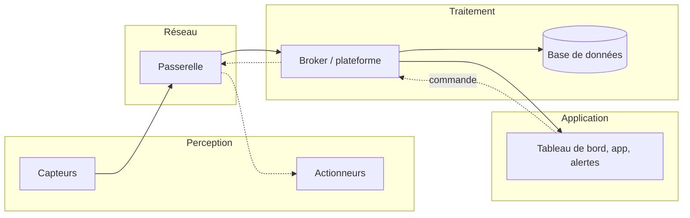

# Architecture et protocoles de l'IoT

> [!definition] Internet des objets (IoT)
> Un réseau d'**objets physiques** équipés de capteurs, d'actionneurs et d'une connexion, capables de collecter des données, de les transmettre et d'agir sur leur environnement, souvent sans intervention humaine.

Exemples : maison connectée, agriculture (humidité du sol, arrosage automatique), ville intelligente (parkings, éclairage), santé (montres connectées), industrie 4.0 (maintenance prédictive).

## Une architecture en couches



1. **Perception** : capteurs (température, humidité, mouvement, gaz…) et actionneurs (relais, moteurs, LED).
2. **Réseau** : transmission des données (Wi-Fi, BLE, LoRaWAN…), souvent par une **passerelle**.
3. **Traitement** : réception, stockage et analyse — dans le cloud ou au plus près des objets (**edge computing**).
4. **Application** : ce que voit l'utilisateur (tableau de bord, alertes, application mobile).

## Le matériel

| Carte | Type | Points forts | Usage typique |
|---|---|---|---|
| Arduino Uno | microcontrôleur | simple, robuste, très documenté | prototypes, apprentissage |
| **ESP32** | microcontrôleur + Wi-Fi + BLE | puissant, peu cher, en C++ (Arduino) ou MicroPython | objets connectés |
| Raspberry Pi | ordinateur sous Linux | Python, caméra, serveur local | passerelle, edge computing |

Un capteur **analogique** donne une tension qu'on lit avec un convertisseur (`analogRead`) ; un capteur **numérique** communique par un bus (I²C, SPI, 1-Wire) ou un protocole propre (le DHT22, par exemple).

## Les réseaux

| Technologie | Portée | Débit | Consommation | Usage |
|---|---|---|---|---|
| Wi-Fi | ~50 m | élevé | élevée | maison, objets sur secteur |
| Bluetooth Low Energy | ~10–50 m | moyen | très faible | objets portés, smartphone |
| Zigbee | ~10–100 m (maillé) | faible | très faible | domotique |
| **LoRaWAN** | 2–15 km | très faible | très faible | agriculture, ville |
| NB-IoT / LTE-M | réseau mobile | faible | faible | compteurs, suivi |

> [!tip] Le compromis
> On ne peut pas avoir à la fois une longue portée, un haut débit et une faible consommation : on choisit selon l'usage.

## Les protocoles applicatifs

### MQTT

Le protocole le plus utilisé en IoT : léger, au-dessus de TCP, sur le modèle **publish/subscribe** — le même que les middleware à messages du [[Applications réparties|cours d'applications réparties]].

- Les objets **publient** sur un **topic** (`maison/salon/temperature`).
- Les applications **s'abonnent** aux topics qui les intéressent.
- Le **broker** (Mosquitto, HiveMQ, EMQX) reçoit et redistribue les messages.
- Jokers : `+` remplace un niveau (`maison/+/temperature`), `#` tous les niveaux suivants (`maison/#`).

| QoS | Garantie |
|---|---|
| 0 | au plus une fois (aucun accusé de réception) |
| 1 | au moins une fois (doublons possibles) |
| 2 | exactement une fois (le plus lent) |

Deux options utiles : le message **retenu** (*retained* : le broker donne le dernier message à chaque nouvel abonné) et le **testament** (*Last Will* : publié par le broker si l'objet se déconnecte brutalement).

```sh
mosquitto_sub -h test.mosquitto.org -t "cozyclass/demo/#" -v
mosquitto_pub -h test.mosquitto.org -t "cozyclass/demo/temp" -m "23.5"
```

### CoAP et HTTP

- **CoAP** : un « HTTP allégé » sur **UDP**, pour les objets très contraints (avec GET, POST, PUT, DELETE).
- **HTTP / REST** : simple et universel, mais plus lourd ; adapté aux objets alimentés sur secteur (voir le [[Chapitre 1 - SOA, SOAP et REST|cours REST]]).

## Les plateformes IoT

Elles gèrent les objets, reçoivent leurs données, les stockent et les affichent.

- **Node-RED** : programmation visuelle par flux, idéale pour relier MQTT, bases de données et tableaux de bord.
- **ThingSpeak**, **ThingsBoard** : collecte et graphiques prêts à l'emploi.
- **AWS IoT Core**, **Azure IoT Hub** : plateformes cloud à grande échelle (voir le [[Chapitre 1 - Virtualisation et conteneurs|cours de cloud]]).
- Séries temporelles : **InfluxDB** ; tableaux de bord : **Grafana**.

## La sécurité, point faible de l'IoT

Mots de passe par défaut, firmware jamais mis à jour, communications en clair… En 2016, le botnet **Mirai** a pris le contrôle de centaines de milliers de caméras et de routeurs de cette façon.

> [!warning] Bonnes pratiques
> Changer les identifiants par défaut · chiffrer avec **TLS** (MQTT sur le port 8883) · authentifier chaque objet (certificat ou jeton) · mettre à jour le firmware à distance (OTA) · isoler les objets sur un réseau séparé. Voir [[Résumé - Sécurité informatique]].

> [!abstract] À retenir
> Perception → réseau → traitement → application. L'ESP32 pour l'objet, le Raspberry Pi pour la passerelle. MQTT : publish/subscribe via un broker, des topics, QoS 0/1/2. Le réseau se choisit selon la portée, le débit et l'énergie. Fiche : [[Résumé - IoT]].
