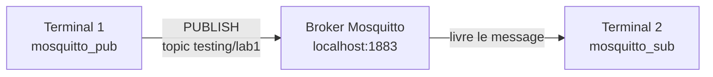

# TP 1 — Prise en main de MQTT en ligne de commande

Énoncé complet : [[Fascicule de TP - 12 laboratoires.pdf]], pages 3 à 7 · durée 1 h 30 · cours : [[Résumé - IoT#Module 3 — MQTT|module 3, MQTT]] · suite : [[TP 2 - Simulateur de dispositif en Python]]

> [!abstract] En une phrase
> On installe un **broker MQTT** (Mosquitto) sur sa machine, puis on fait discuter deux terminaux à travers lui, sans écrire une seule ligne de code.

## Le principe

Le broker est un **bureau de poste**. Un **topic** est une adresse (`testing/lab1`). `mosquitto_pub` dépose un message à cette adresse, `mosquitto_sub` s'abonne à l'adresse et reçoit tout ce qui y arrive. Les deux terminaux ne se connaissent pas : ils ne parlent qu'au broker.



## Étape 1 — Installer et démarrer le broker

| Système | Installer | Démarrer le service |
|---|---|---|
| Arch Linux | `sudo pacman -S mosquitto` | `sudo systemctl start mosquitto` |
| Debian / Ubuntu | `sudo apt install mosquitto mosquitto-clients` | `sudo systemctl start mosquitto` |
| macOS | `brew install mosquitto` | `brew services start mosquitto` |
| Windows | installeur de [mosquitto.org/download](https://mosquitto.org/download/) | service « Mosquitto Broker » (`services.msc`) |

Vérifier que le broker écoute sur le **port 1883** (le port MQTT par défaut) :

```sh
ss -ltn | grep 1883                  # Linux (ou : netstat -ltn)
netstat -an | findstr 1883           # Windows
lsof -nP -iTCP:1883 | grep LISTEN    # macOS
```

```text
LISTEN 0      100      127.0.0.1:1883      0.0.0.0:*
```

`LISTEN` = le broker attend des connexions. `127.0.0.1` veut dire « seulement depuis cette machine » (c'est le réglage par défaut de Mosquitto 2) ; `0.0.0.0` voudrait dire « depuis tout le réseau ». On verra à l'étape 5 comment changer ça.

## Étape 2 — Publier et s'abonner

Il faut **deux terminaux**. On lance d'abord l'abonné (`-v` affiche aussi le nom du topic) :

```sh
# Terminal 2 : l'abonné, qui attend
mosquitto_sub -t "testing/lab1" -v

# Terminal 1 : l'éditeur
mosquitto_pub -t "testing/lab1" -m "Testing publish"
```

Ce qu'on voit dans le terminal 2 :

```text
testing/lab1 Testing publish
```

`mosquitto_sub` ne rend pas la main : il reste connecté et affiche chaque nouveau message (`Ctrl+C` pour arrêter).

> [!warning] L'ordre compte
> Si on publie **avant** que quelqu'un soit abonné, le message est perdu : le broker ne garde rien par défaut. Pour qu'il garde le dernier message d'un topic et le donne à chaque nouvel abonné, on publie un message **retenu** avec `-r` :
> ```sh
> mosquitto_pub -t "testing/lab1" -m "valeur retenue" -r
> mosquitto_sub -t "testing/lab1" -v      # reçoit tout de suite « valeur retenue »
> mosquitto_pub -t "testing/lab1" -r -n   # efface le message retenu
> ```

## Étape 3 — Les topics et les wildcards

Un topic est une **hiérarchie** séparée par `/`, comme un chemin de fichier : `B1/F1/R1` = bâtiment 1, étage 1, salle 1. À l'abonnement, deux jokers :

- `+` remplace **exactement un niveau**, n'importe où ;
- `#` remplace **tous les niveaux qui suivent** (zéro ou plus), et seulement à la fin.

```sh
# Terminal 2
mosquitto_sub -t "B1/+/R1" -v

# Terminal 1
mosquitto_pub -t "B1/F1/R1" -m "Message to B1/F1/R1"
mosquitto_pub -t "B1/F2/R1" -m "Message to B1/F2/R1"
mosquitto_pub -t "B1/F1/R2" -m "Message to B1/F1/R2"
```

Résultats obtenus (les mêmes tests refaits avec `B1/#`) :

| Topic publié | Reçu par `B1/+/R1` ? | Reçu par `B1/#` ? |
|---|---|---|
| `B1/F1/R1` | oui | oui |
| `B1/F2/R1` | oui | oui |
| `B1/F1/R2` | non (dernier niveau ≠ `R1`) | oui |
| `B1/F1` | non (il manque un niveau) | oui |
| `B2/F1` | non | non (autre bâtiment) |

Les topics qui commencent par `$` sont réservés aux **statistiques du broker**. Les guillemets simples empêchent le shell de prendre `$SYS` pour une variable :

```sh
mosquitto_sub -t '$SYS/broker/uptime' -v -C 1     # -C 1 : s'arrête après 1 message
```

```text
$SYS/broker/uptime 30 seconds
```

## Étape 4 — Publier un fichier, mode debug

```json
{
  "device_name": "GL248",
  "device_type": "counter",
  "timestamp": "2021-01-14 13:13:13",
  "value": 45
}
```

```sh
mosquitto_pub -t "filepublish" -f message.json     # -f : envoie le contenu du fichier
```

Le mode debug (`-d`) montre les paquets MQTT échangés, et `-i` donne un nom (Client ID) au client :

```sh
mosquitto_sub -d -i "terminal_subscriber" -t "topic_name"
```

```text
Client terminal_subscriber sending CONNECT
Client terminal_subscriber received CONNACK (0)
Client terminal_subscriber sending SUBSCRIBE (Mid: 1, Topic: topic_name, QoS: 0, Options: 0x00)
Client terminal_subscriber received SUBACK
Subscribed (mid: 1): 0
Client terminal_subscriber received PUBLISH (d0, q0, r0, m0, 'topic_name', ... (21 bytes))
Bonjour en mode debug
```

On reconnaît la poignée de main du cours : `CONNECT` → `CONNACK (0)` (0 = accepté) → `SUBSCRIBE` → `SUBACK` → `PUBLISH`.

## Étape 5 — Configurer le broker

Plutôt que de modifier le fichier système, on crée un `mosquitto.conf` dans le dossier du TP et on lance un **second broker** avec lui (`-v` affiche son journal) :

```text
listener 5000
allow_anonymous true
```

```sh
mosquitto -c mosquitto.conf -v                     # terminal 3 : le broker sur le port 5000
mosquitto_sub -p 5000 -t "topic_name"              # terminal 2
mosquitto_pub -p 5000 -t "topic_name" -m "message" # terminal 1
```

> [!warning] `allow_anonymous true` est obligatoire ici
> Depuis Mosquitto 2.0, dès qu'on déclare un `listener`, les clients sans identifiant sont **refusés** par défaut. Sans cette ligne :
> ```text
> Connection error: Connection Refused: not authorised
> ```
> (Le TP 6 remplacera justement l'accès anonyme par des identifiants.)

Choisir **sur quelle interface réseau** le broker écoute :

```text
# Accessible seulement depuis cette machine
listener 1883 localhost
allow_anonymous true

# Accessible depuis le réseau local (mettre l'adresse IP de la machine, voir `ip a`)
listener 1883 192.168.1.105
allow_anonymous true
```

Si le service système tourne déjà sur 1883, un second broker sur le même port échoue avec `Address already in use` : arrêter le service (`sudo systemctl stop mosquitto`) ou garder un autre port.

## À retenir

- Le broker reçoit, trie par topic et distribue : éditeurs et abonnés ne se connaissent pas.
- Un message publié sans abonné est perdu, sauf s'il est **retenu** (`-r`).
- `+` = un niveau, `#` = tout ce qui suit. `$SYS/...` = statistiques du broker.
- `-d` montre les paquets, `-i` nomme le client, `-p` change le port, `-f` publie un fichier.
- Mosquitto 2 refuse les clients anonymes sur un listener déclaré, sauf `allow_anonymous true`.

## Questions du fascicule

1. Quelle est la différence entre le wildcard `+` et le wildcard `#` ?
2. Pourquoi `mosquitto_sub` est-elle une commande bloquante ?
3. Quel est le risque de s'abonner directement au topic `#` en production ?
4. À quoi sert le Client ID (`-i`) lors du débogage ?

> [!question]- Réponses
> 1. `+` remplace **un seul** niveau, à n'importe quelle position (`B1/+/R1`). `#` remplace **tous les niveaux restants**, y compris aucun, et ne peut être qu'à la fin (`B1/#` reçoit aussi `B1`).
> 2. Un abonné doit **rester connecté** pour recevoir les messages au moment où ils sont publiés : la commande attend indéfiniment. On l'arrête avec `Ctrl+C`, ou avec `-C n` (après n messages) ou `-W s` (après s secondes).
> 3. On reçoit **tout** le trafic de tous les dispositifs : avec des milliers de capteurs, le client et le réseau sont submergés. C'est aussi un problème de sécurité (on lit tout), que les ACL du TP 6 permettent d'interdire.
> 4. Il identifie le client dans le journal du broker et dans la sortie `-d` : avec plusieurs clients, on sait qui fait quoi. Sans `-i`, Mosquitto donne un nom aléatoire (`auto-…`), difficile à suivre. Deux clients avec le même ID s'éjectent l'un l'autre (voir le TP 4).
