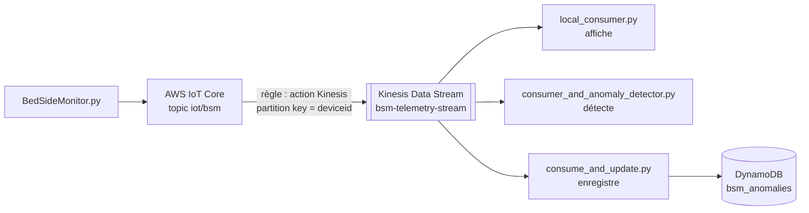

# TP 10 — Traitement en flux avec AWS Kinesis et détection d'anomalies

Énoncé complet : [[Fascicule de TP - 12 laboratoires.pdf]], pages 51 à 53 · durée 2 h · cours : [[Résumé - IoT#Module 6 — Cloud AWS pour l'IoT|module 6, stream vs batch et Kinesis]] · avant : [[TP 9 - AWS IoT Core et DynamoDB]] · suite : [[TP 11 - TinyML, reconnaissance de gestes]]

> [!abstract] En une phrase
> Les mesures du moniteur passent par un **flux Kinesis** ; trois petits programmes lisent ce flux **en temps réel** : l'un affiche, l'autre détecte les anomalies, le dernier les enregistre dans DynamoDB.

## Le principe : traiter au fil de l'eau

Au TP 9, les mesures étaient **stockées** puis consultées plus tard. Ici on les **traite pendant qu'elles passent** (*stream processing*) : une alerte part quelques secondes après la mesure anormale, pas le lendemain.

Un flux Kinesis est un **tapis roulant** découpé en **shards** (voies parallèles). Il garde les données 24 h par défaut : plusieurs programmes peuvent lire le même flux, chacun à son rythme, et relire si besoin.



> [!warning] Kinesis n'est pas gratuit
> Kinesis Data Streams ne fait pas partie du niveau gratuit d'AWS : un flux est facturé **à l'heure** tant qu'il existe. Le créer au début de la séance, le **supprimer** à la fin.

## Étape 1 — Accès AWS en ligne de commande

Les consommateurs sont des programmes Python qui utilisent **boto3**, le SDK général d'AWS (l'`AWSIoTPythonSDK` du TP 9 ne sert qu'à connecter un dispositif à IoT Core). boto3 a besoin d'identifiants :

1. IAM → *Users* → *Create user*, permissions Kinesis et DynamoDB, puis *Security credentials* → *Create access key*.
2. Installer AWS CLI v2, puis :

```sh
aws configure
```

```text
AWS Access Key ID [None]: AKIA****************
AWS Secret Access Key [None]: ****************
Default region name [None]: eu-north-1
Default output format [None]: json
```

Les clés sont rangées dans `~/.aws/credentials` ; boto3 les y trouve tout seul. Elles ne doivent **jamais** apparaître dans le code ni sur GitHub.

## Étape 2 — Créer le flux

Console Kinesis → *Create data stream* : nom `bsm-telemetry-stream`, mode **On-demand** (AWS ajuste le nombre de shards tout seul).

## Étape 3 — Router IoT Core vers Kinesis

1. Un rôle IAM pour la règle (cas d'usage *IoT*, permission `kinesis:PutRecord`), ou *Create new role* directement depuis la règle.
2. *Message routing → Rules → Create rule* :
   ```sql
   SELECT * FROM 'iot/bsm'
   ```
   Action **Kinesis Data Stream**, flux `bsm-telemetry-stream`, **Partition key : `${deviceid}`**, et le rôle.

> [!warning] `${deviceid}` et pas `deviceid`
> Le fascicule dit « définissez deviceid comme Partition key ». Dans la console, il faut écrire **`${deviceid}`** : c'est un modèle remplacé par la valeur du champ dans chaque message. Écrit sans `${}`, la clé serait le mot « deviceid » pour tous les messages, qui iraient alors tous dans le même shard.

## Étape 4 — Lire le flux

Les scripts du fascicule sont fournis par l'enseignant. En voici une version courte, testée, en 5 fichiers. D'abord un outil commun pour lire le flux, et les règles de détection :

```python
# kinesis_reader.py
import json
import time

import boto3


def read_stream(stream_name):
    """Renvoie les enregistrements du flux au fur et à mesure qu'ils arrivent."""
    kinesis = boto3.client("kinesis")
    shards = kinesis.list_shards(StreamName=stream_name)["Shards"]
    # Un itérateur par shard ; LATEST = seulement ce qui arrive à partir de maintenant
    iterators = {
        s["ShardId"]: kinesis.get_shard_iterator(StreamName=stream_name, ShardId=s["ShardId"],
                                                 ShardIteratorType="LATEST")["ShardIterator"]
        for s in shards
    }
    while True:
        for shard_id, iterator in iterators.items():
            response = kinesis.get_records(ShardIterator=iterator, Limit=100)
            iterators[shard_id] = response["NextShardIterator"]     # où reprendre la prochaine fois
            for record in response["Records"]:
                yield shard_id, json.loads(record["Data"])
        time.sleep(1)        # un shard accepte au plus 5 lectures par seconde
```

Lire un flux, c'est : lister les shards, demander pour chacun un **itérateur** (un marque-page), puis appeler `get_records` en boucle ; chaque réponse donne les nouveaux enregistrements et le marque-page suivant. `yield` renvoie les enregistrements un par un sans arrêter la boucle.

```python
# rules.py
NORMAL_RANGES = {
    "SPO2": (90, 100),            # saturation en oxygène, %
    "Temperature": (35.5, 38.0),  # °C
    "HeartRate": (60, 100),       # battements par minute
}


def check(record):
    """Description de l'anomalie, ou None si la mesure est normale."""
    low, high = NORMAL_RANGES[record["datatype"]]
    value = float(record["value"])
    if value < low:
        return f"{record['datatype']} trop bas ({value} < {low})"
    if value > high:
        return f"{record['datatype']} trop haut ({value} > {high})"
    return None
```

Le consommateur le plus simple : il affiche tout.

```python
# local_consumer.py
from kinesis_reader import read_stream

StreamName = "bsm-telemetry-stream"         # le nom de VOTRE flux

print(f"Lecture du flux {StreamName}...")
for shard_id, record in read_stream(StreamName):
    print(f"[{shard_id}] {record}")
```

Comme on lit en `LATEST`, on lance le consommateur **avant** (ou pendant) le simulateur du TP 9 :

```sh
python local_consumer.py                                   # terminal 1
python BedSideMonitor.py -e <endpoint> -r AmazonRootCA1.pem -c <cert> -k <cle> -id client001 -t iot/bsm   # terminal 2
```

```text
Lecture du flux bsm-telemetry-stream...
[shardId-000000000000] {'deviceid': 'BSM_A101', 'timestamp': '2026-11-06 21:30:41.704365', 'datatype': 'SPO2', 'value': 96.4}
[shardId-000000000000] {'deviceid': 'BSM_A101', 'timestamp': '2026-11-06 21:30:41.704616', 'datatype': 'Temperature', 'value': 36.8}
[shardId-000000000000] {'deviceid': 'BSM_A101', 'timestamp': '2026-11-06 21:30:41.704946', 'datatype': 'HeartRate', 'value': 79}
```

`Ctrl+C` arrête le consommateur (Python affiche alors une trace `KeyboardInterrupt`, c'est normal).

## Étape 5 — Détecter les anomalies en flux

```python
# consumer_and_anomaly_detector.py
from kinesis_reader import read_stream
from rules import check

StreamName = "bsm-telemetry-stream"

print(f"Détection d'anomalies sur {StreamName}...")
for _, record in read_stream(StreamName):
    anomaly = check(record)
    if anomaly:
        print(f"ANOMALIE {record['deviceid']} {record['timestamp']} : {anomaly}")
    else:
        print(f"ok       {record['deviceid']} {record['datatype']:<12} = {record['value']}")
```

```text
Détection d'anomalies sur bsm-telemetry-stream...
ok       BSM_A101 SPO2         = 96.4
ok       BSM_A101 Temperature  = 36.8
ok       BSM_A101 HeartRate    = 79
ok       BSM_A101 SPO2         = 97.9
ok       BSM_A101 Temperature  = 37.5
ok       BSM_A101 HeartRate    = 87
ok       BSM_A101 SPO2         = 93.7
ANOMALIE BSM_A101 2026-11-06 21:30:43.707655 : Temperature trop haut (38.6 > 38.0)
ok       BSM_A101 HeartRate    = 85
```

## Étape 6 — Enregistrer les anomalies dans DynamoDB

Créer une table `bsm_anomalies`, avec les mêmes clés qu'au TP 9 (`deviceid` + `timestamp`), puis :

```python
# consume_and_update.py
from decimal import Decimal

import boto3

from kinesis_reader import read_stream
from rules import check

StreamName = "bsm-telemetry-stream"
TableName = "bsm_anomalies"            # partition key deviceid, sort key timestamp

table = boto3.resource("dynamodb").Table(TableName)

print(f"{StreamName} -> anomalies enregistrées dans {TableName}")
for _, record in read_stream(StreamName):
    anomaly = check(record)
    if anomaly:
        table.put_item(Item={
            "deviceid": record["deviceid"],
            "timestamp": record["timestamp"],
            "datatype": record["datatype"],
            "value": Decimal(str(record["value"])),     # DynamoDB refuse les float
            "anomaly": anomaly,
        })
        print(f"Anomalie enregistrée : {record['deviceid']} {record['timestamp']} - {anomaly}")
```

```text
bsm-telemetry-stream -> anomalies enregistrées dans bsm_anomalies
Anomalie enregistrée : BSM_A101 2026-11-06 21:30:43.707655 - Temperature trop haut (38.6 > 38.0)
```

Dans la console DynamoDB, la table `bsm_anomalies` ne contient **que** les mesures anormales, avec leur explication : sur ~30 mesures lues pendant ce test, une seule anomalie.

> [!remarque] Pourquoi `Decimal` ?
> boto3 refuse les nombres `float` Python pour DynamoDB (`TypeError: Float types are not supported`) : DynamoDB stocke des nombres exacts. `Decimal(str(value))` convertit sans erreur d'arrondi.

Les trois consommateurs peuvent tourner **en même temps** sur le même flux : chacun a ses propres itérateurs, aucun ne « vole » les données des autres. C'est une différence importante avec une file d'attente comme SQS, où un message lu disparaît.

## Étape 7 — Partition key et shards

En mode On-demand, le flux démarre avec **4 shards**. Kinesis calcule une empreinte (*hash*) de la partition key pour choisir le shard. Avec trois moniteurs lancés en même temps (`BSM_G101`, `BSM_G102`, `BSM_G103`), chacun atterrit dans son shard, et y reste :

```text
BSM_G101  ->  shardId-000000000001  (12 messages)
BSM_G102  ->  shardId-000000000000  (12 messages)
BSM_G103  ->  shardId-000000000003  (12 messages)
```

Résultat : les mesures d'un même patient restent **dans l'ordre**, et la charge se répartit entre les shards.

## Vue d'ensemble et nettoyage

Simulateur → IoT Core → Kinesis → consommateurs Python → DynamoDB. En production, les consommateurs ne tourneraient pas sur un PC, mais en fonctions **AWS Lambda** déclenchées par le flux, ou sur des serveurs EC2 / conteneurs.

**Nettoyage obligatoire** : supprimer le flux Kinesis (il coûte tant qu'il existe), les tables DynamoDB, la règle et les rôles IAM, et désactiver la clé d'accès de l'utilisateur IAM si elle ne sert plus.

> [!example]- Variante testée sans compte AWS
> Même principe qu'au [[TP 9 - AWS IoT Core et DynamoDB#Étape 9 — Tout nettoyer (obligatoire)|TP 9]] : `moto_server -p 4566`, les mêmes variables `AWS_ENDPOINT_URL…`, et `iot_rule_emulator.py kinesis` à la place de la règle. Il faut juste créer le flux par script :
> ```python
> # create_stream.py  (équivalent de « Kinesis > Create data stream »)
> import boto3
>
> kinesis = boto3.client("kinesis")
> kinesis.create_stream(StreamName="bsm-telemetry-stream",
>                       StreamModeDetails={"StreamMode": "ON_DEMAND"})
> kinesis.get_waiter("stream_exists").wait(StreamName="bsm-telemetry-stream")
> print("Flux bsm-telemetry-stream actif")
> ```
> ```sh
> python create_stream.py && python create_table.py bsm_anomalies
> python iot_rule_emulator.py kinesis            # terminal 1
> python consume_and_update.py                   # terminal 2 (et/ou les deux autres consommateurs)
> python BedSideMonitor.py -id client001 -t iot/bsm   # terminal 3
> python scan_table.py bsm_anomalies
> ```
> Toutes les sorties de cette page ont été obtenues ainsi.

## À retenir

- **Stream** : on traite chaque donnée à son arrivée (alertes en secondes) ; **batch** : on traite un lot plus tard (tendances, rapports).
- Kinesis Data Streams : un flux découpé en **shards** ; la **partition key** choisit le shard et garantit l'ordre par clé.
- Un consommateur lit avec des **itérateurs** de shard et `get_records` ; plusieurs consommateurs peuvent lire le même flux.
- La règle IoT Core écrit dans Kinesis avec la partition key `${deviceid}`.
- DynamoDB + boto3 : `Decimal` au lieu de `float`. Kinesis est payant à l'heure : supprimer le flux à la fin.

## Questions du fascicule

1. Pourquoi utiliser `deviceid` comme clé de partition (Partition key) dans Kinesis ?
2. Quelle est la différence entre Kinesis Data Streams et Kinesis Firehose ?
3. Dans un contexte de production, où feriez-vous tourner les scripts consommateurs plutôt qu'en local ?

> [!question]- Réponses
> 1. Kinesis envoie tous les enregistrements d'une même partition key dans le **même shard**, où l'ordre d'arrivée est conservé : les mesures d'un patient sont lues **dans l'ordre**. Et comme il y a beaucoup de `deviceid` différents, les dispositifs se **répartissent** sur les shards (charge équilibrée).
> 2. **Data Streams** : un flux où l'on écrit **ses propres consommateurs** (Python, Lambda…), en temps réel, avec des données conservées et relisibles (24 h par défaut). **Firehose** : un service de **livraison sans code** vers une destination (S3, Redshift, OpenSearch / Elasticsearch), qui regroupe les données par lots (taille ou durée) et s'adapte tout seul à la charge, mais sans relecture ni traitement sur mesure.
> 3. Dans le cloud, près du flux : des fonctions **AWS Lambda** déclenchées automatiquement par le flux (rien à gérer, payé à l'usage), ou des services sur **EC2** / conteneurs (ECS) pour un traitement continu, ou Amazon Managed Service for Apache Flink (ex-Kinesis Data Analytics) pour de l'analyse en flux.
