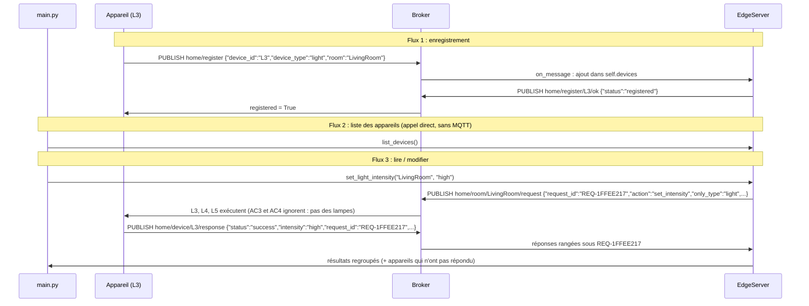

# TP 12 — Projet de synthèse : concevoir une maison intelligente (Smart Home)

Énoncé complet : [[Fascicule de TP - 12 laboratoires.pdf]], pages 59 à 62 · durée 3 h (projet) · cours : [[Résumé - IoT#Module 3 — MQTT|MQTT]], [[Résumé - IoT#Module 4 — Cloud et Edge Computing|edge]] · avant : [[TP 11 - TinyML, reconnaissance de gestes]]

> [!abstract] En une phrase
> Plusieurs lampes et climatiseurs, répartis dans les pièces d'une maison, s'enregistrent auprès d'un **serveur Edge** ; ce serveur peut ensuite lire ou changer l'état d'un appareil, d'un type d'appareil, d'une pièce ou de toute la maison, uniquement via MQTT.

C'est un exercice de **conception** : il n'y a pas une seule bonne réponse. Ce qui suit est **une** solution complète et testée, à comprendre puis à adapter.

## L'énoncé

| Pièce | Appareils |
|---|---|
| BR1 (chambre 1) | L1, AC1 |
| BR2 (chambre 2) | L2, AC2 |
| LivingRoom | AC3, AC4, L3, L4, L5 |
| Kitchen | L6 |
| Garage | L7 |

| Composant | Ce qu'il doit faire |
|---|---|
| broker MQTT | sans authentification, adresse et port en configuration |
| `LightDevice.py` | lampe : off / low / medium / high ; s'enregistrer, s'allumer, s'éteindre, répondre à une demande de statut |
| `ACDevice.py` | climatiseur : on / off, consigne entre 18 et 32 °C ; erreur claire hors bornes |
| `EdgeServer.py` | garde en mémoire les appareils enregistrés, confirme les enregistrements, transmet les commandes et regroupe les réponses |
| `main.py` | le « client » qui crée les appareils et appelle le serveur |

## Étape 1 — Choisir les topics

C'est le cœur du projet. Deux extrêmes à éviter :

- **un topic par appareil seulement** : pour éteindre la maison, le serveur doit publier 11 messages, puis 10 000 dans un grand immeuble ;
- **un seul topic pour tout** : chaque appareil reçoit tous les messages de la maison et doit trier, et on ne peut plus donner de droits par appareil (ACL).

Solution **hybride** : chaque appareil écoute **son** topic, plus un canal pour **son type**, **sa pièce**, et **toute la maison**. Le broker se charge de distribuer : pour viser le salon, le serveur publie **un** message.

| Topic | Qui publie | Qui écoute | Sert à |
|---|---|---|---|
| `home/register` | appareil | serveur | « enregistre-moi » |
| `home/register/{device_id}/ok` | serveur | l'appareil concerné | confirmation |
| `home/device/{device_id}/request` | serveur | un appareil | viser un appareil |
| `home/type/{device_type}/request` | serveur | tous les `light` ou tous les `ac` | viser un type |
| `home/room/{room}/request` | serveur | tous les appareils d'une pièce | viser une pièce |
| `home/all/request` | serveur | tout le monde | viser la maison |
| `home/device/{device_id}/response` | appareil | serveur (`home/device/+/response`) | les réponses |

Requêtes et réponses sont sur des topics **différents** : on ne mélange jamais une question et sa réponse sur le même canal. Chaque requête porte un `request_id`, recopié dans chaque réponse, pour que le serveur sache à quoi elle répond (comme au TP 5).

### Les flux



## Étape 2 — La configuration

```python
# config.py
BROKER_HOST = "localhost"
BROKER_PORT = 1883

# Topologie des topics (approche hybride)
REGISTER = "home/register"                       # dispositif -> serveur : « enregistre-moi »
REGISTER_OK = "home/register/{device_id}/ok"     # serveur -> dispositif : confirmation
TO_DEVICE = "home/device/{device_id}/request"    # serveur -> UN dispositif
TO_TYPE = "home/type/{device_type}/request"      # serveur -> tous les dispositifs d'un type
TO_ROOM = "home/room/{room}/request"             # serveur -> toute une pièce
TO_ALL = "home/all/request"                      # serveur -> toute la maison
RESPONSE = "home/device/{device_id}/response"    # dispositif -> serveur : réponse
```

## Étape 3 — Ce que tous les appareils ont en commun

Lampes et climatiseurs se connectent, s'abonnent, s'enregistrent et répondent **de la même façon**. Ce code commun va dans une classe mère ; chaque type d'appareil n'écrit que `handle` (exécuter une action) et `state` (son état actuel).

```python
# base_device.py
import json

import paho.mqtt.client as mqtt

import config


class BaseDevice:
    """Ce que les lampes et les climatiseurs font de la même façon."""

    device_type = "generic"

    def __init__(self, device_id, room):
        self.device_id = device_id
        self.room = room
        self.registered = False
        self.client = mqtt.Client(mqtt.CallbackAPIVersion.VERSION2, client_id=f"device-{device_id}")
        self.client.on_connect = self.on_connect
        self.client.on_message = self.on_message

    def start(self):
        self.client.connect(config.BROKER_HOST, config.BROKER_PORT)
        self.client.loop_start()

    def stop(self):
        self.client.disconnect()
        self.client.loop_stop()

    def on_connect(self, client, userdata, flags, reason_code, properties):
        # La confirmation d'enregistrement + les 4 canaux où le serveur peut me parler
        for topic in (config.REGISTER_OK.format(device_id=self.device_id),
                      config.TO_DEVICE.format(device_id=self.device_id),
                      config.TO_TYPE.format(device_type=self.device_type),
                      config.TO_ROOM.format(room=self.room),
                      config.TO_ALL):
            client.subscribe(topic, qos=1)
        # Flux 1 : je demande mon enregistrement
        client.publish(config.REGISTER, json.dumps({"device_id": self.device_id,
                                                    "device_type": self.device_type,
                                                    "room": self.room}), qos=1)

    def on_message(self, client, userdata, message):
        request = json.loads(message.payload)
        if message.topic == config.REGISTER_OK.format(device_id=self.device_id):
            self.registered = True
            return
        # Une requête de pièce peut ne viser qu'un type (« les lampes du salon »)
        if request.get("only_type") not in (None, self.device_type):
            return
        try:
            response = {"status": "success", **self.handle(request["action"], request.get("value"))}
        except ValueError as error:
            response = {"status": "error", "error": str(error), **self.state()}
        response.update(request_id=request["request_id"], device_id=self.device_id,
                        device_type=self.device_type, room=self.room)
        client.publish(config.RESPONSE.format(device_id=self.device_id),
                       json.dumps(response), qos=1)

    # À écrire dans chaque type de dispositif
    def handle(self, action, value):
        raise NotImplementedError

    def state(self):
        raise NotImplementedError
```

Une valeur invalide ne fait pas planter l'appareil : `handle` lève une `ValueError`, transformée en réponse `"status": "error"` avec l'explication et l'état inchangé.

## Étape 4 — La lampe et le climatiseur

```python
# LightDevice.py
from base_device import BaseDevice

LEVELS = ("off", "low", "medium", "high")


class LightDevice(BaseDevice):
    device_type = "light"

    def __init__(self, device_id, room):
        super().__init__(device_id, room)
        self.intensity = "off"

    def state(self):
        return {"power": "off" if self.intensity == "off" else "on", "intensity": self.intensity}

    def handle(self, action, value):
        if action == "set_power":
            if value not in ("on", "off"):
                raise ValueError(f"Valeur on/off invalide : {value}")
            if value == "off":
                self.intensity = "off"
            elif self.intensity == "off":
                self.intensity = "medium"          # allumer = intensité moyenne par défaut
        elif action == "set_intensity":
            if value not in LEVELS:
                raise ValueError(f"Intensité invalide : {value} (attendu : off, low, medium, high)")
            self.intensity = value
        elif action != "get_status":
            raise ValueError(f"Action inconnue pour une lampe : {action}")
        return self.state()
```

```python
# ACDevice.py
from base_device import BaseDevice

MIN_TEMP, MAX_TEMP = 18, 32


class ACDevice(BaseDevice):
    device_type = "ac"

    def __init__(self, device_id, room):
        super().__init__(device_id, room)
        self.power = "off"
        self.temperature = 24

    def state(self):
        return {"power": self.power, "temperature": self.temperature}

    def handle(self, action, value):
        if action == "set_power":
            if value not in ("on", "off"):
                raise ValueError(f"Valeur on/off invalide : {value}")
            self.power = value
        elif action == "set_temperature":
            if not isinstance(value, (int, float)) or not MIN_TEMP <= value <= MAX_TEMP:
                raise ValueError(f"Température hors bornes : {value} °C "
                                 f"(autorisé : {MIN_TEMP}-{MAX_TEMP} °C)")
            self.temperature = value
        elif action != "get_status":
            raise ValueError(f"Action inconnue pour un climatiseur : {action}")
        return self.state()
```

## Étape 5 — Le serveur Edge

Trois responsabilités : tenir le **registre** des appareils (en mémoire), **choisir le bon topic** selon la cible, et **regrouper les réponses** en attendant au plus 2 secondes.

```python
# EdgeServer.py
import json
import time
import uuid

import paho.mqtt.client as mqtt

import config


class EdgeServer:
    def __init__(self):
        self.devices = {}     # device_id -> {"device_type": ..., "room": ...}   (en mémoire)
        self.responses = {}   # request_id -> {device_id: réponse}               (en attente)
        self.client = mqtt.Client(mqtt.CallbackAPIVersion.VERSION2, client_id="edge-server")
        self.client.on_connect = self.on_connect
        self.client.on_message = self.on_message

    def start(self):
        self.client.connect(config.BROKER_HOST, config.BROKER_PORT)
        self.client.loop_start()
        time.sleep(0.5)                     # le temps de se connecter et de s'abonner

    def stop(self):
        self.client.disconnect()
        self.client.loop_stop()

    # ---------------- MQTT ----------------
    def on_connect(self, client, userdata, flags, reason_code, properties):
        client.subscribe(config.REGISTER, qos=1)
        client.subscribe(config.RESPONSE.format(device_id="+"), qos=1)

    def on_message(self, client, userdata, message):
        data = json.loads(message.payload)
        if message.topic == config.REGISTER:                       # Flux 1 : enregistrement
            self.devices[data["device_id"]] = {"device_type": data["device_type"],
                                               "room": data["room"]}
            client.publish(config.REGISTER_OK.format(device_id=data["device_id"]),
                           json.dumps({"status": "registered"}), qos=1)
        else:                                                      # Flux 3 : une réponse
            answers = self.responses.get(data.get("request_id"))
            if answers is not None:
                answers[data["device_id"]] = data

    # ---------------- Ciblage ----------------
    def targets(self, target, only_type=None):
        """Sur quel topic publier, et quels dispositifs doivent répondre ?"""
        devices = dict(self.devices)
        if target == "all":
            topic = config.TO_TYPE.format(device_type=only_type) if only_type else config.TO_ALL
            expected = set(devices)
        elif target in devices:                                    # un device_id
            topic, expected = config.TO_DEVICE.format(device_id=target), {target}
        elif target in ("light", "ac"):                            # un type
            topic = config.TO_TYPE.format(device_type=target)
            expected = {d for d, info in devices.items() if info["device_type"] == target}
        else:                                                      # une pièce
            topic = config.TO_ROOM.format(room=target)
            expected = {d for d, info in devices.items() if info["room"] == target}
        if only_type:
            expected = {d for d in expected if devices[d]["device_type"] == only_type}
        return topic, expected

    def request(self, target, action, value=None, only_type=None, timeout=2.0):
        topic, expected = self.targets(target, only_type)
        if not expected:
            return {"error": f"aucun dispositif ne correspond à la cible {target}"}
        request_id = f"REQ-{uuid.uuid4().hex[:8].upper()}"
        self.responses[request_id] = {}
        self.client.publish(topic, json.dumps({"request_id": request_id, "action": action,
                                               "value": value, "only_type": only_type}), qos=1)
        # On attend que tous les dispositifs visés répondent (au plus `timeout` secondes)
        deadline = time.time() + timeout
        while len(self.responses[request_id]) < len(expected) and time.time() < deadline:
            time.sleep(0.05)
        answers = self.responses.pop(request_id)
        return {"topic": topic,
                "results": [answers[d] for d in sorted(answers)],
                "missing": sorted(expected - set(answers))}

    # ---------------- Ce que main.py peut appeler ----------------
    def list_devices(self):                       # Flux 2 : appel direct, sans MQTT
        return dict(self.devices)

    def get_status(self, target="all"):
        return self.request(target, "get_status")

    def set_status(self, target, power):          # power = "on" ou "off"
        return self.request(target, "set_power", power)

    def set_light_intensity(self, target, level):
        return self.request(target, "set_intensity", level, only_type="light")

    def set_ac_temperature(self, target, temperature):
        return self.request(target, "set_temperature", temperature, only_type="ac")
```

Comment marche l'attente des réponses : avant de publier, le serveur crée une boîte vide `self.responses[request_id]`. Les réponses arrivent dans `on_message` (thread réseau) et s'y rangent. Pendant ce temps, `request` vérifie toutes les 50 ms si **tous les appareils attendus** ont répondu, et abandonne après 2 secondes en listant les absents. Ainsi, un appareil en panne ne bloque jamais le serveur.

## Étape 6 — Le scénario de démonstration

```python
# main.py
import time

from ACDevice import ACDevice
from EdgeServer import EdgeServer
from LightDevice import LightDevice


def show(title, report):
    print(f"\n> {title}")
    if "error" in report:
        print("  ERREUR :", report["error"])
        return
    print("  topic :", report["topic"])
    for r in report["results"]:
        if r["device_type"] == "light":
            detail = f"intensité={r['intensity']}"
        else:
            detail = f"consigne={r['temperature']} °C"
        line = f"  {r['device_id']:<4} {r['room']:<11} power={r['power']:<4} {detail}"
        if r["status"] == "error":
            line += f"   ERREUR : {r['error']}"
        print(line)
    for device_id in report["missing"]:
        print(f"  {device_id:<4} pas de réponse (délai dépassé)")


server = EdgeServer()
server.start()

devices = [LightDevice("L1", "BR1"), ACDevice("AC1", "BR1"),
           LightDevice("L2", "BR2"), ACDevice("AC2", "BR2"),
           ACDevice("AC3", "LivingRoom"), ACDevice("AC4", "LivingRoom"),
           LightDevice("L3", "LivingRoom"), LightDevice("L4", "LivingRoom"),
           LightDevice("L5", "LivingRoom"),
           LightDevice("L6", "Kitchen"), LightDevice("L7", "Garage")]

# 1. Enregistrement de tous les dispositifs (Flux 1, via MQTT)
for device in devices:
    device.start()
deadline = time.time() + 5
while not all(d.registered for d in devices) and time.time() < deadline:
    time.sleep(0.1)
print(f"Enregistrés : {sum(d.registered for d in devices)}/{len(devices)}")

# 2. Liste des dispositifs (Flux 2, appel direct)
for device_id, info in sorted(server.list_devices().items()):
    print(f"  {device_id:<4} {info['device_type']:<6} {info['room']}")

# 3. Lire le statut : un dispositif, un type, une pièce
show("get_status('L1')", server.get_status("L1"))
show("get_status('ac') : tous les climatiseurs", server.get_status("ac"))
show("get_status('BR1') : toute la chambre 1", server.get_status("BR1"))

# 4. Allumer / éteindre
show("set_status('LivingRoom', 'on')", server.set_status("LivingRoom", "on"))

# 5. Valeurs spécifiques
show("set_light_intensity('LivingRoom', 'high') : les lampes seulement",
     server.set_light_intensity("LivingRoom", "high"))
show("set_light_intensity('L7', 'dim') : valeur invalide", server.set_light_intensity("L7", "dim"))
show("set_light_intensity('AC1', 'low') : mauvaise cible", server.set_light_intensity("AC1", "low"))
show("set_ac_temperature('AC1', 22)", server.set_ac_temperature("AC1", 22))
show("set_ac_temperature('AC2', 35) : hors bornes", server.set_ac_temperature("AC2", 35))
show("set_ac_temperature('all', 25)", server.set_ac_temperature("all", 25))

# 6. Un dispositif tombe en panne : le serveur le signale au lieu d'attendre sans fin
devices[-1].stop()                                    # L7 se déconnecte
show("get_status('all') après la panne de L7", server.get_status("all"))
show("set_status('all', 'off')", server.set_status("all", "off"))

for device in devices:
    device.stop()
server.stop()
```

## Étape 7 — Lancer

```sh
mosquitto_sub -t "home/#" -v      # terminal 1 (facultatif) : voir passer tout le trafic
python main.py                    # terminal 2
```

```text
Enregistrés : 11/11
  AC1  ac     BR1
  AC2  ac     BR2
  AC3  ac     LivingRoom
  AC4  ac     LivingRoom
  L1   light  BR1
  L2   light  BR2
  L3   light  LivingRoom
  L4   light  LivingRoom
  L5   light  LivingRoom
  L6   light  Kitchen
  L7   light  Garage

> get_status('L1')
  topic : home/device/L1/request
  L1   BR1         power=off  intensité=off

> get_status('ac') : tous les climatiseurs
  topic : home/type/ac/request
  AC1  BR1         power=off  consigne=24 °C
  AC2  BR2         power=off  consigne=24 °C
  AC3  LivingRoom  power=off  consigne=24 °C
  AC4  LivingRoom  power=off  consigne=24 °C

> get_status('BR1') : toute la chambre 1
  topic : home/room/BR1/request
  AC1  BR1         power=off  consigne=24 °C
  L1   BR1         power=off  intensité=off

> set_status('LivingRoom', 'on')
  topic : home/room/LivingRoom/request
  AC3  LivingRoom  power=on   consigne=24 °C
  AC4  LivingRoom  power=on   consigne=24 °C
  L3   LivingRoom  power=on   intensité=medium
  L4   LivingRoom  power=on   intensité=medium
  L5   LivingRoom  power=on   intensité=medium

> set_light_intensity('LivingRoom', 'high') : les lampes seulement
  topic : home/room/LivingRoom/request
  L3   LivingRoom  power=on   intensité=high
  L4   LivingRoom  power=on   intensité=high
  L5   LivingRoom  power=on   intensité=high

> set_light_intensity('L7', 'dim') : valeur invalide
  topic : home/device/L7/request
  L7   Garage      power=off  intensité=off   ERREUR : Intensité invalide : dim (attendu : off, low, medium, high)

> set_light_intensity('AC1', 'low') : mauvaise cible
  ERREUR : aucun dispositif ne correspond à la cible AC1

> set_ac_temperature('AC1', 22)
  topic : home/device/AC1/request
  AC1  BR1         power=off  consigne=22 °C

> set_ac_temperature('AC2', 35) : hors bornes
  topic : home/device/AC2/request
  AC2  BR2         power=off  consigne=24 °C   ERREUR : Température hors bornes : 35 °C (autorisé : 18-32 °C)

> set_ac_temperature('all', 25)
  topic : home/type/ac/request
  AC1  BR1         power=off  consigne=25 °C
  AC2  BR2         power=off  consigne=25 °C
  AC3  LivingRoom  power=on   consigne=25 °C
  AC4  LivingRoom  power=on   consigne=25 °C

> get_status('all') après la panne de L7
  topic : home/all/request
  AC1  BR1         power=off  consigne=25 °C
  AC2  BR2         power=off  consigne=25 °C
  AC3  LivingRoom  power=on   consigne=25 °C
  AC4  LivingRoom  power=on   consigne=25 °C
  L1   BR1         power=off  intensité=off
  L2   BR2         power=off  intensité=off
  L3   LivingRoom  power=on   intensité=high
  L4   LivingRoom  power=on   intensité=high
  L5   LivingRoom  power=on   intensité=high
  L6   Kitchen     power=off  intensité=off
  L7   pas de réponse (délai dépassé)

> set_status('all', 'off')
  topic : home/all/request
  AC1  BR1         power=off  consigne=25 °C
  ...
  L6   Kitchen     power=off  intensité=off
  L7   pas de réponse (délai dépassé)
```

Le trafic MQTT correspondant (terminal 1, extrait) :

```text
home/register {"device_id": "L1", "device_type": "light", "room": "BR1"}
home/register {"device_id": "AC1", "device_type": "ac", "room": "BR1"}
home/register/L1/ok {"status": "registered"}
home/register/AC1/ok {"status": "registered"}
home/room/LivingRoom/request {"request_id": "REQ-1FFEE217", "action": "set_intensity", "value": "high", "only_type": "light"}
home/device/L3/response {"status": "success", "power": "on", "intensity": "high", "request_id": "REQ-1FFEE217", "device_id": "L3", "device_type": "light", "room": "LivingRoom"}
home/device/L4/response {"status": "success", "power": "on", "intensity": "high", "request_id": "REQ-1FFEE217", "device_id": "L4", "device_type": "light", "room": "LivingRoom"}
home/device/L5/response {"status": "success", "power": "on", "intensity": "high", "request_id": "REQ-1FFEE217", "device_id": "L5", "device_type": "light", "room": "LivingRoom"}
```

Une seule publication sur `home/room/LivingRoom/request` suffit à viser les 5 appareils du salon ; AC3 et AC4 la reçoivent aussi mais l'ignorent (`only_type: light`), donc seules les 3 lampes répondent.

## Livrables

- [ ] `ACDevice.py` : abonnements, lecture et réglage de la température, gestion des bornes
- [ ] `LightDevice.py` : abonnements, lecture et réglage de l'intensité
- [ ] `EdgeServer.py` : enregistrement, publication des requêtes, agrégation des réponses
- [ ] `main.py` : scénario couvrant enregistrement, lecture et modification de statut
- [ ] au moins 3 lampes et 2 climatiseurs dans au moins 3 pièces (ici 7 lampes et 4 climatiseurs dans 5 pièces)

## À retenir

- Topics **hybrides** : un canal par appareil + un par type + un par pièce + un global ; le broker fait le tri.
- Requêtes et réponses sur des topics séparés, reliées par un `request_id`.
- Le serveur Edge attend les réponses **avec un délai maximum** et signale les appareils muets.
- Le code commun (MQTT) va dans une classe mère ; chaque appareil n'écrit que son comportement.

## Questions de synthèse

1. Quelle topologie de topics avez-vous choisie, et pourquoi représente-t-elle le meilleur compromis pour ce cas d'usage ?
2. Comment votre conception évoluerait-elle avec 10 000 dispositifs répartis sur 500 maisons ?
3. Quels éléments du cours (QoS, sécurité, persistance MongoDB, Edge AI) intégreriez-vous pour rendre ce système prêt pour la production ?

> [!question]- Réponses
> 1. L'approche **hybride** : chaque appareil s'abonne à 5 topics (sa confirmation, lui-même, son type, sa pièce, toute la maison) et répond sur son propre topic. Viser un groupe ne coûte **qu'une publication** au serveur (c'est le broker qui distribue), chaque appareil ne reçoit que ce qui peut le concerner, le serveur écoute toutes les réponses avec un seul abonnement `home/device/+/response`, et chaque appareil a ses propres topics, ce qui permet des ACL.
> 2. Ajouter un niveau **maison** dans les topics (`home/{house_id}/room/...`) ; un serveur Edge **par maison** (une passerelle locale) plutôt qu'un seul pour tout ; un registre **persistant** (base de données) au lieu d'un dictionnaire en mémoire ; un broker en cluster (EMQX, HiveMQ) ; et le cloud pour la vue globale des 500 maisons. Le format des topics et des messages reste le même.
> 3. **Sécurité** (TP 6) : TLS, un identifiant et des ACL par appareil (un appareil ne peut écrire que sur ses topics). **QoS 1** pour les commandes, des messages **retenus** pour l'état courant et un **testament** (*Last Will*) pour détecter un appareil déconnecté sans attendre un délai. **MongoDB** (TP 7) pour le registre et l'historique, une **API REST** (TP 8) pour l'application mobile, le **cloud** (TP 9-10) pour la supervision à grande échelle, et de l'**Edge AI** (TP 11) pour des automatismes locaux (présence, habitudes, détection d'anomalies de consommation).
