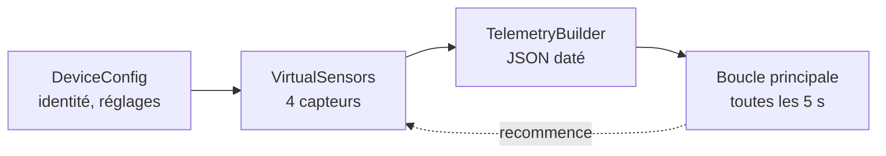

# TP 2 — Construire un simulateur de dispositif AIoT en Python

Énoncé complet : [[Fascicule de TP - 12 laboratoires.pdf]], pages 8 à 12 · durée 1 h 30 · cours : [[Résumé - IoT#Module 5 — Construire un dispositif AIoT virtuel|module 5]] · avant : [[TP 1 - MQTT en ligne de commande]] · suite : [[TP 3 - Dispositif réaliste (dérive, bruit, états)]]

> [!abstract] En une phrase
> On écrit un petit programme qui **fait semblant d'être la machine MCH-007** (une remplisseuse de bouteilles) et qui donne ses mesures toutes les 5 secondes.

## Pourquoi simuler ?

On n'a pas de machine d'usine en salle de TP. Un dispositif virtuel produit des données réalistes pour tester tout le reste du système (broker, base de données, API, IA) : le reste de la chaîne ne voit pas la différence. C'est le même principe qu'un pilote qui s'entraîne sur simulateur.

Le programme tient en **4 fichiers**, un par rôle :

| Fichier | Rôle | Image |
|---|---|---|
| `config.py` | identité et réglages du dispositif | la carte d'identité |
| `sensors.py` | les 4 capteurs virtuels | les instruments de mesure |
| `telemetry.py` | met les mesures dans un message JSON daté | le secrétaire qui remplit la fiche |
| `device_simulator.py` | la boucle : mesurer, mettre en forme, afficher, attendre | le chef d'équipe |



## Étape 1 — Préparer le projet

```sh
mkdir aiot-device-simulator && cd aiot-device-simulator
python -m venv .venv
source .venv/bin/activate          # Windows : .venv\Scripts\activate
```

Un **environnement virtuel** (`.venv`) est une trousse à outils propre au projet : ce qu'on y installe ne se mélange pas avec les autres projets. Ici, aucune installation : on n'utilise que la bibliothèque standard de Python.

## Étape 2 — L'identité du dispositif

```python
# config.py
import time
from dataclasses import dataclass, field


@dataclass
class DeviceConfig:
    device_id: str = "MCH-007"
    device_type: str = "Bottle Filling Machine"
    location: str = "Production Line 2"
    sampling_interval: int = 5          # secondes entre deux mesures
    status: str = "RUNNING"
    created_at: float = field(default_factory=time.time)


config = DeviceConfig()
```

`@dataclass` crée une classe « fiche » sans écrire de constructeur. `field(default_factory=time.time)` calcule l'heure de création **au moment où on crée l'objet** (et non une seule fois au chargement du fichier).

## Étape 3 — Les capteurs virtuels

```python
# sensors.py
import random
from typing import Dict


class VirtualSensors:
    def read_temperature(self) -> float:
        return round(random.uniform(70.0, 85.0), 2)     # °C

    def read_vibration(self) -> float:
        return round(random.uniform(1.5, 3.5), 2)       # mm/s

    def read_pressure(self) -> float:
        return round(random.uniform(5.0, 7.0), 2)       # bar

    def read_energy(self) -> float:
        return round(random.uniform(1.0, 2.0), 2)       # kWh

    def read_all(self) -> Dict[str, float]:
        return {
            "temperature": self.read_temperature(),
            "vibration": self.read_vibration(),
            "pressure": self.read_pressure(),
            "energy": self.read_energy(),
        }
```

`random.uniform(a, b)` tire un nombre au hasard entre `a` et `b` ; `round(…, 2)` garde deux décimales. Chaque capteur a sa propre méthode : on pourra en ajouter un sans toucher aux autres.

## Étape 4 — Le message de télémétrie

```python
# telemetry.py
import time
from typing import Dict


class TelemetryBuilder:
    def __init__(self, device_config):
        self.cfg = device_config

    def build(self, readings: Dict[str, float]) -> Dict:
        return {
            "device_id": self.cfg.device_id,
            "device_type": self.cfg.device_type,
            "location": self.cfg.location,
            "timestamp": time.strftime("%Y-%m-%dT%H:%M:%SZ", time.gmtime()),   # heure UTC
            "status": self.cfg.status,
            "readings": {**readings},
        }
```

Chaque message répond à quatre questions : **qui** (id, type, lieu), **quand** (horodatage), **comment ça va** (status), **quelles mesures** (readings). L'heure est en **UTC** (le `Z` final) pour que tous les systèmes lisent la même heure, quel que soit le pays.

## Étape 5 — La boucle de simulation

```python
# device_simulator.py
import time

from config import config
from sensors import VirtualSensors
from telemetry import TelemetryBuilder

sensors = VirtualSensors()
telemetry_builder = TelemetryBuilder(config)

print(f"\nDémarrage du dispositif virtuel : {config.device_id}")
print(f"Échantillonnage toutes les {config.sampling_interval}s\n")

try:
    while True:
        readings = sensors.read_all()                     # 1. mesurer
        telemetry = telemetry_builder.build(readings)     # 2. mettre en forme
        print(telemetry)                                  # 3. « envoyer » (ici : afficher)
        time.sleep(config.sampling_interval)              # 4. attendre
except KeyboardInterrupt:
    print("\nDispositif arrêté.")
```

Un objet connecté ne s'exécute pas une fois : il **tourne en boucle**. `except KeyboardInterrupt` transforme le `Ctrl+C` en arrêt propre au lieu d'une erreur.

## Étape 6 — Lancer

```sh
python device_simulator.py
```

```text
Démarrage du dispositif virtuel : MCH-007
Échantillonnage toutes les 5s

{'device_id': 'MCH-007', 'device_type': 'Bottle Filling Machine', 'location': 'Production Line 2', 'timestamp': '2026-11-06T21:17:52Z', 'status': 'RUNNING', 'readings': {'temperature': 78.38, 'vibration': 2.65, 'pressure': 6.23, 'energy': 1.18}}
{'device_id': 'MCH-007', 'device_type': 'Bottle Filling Machine', 'location': 'Production Line 2', 'timestamp': '2026-11-06T21:17:57Z', 'status': 'RUNNING', 'readings': {'temperature': 73.77, 'vibration': 2.47, 'pressure': 6.19, 'energy': 1.3}}
{'device_id': 'MCH-007', 'device_type': 'Bottle Filling Machine', 'location': 'Production Line 2', 'timestamp': '2026-11-06T21:18:02Z', 'status': 'RUNNING', 'readings': {'temperature': 78.06, 'vibration': 3.13, 'pressure': 7.0, 'energy': 1.25}}
^C
Dispositif arrêté.
```

Ça marche : un message toutes les 5 s (regarder les secondes : 52, 57, 02).

> [!remarque] Ce qui ne va pas encore
> La température saute 78,38 → 73,77 → 78,06 °C en 10 secondes. Une vraie machine ne fait pas ça : sa température monte ou descend **doucement**. Et le `status` reste `RUNNING` quoi qu'il arrive. Le [[TP 3 - Dispositif réaliste (dérive, bruit, états)|TP 3]] règle ces deux problèmes.

## À retenir

- On peut simuler un dispositif pour tester un système IoT sans matériel.
- Un message de télémétrie dit : qui, quand, comment ça va, quelles mesures. En JSON, horodaté en UTC.
- Un dispositif tourne en boucle : **Sense → Process → Communicate → attendre**.
- Un fichier = un rôle : on changera les capteurs au TP 3 sans toucher au reste.

## Questions du fascicule

1. Pourquoi utiliser une `dataclass` plutôt que des variables globales pour la configuration ?
2. Que se passerait-il si `sampling_interval` était fixé à 0 ?
3. Quels champs ajouteriez-vous à la télémétrie pour détecter un état « WARNING » ?

> [!question]- Réponses
> 1. Toute la configuration est **regroupée dans un seul objet**, facile à passer aux autres fichiers, typé et lisible. On peut aussi créer plusieurs dispositifs différents (`DeviceConfig(device_id="MCH-008")`), impossible avec des variables globales uniques.
> 2. Plus aucune pause : la boucle produit des milliers de messages par seconde et occupe le processeur à 100 %. Sur un vrai objet, la batterie et le réseau seraient épuisés, et le broker inondé.
> 3. Un champ **`state`** calculé à partir des mesures et des seuils métier (RUNNING, WARNING, FAULT) et un champ **`message`** qui explique pourquoi (« température proche de la limite »). C'est exactement ce qu'ajoute le TP 3.
