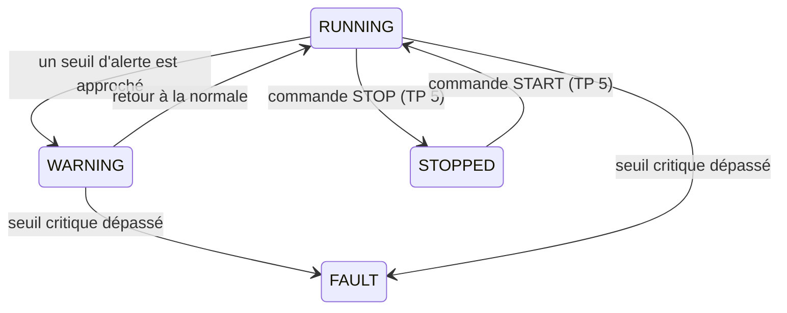

# TP 3 — Rendre le dispositif réaliste : état, bruit, dérive et scénarios

Énoncé complet : [[Fascicule de TP - 12 laboratoires.pdf]], pages 13 à 18 · durée 1 h · cours : [[Résumé - IoT#Module 5 — Construire un dispositif AIoT virtuel|module 5]] · avant : [[TP 2 - Simulateur de dispositif en Python]] · suite : [[TP 4 - Connecter le dispositif à MQTT]]

> [!abstract] En une phrase
> Les capteurs **se souviennent** de leur dernière valeur et la font bouger doucement, comme une vraie machine ; à chaque mesure, le dispositif **décide** de son état (RUNNING, WARNING, FAULT).

## Dérive et bruit

Au TP 2, chaque mesure était tirée au hasard, sans lien avec la précédente. Une vraie mesure, c'est :

$$\text{valeur lue} = \underbrace{\text{valeur réelle}}_{\text{bouge lentement : la dérive}} + \underbrace{\text{petite erreur}}_{\text{le bruit du capteur}}$$

- La **dérive** (*drift*) : la valeur réelle évolue un peu à chaque cycle, **à partir de la précédente** (échauffement, usure). Elle s'accumule.
- Le **bruit** (*noise*) : à chaque lecture, le capteur se trompe un peu autour de la valeur réelle. Il ne s'accumule pas.

![[tp03-hasard-vs-derive.png]]

Sur 150 cycles, la température du TP 2 franchit le seuil WARNING de 80 °C **39 fois** par pur hasard : chaque franchissement déclencherait une fausse alerte. Celle du TP 3 part de 72 °C et dérive lentement, comme une vraie machine.

## Les fichiers

On repart du dossier du TP 2. `config.py`, `sensors.py`, `telemetry.py` et `device_simulator.py` sont réécrits ; `state.py`, `scenarios.py` et `test_scenarios.py` sont nouveaux.

### Étape 1 — Un capteur à état

```python
# sensors.py
import random
from dataclasses import dataclass


@dataclass
class SensorModel:
    name: str
    value: float        # valeur « réelle » actuelle
    min_value: float
    max_value: float
    drift: float        # de combien la valeur réelle peut bouger à chaque cycle
    noise: float        # imprécision du capteur à chaque lecture

    def read(self):
        # 1. Dérive : la valeur réelle bouge un peu, à partir de sa valeur précédente
        self.value += random.uniform(-self.drift, self.drift)
        self.value = max(self.min_value, min(self.max_value, self.value))   # reste dans les bornes
        # 2. Bruit : la mesure s'écarte un peu de la valeur réelle
        observed = self.value + random.uniform(-self.noise, self.noise)
        return round(observed, 2)


class VirtualSensors:
    def __init__(self):
        #                          nom          départ  min   max   drift noise
        self.temperature = SensorModel("temperature", 72.0, 65.0, 95.0, 0.35, 0.20)
        self.vibration = SensorModel("vibration", 2.0, 1.0, 5.0, 0.08, 0.05)
        self.pressure = SensorModel("pressure", 6.2, 4.0, 7.5, 0.08, 0.04)
        self.energy = SensorModel("energy", 1.4, 0.8, 2.5, 0.04, 0.03)

    def read_all(self):
        return {
            "temperature": self.temperature.read(),
            "vibration": self.vibration.read(),
            "pressure": self.pressure.read(),
            "energy": self.energy.read(),
        }
```

La ligne clé : `self.value += …`. On **ajoute** un petit pas à la valeur précédente au lieu d'en tirer une nouvelle. `max(min, min(max, …))` empêche la valeur de sortir des bornes physiques.

### Étape 2 — Les seuils métier

```python
# config.py
DEVICE_CONFIG = {
    "device_id": "MCH-007",
    "device_type": "Bottle Filling Machine",
    "location": "Production Line 2",
    "sampling_interval": 2,
}

THRESHOLDS = {
    "temperature_warning": 80.0,
    "temperature_fault": 88.0,
    "vibration_warning": 3.2,
    "vibration_fault": 4.0,
    "pressure_warning_low": 4.5,
    "pressure_fault_low": 4.0,
}
```

### Étape 3 — Décider de l'état



```python
# state.py
from enum import Enum

from config import THRESHOLDS


class MachineState(str, Enum):
    RUNNING = "RUNNING"
    WARNING = "WARNING"
    FAULT = "FAULT"
    STOPPED = "STOPPED"


def evaluate_state(readings):
    t = readings["temperature"]
    v = readings["vibration"]
    p = readings["pressure"]

    # Les cas les plus graves d'abord
    if t >= THRESHOLDS["temperature_fault"] and v >= THRESHOLDS["vibration_fault"]:
        return MachineState.FAULT, "Critical temperature and vibration"
    if t >= THRESHOLDS["temperature_fault"]:
        return MachineState.FAULT, "Critical temperature"
    if p <= THRESHOLDS["pressure_fault_low"]:
        return MachineState.FAULT, "Critical low pressure"
    # Puis les avertissements
    if (t >= THRESHOLDS["temperature_warning"]
            or v >= THRESHOLDS["vibration_warning"]
            or p <= THRESHOLDS["pressure_warning_low"]):
        return MachineState.WARNING, "Operating parameter approaching limit"

    return MachineState.RUNNING, "Normal operation"
```

La fonction renvoie **deux choses** : l'état, et une phrase qui l'explique. L'ordre des `if` compte : voir la question 1.

### Étape 4 — Rejouer des scénarios

Attendre que le hasard produise une panne peut prendre des heures. On fixe donc des valeurs qui représentent des situations connues :

```python
# scenarios.py
SCENARIOS = {
    "NORMAL":         {"temperature": 72.0, "vibration": 2.0, "pressure": 6.2, "energy": 1.4},
    "OVERHEATING":    {"temperature": 86.0, "vibration": 2.8, "pressure": 6.1, "energy": 1.7},
    "COMBINED_FAULT": {"temperature": 91.0, "vibration": 4.6, "pressure": 6.5, "energy": 2.1},
    "LOW_PRESSURE":   {"temperature": 74.0, "vibration": 2.2, "pressure": 4.2, "energy": 1.5},
}
```

```python
# test_scenarios.py
from scenarios import SCENARIOS
from state import evaluate_state

for name, readings in SCENARIOS.items():
    state, message = evaluate_state(readings)
    print(f"{name:<15} -> {state.value:<8} ({message})")
```

```text
NORMAL          -> RUNNING  (Normal operation)
OVERHEATING     -> WARNING  (Operating parameter approaching limit)
COMBINED_FAULT  -> FAULT    (Critical temperature and vibration)
LOW_PRESSURE    -> WARNING  (Operating parameter approaching limit)
```

OVERHEATING (86 °C) est entre 80 et 88 : WARNING. LOW_PRESSURE (4,2 bar) est sous 4,5 mais au-dessus de 4,0 : WARNING aussi.

### Étape 5 — Le message enrichi

```python
# telemetry.py
from datetime import datetime, timezone


def build_telemetry(device_config, readings, state, message):
    return {
        "device_id": device_config["device_id"],
        "device_type": device_config["device_type"],
        "location": device_config["location"],
        "timestamp": datetime.now(timezone.utc).isoformat(timespec="seconds"),   # heure UTC
        "state": state.value,
        "message": message,
        "readings": readings,
    }
```

> [!warning] Mettre l'heure en UTC
> Le fascicule écrit `datetime.now().isoformat(…)` : l'heure **locale**, sans fuseau (`2025-05-11T11:30:15`). Une fois stockée dans MongoDB (TP 7), elle serait lue comme de l'UTC, avec une heure d'écart. `datetime.now(timezone.utc)` donne `2026-11-06T21:19:20+00:00`, sans ambiguïté.

### Étape 6 — Tout assembler

```python
# device_simulator.py
import time

from config import DEVICE_CONFIG
from sensors import VirtualSensors
from state import evaluate_state
from telemetry import build_telemetry


class AIoTDevice:
    def __init__(self):
        self.config = DEVICE_CONFIG.copy()
        self.sensors = VirtualSensors()

    def read_and_process(self):
        readings = self.sensors.read_all()                 # Sense
        state, message = evaluate_state(readings)          # Process + Decide
        return build_telemetry(self.config, readings, state, message)

    def run(self, cycles=10):
        print(f"Démarrage de {self.config['device_id']}...")
        for cycle in range(1, cycles + 1):
            telemetry = self.read_and_process()
            print(f"\nCycle {cycle} — État : {telemetry['state']} — {telemetry['message']}")
            print(telemetry["readings"])
            time.sleep(self.config["sampling_interval"])


if __name__ == "__main__":
    AIoTDevice().run(cycles=10)
```

```text
Démarrage de MCH-007...

Cycle 1 — État : RUNNING — Normal operation
{'temperature': 71.88, 'vibration': 2.0, 'pressure': 6.19, 'energy': 1.42}

Cycle 2 — État : RUNNING — Normal operation
{'temperature': 72.07, 'vibration': 1.92, 'pressure': 6.19, 'energy': 1.41}

Cycle 3 — État : RUNNING — Normal operation
{'temperature': 72.2, 'vibration': 1.98, 'pressure': 6.25, 'energy': 1.39}

Cycle 4 — État : RUNNING — Normal operation
{'temperature': 72.0, 'vibration': 2.01, 'pressure': 6.19, 'energy': 1.38}
```

La température bouge de quelques dixièmes par cycle (71,88 → 72,07 → 72,20 → 72,00) : c'est la dérive plus le bruit. C'est le cycle **Sense → Process → Decide → Communicate** du cours.

## À retenir

- Valeur lue = valeur réelle qui **dérive** lentement + **bruit** de mesure.
- Le dispositif décide lui-même de son état grâce à des **seuils métier**, en testant les cas graves en premier.
- Des **scénarios** fixes permettent de démontrer chaque état sans attendre le hasard.
- Horodater en **UTC**.

## Questions du fascicule

1. Pourquoi teste-t-on les conditions FAULT avant les conditions WARNING dans `evaluate_state` ?
2. Quelle est la différence de rôle entre le paramètre `drift` et le paramètre `noise` ?
3. Comment ajouteriez-vous un état MAINTENANCE déclenché manuellement plutôt que par un seuil ?

> [!question]- Réponses
> 1. Une valeur critique dépasse **aussi** le seuil d'alerte (91 °C ≥ 80 °C). Si on testait WARNING d'abord, la fonction s'arrêterait au premier `return` et la panne serait **masquée** en simple avertissement.
> 2. `drift` fait évoluer la **valeur réelle** d'un cycle à l'autre, et cette évolution s'accumule (tendance). `noise` ajoute une erreur **ponctuelle** à chaque lecture, centrée sur la valeur réelle, qui ne s'accumule pas.
> 3. Ajouter `MAINTENANCE` à l'énumération et un attribut (par exemple `self.maintenance = True`) qu'une **commande** active (voir le TP 5). Tant qu'il est vrai, on n'appelle plus `evaluate_state` : l'état est forcé à MAINTENANCE, mais la télémétrie continue d'être envoyée, ce qui évite de prendre une intervention pour une panne.
