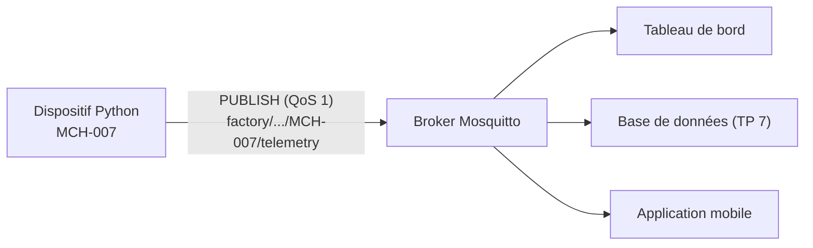

# TP 4 — Connecter le dispositif Python au broker MQTT

Énoncé complet : [[Fascicule de TP - 12 laboratoires.pdf]], pages 19 à 22 · durée 1 h · cours : [[Résumé - IoT#Module 3 — MQTT|module 3]] et [[Résumé - IoT#Module 5 — Construire un dispositif AIoT virtuel|module 5]] · avant : [[TP 3 - Dispositif réaliste (dérive, bruit, états)]] · suite : [[TP 5 - Commandes et accusés de réception]]

> [!abstract] En une phrase
> Au lieu d'afficher ses mesures, la machine du TP 3 les **publie sur MQTT** ; n'importe quelle application abonnée les reçoit en direct.

## Le principe



Le dispositif ne sait pas qui l'écoute : il publie sur un topic, le broker distribue. Ajouter un abonné ne demande aucune modification du dispositif.

## Étape 1 — Installer le client MQTT

```sh
pip install paho-mqtt
```

## Étape 2 — Choisir les topics

Un topic bien construit se lit comme une adresse : **site / ligne / type / identifiant / nature du message**.

| Usage | Topic |
|---|---|
| Télémétrie (mesures) | `factory/production-line-2/machine/MCH-007/telemetry` |
| État / santé | `factory/production-line-2/machine/MCH-007/status` |
| Commandes reçues (TP 5) | `factory/production-line-2/machine/MCH-007/command` |
| Alertes, événements | `factory/production-line-2/machine/MCH-007/event` |

Avec cette hiérarchie, un tableau de bord s'abonne à `factory/+/machine/+/telemetry` pour recevoir **toutes** les machines, ou à un seul topic pour une seule.

## Étape 3 — Le dispositif connecté

On copie `config.py`, `sensors.py`, `state.py` et `telemetry.py` du TP 3 dans un nouveau dossier, et on ajoute :

```python
# device_mqtt.py
import json
import time

import paho.mqtt.client as mqtt

from config import DEVICE_CONFIG
from sensors import VirtualSensors
from state import evaluate_state
from telemetry import build_telemetry

BROKER_HOST = "localhost"
BROKER_PORT = 1883
TOPIC_TELEMETRY = "factory/production-line-2/machine/MCH-007/telemetry"


def on_connect(client, userdata, flags, reason_code, properties):
    if reason_code == 0:
        print("Connecté au broker MQTT")
    else:
        print(f"Échec de connexion : {reason_code}")


# paho-mqtt 2.x : on indique la version de l'API des callbacks
client = mqtt.Client(mqtt.CallbackAPIVersion.VERSION2, client_id="MCH-007-Device")
client.on_connect = on_connect
client.connect(BROKER_HOST, BROKER_PORT, 60)
client.loop_start()          # thread réseau en arrière-plan (c'est lui qui appelle on_connect)

sensors = VirtualSensors()
try:
    while True:
        readings = sensors.read_all()
        state, message = evaluate_state(readings)
        telemetry = build_telemetry(DEVICE_CONFIG, readings, state, message)
        result = client.publish(TOPIC_TELEMETRY, json.dumps(telemetry), qos=1)
        if result.rc == mqtt.MQTT_ERR_SUCCESS:
            print(f"[{state.value}] télémétrie publiée : T={readings['temperature']} °C")
        else:
            print(f"Échec de publication : {result.rc}")
        time.sleep(DEVICE_CONFIG["sampling_interval"])
except KeyboardInterrupt:
    print("\nDispositif arrêté.")
finally:
    client.disconnect()
    client.loop_stop()
```

Ligne par ligne, ce qui compte :

| Code | Rôle |
|---|---|
| `mqtt.Client(..., client_id="MCH-007-Device")` | crée le client, avec un identifiant **unique** sur le broker |
| `client.on_connect = on_connect` | fonction appelée quand le broker répond (`CONNACK`) |
| `client.connect(host, port, 60)` | ouvre la connexion TCP ; 60 = *keepalive*, le client prouve qu'il est vivant au moins toutes les 60 s |
| `client.loop_start()` | lance un **thread** qui gère le réseau pendant que notre boucle mesure |
| `json.dumps(telemetry)` | le dictionnaire Python devient du texte JSON |
| `client.publish(topic, payload, qos=1)` | envoie avec la garantie « au moins une fois » |
| `disconnect()` puis `loop_stop()` | ferme proprement (dans cet ordre, l'arrêt est immédiat) |

> [!warning] paho-mqtt 2.x et le code du fascicule
> Le fascicule écrit `mqtt.Client(client_id="MCH-007-Device")` et `on_connect(client, userdata, flags, rc)` : c'est l'API de paho-mqtt 1.x. Avec la version 2 (installée par défaut aujourd'hui), ça marche encore mais affiche :
> ```text
> DeprecationWarning: Callback API version 1 is deprecated, update to latest version
> ```
> La forme moderne passe `mqtt.CallbackAPIVersion.VERSION2` et les callbacks reçoivent **5 paramètres** (`reason_code` et `properties` remplacent `rc`). Tous les TP suivants utilisent cette forme.

## Étape 4 — Vérifier la réception

```sh
# Terminal 1 : un abonné
mosquitto_sub -h localhost -t "factory/production-line-2/machine/MCH-007/telemetry" -v

# Terminal 2 : le dispositif
python device_mqtt.py
```

Terminal 2 :

```text
[RUNNING] télémétrie publiée : T=72.21 °C
Connecté au broker MQTT
[RUNNING] télémétrie publiée : T=71.85 °C
[RUNNING] télémétrie publiée : T=72.26 °C
^C
Dispositif arrêté.
```

La première publication s'affiche **avant** « Connecté » : paho la garde en file d'attente le temps que la connexion s'établisse, puis l'envoie.

Terminal 1 :

```text
factory/production-line-2/machine/MCH-007/telemetry {"device_id": "MCH-007", "device_type": "Bottle Filling Machine", "location": "Production Line 2", "timestamp": "2026-11-06T21:19:20+00:00", "state": "RUNNING", "message": "Normal operation", "readings": {"temperature": 72.21, "vibration": 2.08, "pressure": 6.25, "energy": 1.43}}
factory/production-line-2/machine/MCH-007/telemetry {"device_id": "MCH-007", "device_type": "Bottle Filling Machine", "location": "Production Line 2", "timestamp": "2026-11-06T21:19:22+00:00", "state": "RUNNING", "message": "Normal operation", "readings": {"temperature": 71.85, "vibration": 2.1, "pressure": 6.22, "energy": 1.41}}
```

Avec un broker lancé en mode verbeux (`mosquitto -v`), on voit le QoS 1 à l'œuvre : chaque `PUBLISH` reçoit un accusé `PUBACK`.

```text
Received PUBLISH from MCH-007-Device (d0, q1, r0, m1, 'factory/production-line-2/machine/MCH-007/telemetry', ... (279 bytes))
Sending PUBACK to MCH-007-Device (m1, rc0)
```

`q1` = QoS 1, `m1` = numéro du message, que le `PUBACK` reprend.

## À retenir

- Le dispositif **publie** sur un topic hiérarchique ; il ne connaît pas ses abonnés.
- `loop_start()` : un thread s'occupe du réseau, la boucle principale s'occupe des mesures.
- QoS 1 = chaque message est acquitté (`PUBACK`) et renvoyé s'il n'a pas été acquitté.
- Avec paho-mqtt 2.x : `CallbackAPIVersion.VERSION2` et des callbacks à 5 paramètres.

## Questions du fascicule

1. Pourquoi choisir QoS 1 plutôt que QoS 0 ou QoS 2 pour cette télémétrie ?
2. Que se passe-t-il si deux dispositifs utilisent le même `client_id` ?
3. Comment ajouteriez-vous un topic de commande pour piloter le dispositif à distance ?

> [!question]- Réponses
> 1. QoS 0 peut **perdre** des mesures sans que personne le sache. QoS 2 garantit « exactement une fois » mais coûte une poignée de main en 4 étapes par message, inutile ici. QoS 1 garantit la livraison ; un éventuel doublon est sans gravité, car le `timestamp` permet de le repérer. C'est la règle d'or du cours : **le QoS le plus bas qui satisfait le besoin**. (Pour de la télémétrie très fréquente où une mesure perdue ne compte pas, QoS 0 serait aussi défendable.)
> 2. Le broker n'accepte qu'une session par identifiant : quand le second se connecte, il **déconnecte le premier** (journal : `disconnected: session taken over`). Si les deux se reconnectent automatiquement, ils s'éjectent en boucle et des messages se perdent.
> 3. Le dispositif s'abonne à `factory/production-line-2/machine/MCH-007/command` dans `on_connect`, et traite les ordres reçus dans une fonction `on_message`. C'est le [[TP 5 - Commandes et accusés de réception|TP 5]].
