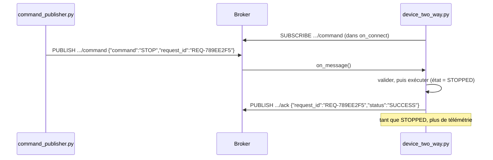

# TP 5 — Communication bidirectionnelle : commandes et accusés de réception

Énoncé complet : [[Fascicule de TP - 12 laboratoires.pdf]], pages 23 à 28 · durée 1 h · cours : [[Résumé - IoT#Module 3 — MQTT|module 3]] · avant : [[TP 4 - Connecter le dispositif à MQTT]] · suite : [[TP 6 - Sécuriser MQTT (TLS, mots de passe, ACL)]]

> [!abstract] En une phrase
> Le dispositif ne fait plus seulement **parler** (télémétrie) : il **écoute** aussi des ordres (START, STOP, STATUS), les exécute, et répond à chacun par un **accusé de réception** (ACK).

## Le principe : trois topics

| Topic | Qui publie → qui écoute | Contenu |
|---|---|---|
| `factory/production-line-2/machine/MCH-007/telemetry` | dispositif → applications | les mesures (comme au TP 4) |
| `factory/production-line-2/machine/MCH-007/command` | application → dispositif | `{"command": "STOP", "request_id": "REQ-789EE2F5"}` |
| `factory/production-line-2/machine/MCH-007/ack` | dispositif → application | `{"command": "STOP", "request_id": "REQ-789EE2F5", "status": "SUCCESS", ...}` |



Le `request_id` est le fil rouge : l'ACK reprend celui de la commande, ce qui permet de savoir **à quelle commande** il répond.

## Étape 1 — La configuration

On copie `sensors.py`, `state.py` et `telemetry.py` du TP 3. Dans `config.py`, on **garde** `DEVICE_CONFIG` et `THRESHOLDS` du TP 3 et on ajoute :

```python
# config.py (à ajouter sous DEVICE_CONFIG et THRESHOLDS du TP 3)
MQTT_CONFIG = {
    "broker_host": "localhost",
    "broker_port": 1883,
    "keepalive": 60,
    "telemetry_topic": "factory/production-line-2/machine/MCH-007/telemetry",
    "command_topic": "factory/production-line-2/machine/MCH-007/command",
    "ack_topic": "factory/production-line-2/machine/MCH-007/ack",
}
```

> [!warning] Trois pièges du code du fascicule
> - Son `config.py` ne contient plus `THRESHOLDS`, alors que `state.py` (TP 3) fait `from config import THRESHOLDS` : `ImportError` au lancement. Il faut garder les seuils.
> - Il importe `evaluate_sensor_state` et `build_ack`, qui n'existent dans aucun fichier des TP précédents. On utilise `evaluate_state` du TP 3, et l'ACK est construit dans `publish_ack` ci-dessous.
> - Il ne montre pas la boucle de télémétrie. Attention : si elle recalcule l'état à chaque cycle, un STOP est immédiatement écrasé par RUNNING. Il faut sauter la mesure quand la machine est arrêtée.

## Étape 2 — Le dispositif qui écoute

```python
# device_two_way.py
import json
import time
import uuid

import paho.mqtt.client as mqtt

from config import DEVICE_CONFIG, MQTT_CONFIG
from sensors import VirtualSensors
from state import MachineState, evaluate_state
from telemetry import build_telemetry

SUPPORTED_COMMANDS = {"START", "STOP", "STATUS"}


class AIoTDeviceTwoWay:
    def __init__(self):
        self.state = MachineState.RUNNING
        self.sensors = VirtualSensors()
        self.client = mqtt.Client(mqtt.CallbackAPIVersion.VERSION2,
                                  client_id=DEVICE_CONFIG["device_id"])
        self.client.on_connect = self.on_connect
        self.client.on_message = self.on_message

    # Dès que la connexion est établie : on s'abonne au topic de commande
    def on_connect(self, client, userdata, flags, reason_code, properties):
        client.subscribe(MQTT_CONFIG["command_topic"])
        print("Connecté et abonné :", MQTT_CONFIG["command_topic"])

    # Appelée à chaque commande reçue : valider d'abord, agir ensuite
    def on_message(self, client, userdata, message):
        text = message.payload.decode(errors="replace")
        print("\nCommande reçue :", text)
        try:                                          # 1. le message est-il du JSON ?
            data = json.loads(text)
            command = str(data.get("command", "")).upper()
            request_id = data.get("request_id", str(uuid.uuid4()))
        except (json.JSONDecodeError, AttributeError):
            self.publish_ack("UNKNOWN", "N/A", "REJECTED", "Payload JSON invalide")
            return
        if command not in SUPPORTED_COMMANDS:         # 2. la commande existe-t-elle ?
            self.publish_ack(command or "UNKNOWN", request_id, "REJECTED", "Commande non supportée")
            return
        if command == "START":                        # 3. on exécute
            self.state = MachineState.RUNNING
        elif command == "STOP":
            self.state = MachineState.STOPPED
        # STATUS ne change rien : il demande seulement un ACK avec l'état actuel
        self.publish_ack(command, request_id, "SUCCESS")
        print(f"Commande exécutée : {command} | état = {self.state.value}")

    def publish_ack(self, command, request_id, status, reason=None):
        ack = {"device_id": DEVICE_CONFIG["device_id"], "command": command,
               "request_id": request_id, "status": status, "state": self.state.value}
        if reason:
            ack["reason"] = reason
            print("Commande rejetée :", reason)
        self.client.publish(MQTT_CONFIG["ack_topic"], json.dumps(ack, ensure_ascii=False))

    def run(self):
        self.client.connect(MQTT_CONFIG["broker_host"], MQTT_CONFIG["broker_port"],
                            MQTT_CONFIG["keepalive"])
        self.client.loop_start()
        try:
            while True:
                if self.state == MachineState.STOPPED:
                    print("Machine arrêtée : pas de télémétrie")
                else:
                    readings = self.sensors.read_all()
                    self.state, message = evaluate_state(readings)
                    telemetry = build_telemetry(DEVICE_CONFIG, readings, self.state, message)
                    self.client.publish(MQTT_CONFIG["telemetry_topic"], json.dumps(telemetry))
                    print(f"Télémétrie [{self.state.value}] T={readings['temperature']} °C")
                time.sleep(DEVICE_CONFIG["sampling_interval"])
        except KeyboardInterrupt:
            print("\nDispositif arrêté.")
        finally:
            self.client.disconnect()
            self.client.loop_stop()


if __name__ == "__main__":
    AIoTDeviceTwoWay().run()
```

Les trois idées du fichier :

1. **S'abonner dans `on_connect`** : si la connexion tombe puis revient, paho rappelle `on_connect` et l'abonnement est refait automatiquement.
2. **Valider avant d'agir** : d'abord le format (JSON ?), ensuite le contenu (commande connue ?), et seulement alors on change l'état. Un message invalide ne fait jamais planter le dispositif.
3. **Toujours répondre** : SUCCESS ou REJECTED avec une raison, jamais de silence.

`on_message` tourne dans le thread réseau de paho, pendant que `run` fait sa boucle : c'est ce qui permet de recevoir un ordre à tout moment.

## Étape 3 — L'application qui envoie les ordres

```python
# command_publisher.py
import json
import uuid

import paho.mqtt.client as mqtt

from config import MQTT_CONFIG

client = mqtt.Client(mqtt.CallbackAPIVersion.VERSION2, client_id="command-publisher")
client.connect(MQTT_CONFIG["broker_host"], MQTT_CONFIG["broker_port"], MQTT_CONFIG["keepalive"])
client.loop_start()

while True:
    command = input("Commande [START/STOP/STATUS/QUIT] : ").strip().upper()
    if command == "QUIT":
        break
    request_id = f"REQ-{uuid.uuid4().hex[:8].upper()}"     # identifiant unique de la demande
    payload = {"command": command, "request_id": request_id}
    client.publish(MQTT_CONFIG["command_topic"], json.dumps(payload)).wait_for_publish()
    print("Envoyé :", json.dumps(payload))

client.disconnect()
client.loop_stop()
```

`wait_for_publish()` attend que le message soit vraiment parti avant de redemander une commande.

## Étape 4 — Tester avec trois terminaux

```sh
python device_two_way.py                                                     # terminal 1
python command_publisher.py                                                  # terminal 2
mosquitto_sub -t "factory/production-line-2/machine/MCH-007/ack" -v          # terminal 3
mosquitto_pub -t "factory/production-line-2/machine/MCH-007/command" -m "ceci n'est pas du JSON"   # test final
```

Terminal 2, on tape STATUS, STOP, START puis une commande inventée :

```text
Commande [START/STOP/STATUS/QUIT] : STATUS
Envoyé : {"command": "STATUS", "request_id": "REQ-6FA7EEB6"}
Commande [START/STOP/STATUS/QUIT] : STOP
Envoyé : {"command": "STOP", "request_id": "REQ-789EE2F5"}
Commande [START/STOP/STATUS/QUIT] : START
Envoyé : {"command": "START", "request_id": "REQ-1C10F7B3"}
Commande [START/STOP/STATUS/QUIT] : DANCE
Envoyé : {"command": "DANCE", "request_id": "REQ-B5F7453F"}
```

Terminal 1, le dispositif :

```text
Connecté et abonné : factory/production-line-2/machine/MCH-007/command
Télémétrie [RUNNING] T=72.04 °C

Commande reçue : {"command": "STATUS", "request_id": "REQ-6FA7EEB6"}
Commande exécutée : STATUS | état = RUNNING

Commande reçue : {"command": "STOP", "request_id": "REQ-789EE2F5"}
Commande exécutée : STOP | état = STOPPED
Machine arrêtée : pas de télémétrie
Machine arrêtée : pas de télémétrie

Commande reçue : {"command": "START", "request_id": "REQ-1C10F7B3"}
Commande exécutée : START | état = RUNNING

Commande reçue : {"command": "DANCE", "request_id": "REQ-B5F7453F"}
Commande rejetée : Commande non supportée
Télémétrie [RUNNING] T=71.73 °C

Commande reçue : ceci n'est pas du JSON
Commande rejetée : Payload JSON invalide
Télémétrie [RUNNING] T=71.35 °C
```

Terminal 3, les accusés de réception (un par commande, même `request_id`) :

```text
.../ack {"device_id": "MCH-007", "command": "STATUS", "request_id": "REQ-6FA7EEB6", "status": "SUCCESS", "state": "RUNNING"}
.../ack {"device_id": "MCH-007", "command": "STOP", "request_id": "REQ-789EE2F5", "status": "SUCCESS", "state": "STOPPED"}
.../ack {"device_id": "MCH-007", "command": "START", "request_id": "REQ-1C10F7B3", "status": "SUCCESS", "state": "RUNNING"}
.../ack {"device_id": "MCH-007", "command": "DANCE", "request_id": "REQ-B5F7453F", "status": "REJECTED", "state": "RUNNING", "reason": "Commande non supportée"}
.../ack {"device_id": "MCH-007", "command": "UNKNOWN", "request_id": "N/A", "status": "REJECTED", "state": "RUNNING", "reason": "Payload JSON invalide"}
```

## Défi : la commande RESET

> [!tip]- Solution testée : RESET accepté seulement en FAULT
> Une panne doit rester « verrouillée » jusqu'à ce qu'un opérateur la réarme. Trois modifications de `device_two_way.py` :
> ```python
> SUPPORTED_COMMANDS = {"START", "STOP", "STATUS", "RESET"}
> ```
> Dans `on_message`, après le cas STOP :
> ```python
>         elif command == "RESET":
>             if self.state != MachineState.FAULT:
>                 self.publish_ack(command, request_id, "REJECTED",
>                                  f"RESET accepté seulement en FAULT (état actuel : {self.state.value})")
>                 return
>             self.sensors = VirtualSensors()      # capteurs remis à leurs valeurs normales
>             self.state = MachineState.RUNNING
> ```
> Dans `run`, la panne n'est plus recalculée tant qu'on n'a pas reçu RESET :
> ```python
>                     readings = self.sensors.read_all()
>                     if self.state == MachineState.FAULT:
>                         message = "En panne : attente d'un RESET"     # la panne reste verrouillée
>                     else:
>                         self.state, message = evaluate_state(readings)
> ```
> Pour tester, on provoque une panne au démarrage en ajoutant dans `__init__`, après `self.sensors = VirtualSensors()` : `self.sensors.temperature.value = 91` et `self.sensors.vibration.value = 4.6`. Résultat :
> ```text
> Télémétrie [FAULT] T=91.14 °C
> Commande reçue : {"command":"RESET","request_id":"R1"}
> Commande exécutée : RESET | état = RUNNING
> Télémétrie [RUNNING] T=72.18 °C
> Commande reçue : {"command":"RESET","request_id":"R2"}
> Commande rejetée : RESET accepté seulement en FAULT (état actuel : RUNNING)
> ```

## À retenir

- Un dispositif d'entreprise **publie** (télémétrie) et **s'abonne** (commandes) : c'est la communication bidirectionnelle.
- S'abonner dans `on_connect` ; traiter dans `on_message`.
- Valider le format puis le contenu **avant** de toucher à l'état.
- Chaque commande reçoit un **ACK** (SUCCESS ou REJECTED + raison) avec le même `request_id`.

## Questions du fascicule

1. Pourquoi valider le format et le contenu de la commande avant de modifier l'état du dispositif ?
2. À quoi sert le `request_id` transmis entre la commande et son accusé de réception ?
3. Que se passerait-il si deux applications envoyaient des commandes contradictoires en même temps ?

> [!question]- Réponses
> 1. Un message reçu du réseau peut être mal formé, incomplet ou malveillant. Sans validation, une exception dans `on_message` peut arrêter le dispositif, ou une valeur absurde peut mettre la machine dans un état dangereux. On ne change l'état qu'avec une commande **connue et bien formée**.
> 2. À **corréler** : l'application qui a envoyé plusieurs commandes sait à laquelle chaque ACK répond, et si une commande n'a jamais reçu d'ACK (dispositif hors ligne). Il sert aussi à la traçabilité (journal des actions).
> 3. Le broker les livre dans l'ordre où il les a reçues : **la dernière arrivée gagne**, sans que personne ne soit prévenu du conflit. Solutions : un seul point d'entrée pour les commandes (l'API du TP 8), des droits par application (ACL du TP 6), des priorités, ou vérifier l'état actuel avant d'appliquer une commande.
