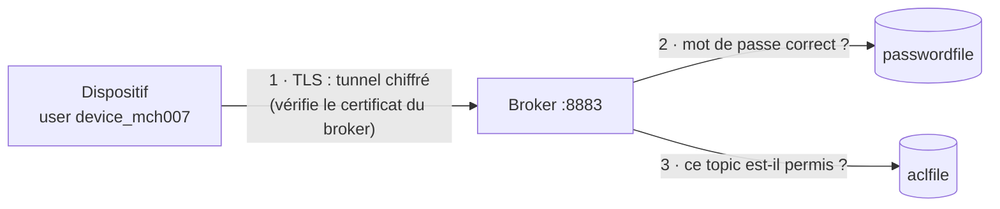

# TP 6 — Sécuriser la communication MQTT (TLS, authentification, ACL)

Énoncé complet : [[Fascicule de TP - 12 laboratoires.pdf]], pages 29 à 32 · durée 1 h 30 · cours : [[Résumé - IoT#Sécuriser MQTT|sécurité MQTT]] et [[Résumé - IoT#Module 13 — Sécurité avancée et conformité|module 13]] · avant : [[TP 5 - Commandes et accusés de réception]] · suite : [[TP 7 - Stocker et analyser avec MongoDB]]

> [!abstract] En une phrase
> Jusqu'ici, n'importe qui pouvait lire nos messages, se connecter et publier n'importe où. On ajoute les **trois piliers** de la sécurité MQTT : chiffrement TLS, mots de passe, et droits par topic (ACL).

## Les trois piliers

| Pilier | Question | Outil dans ce TP | Sans lui… |
|---|---|---|---|
| **Authentification** | Qui êtes-vous ? | fichier de mots de passe | n'importe qui se connecte |
| **Chiffrement** | Le message est-il lisible en route ? | TLS (port 8883) | on peut espionner et falsifier les messages |
| **Autorisation** | Qu'avez-vous le droit de faire ? | ACL (liste de droits par topic) | un dispositif légitime peut se faire passer pour un autre |



Tout se fait dans un dossier `mqtt-tls/`. On lance un **second broker** sur le port 8883 avec sa propre configuration : le broker du TP 1 (port 1883) peut continuer à tourner.

## Étape 1 — Les certificats TLS

Pour TLS, le broker a besoin d'un **certificat** (sa carte d'identité) signé par une **autorité de certification** (CA) que les clients connaissent. On crée notre propre petite CA :

```sh
mkdir mqtt-tls && cd mqtt-tls

# 1. L'autorité de certification : une clé privée + un certificat racine (valable 1 an)
openssl genrsa -out ca.key 2048
openssl req -x509 -new -nodes -key ca.key -days 365 -out ca.crt -subj "/CN=Mon-AIoT-CA"

# 2. Le broker : une clé privée + une demande de certificat (CSR) pour le nom "localhost"
openssl genrsa -out server.key 2048
openssl req -new -key server.key -out server.csr -subj "/CN=localhost"

# 3. La CA signe la demande : on obtient le certificat du broker
openssl x509 -req -in server.csr -CA ca.crt -CAkey ca.key -CAcreateserial -out server.crt -days 365

openssl verify -CAfile ca.crt server.crt
```

```text
Certificate request self-signature ok
subject=CN=localhost
server.crt: OK
```

| Fichier | Rôle | Qui l'a ? |
|---|---|---|
| `ca.crt` | certificat de la CA : sert à **vérifier** les certificats qu'elle a signés | tous les clients |
| `ca.key` | clé privée de la CA : sert à **signer** | personne d'autre (secret) |
| `server.key` | clé privée du broker | le broker seulement (secret) |
| `server.crt` | certificat du broker, signé par la CA, pour le nom `localhost` | le broker le présente à chaque connexion |

## Étape 2 — Les mots de passe

```sh
mosquitto_passwd -c -b passwordfile device_mch007 'Mch007-Secret'    # -c : crée le fichier
mosquitto_passwd -b passwordfile supervisor 'Superv-2026'            # sans -c : ajoute
```

Le fichier ne contient pas les mots de passe en clair, seulement leur **empreinte** (hachage) : `device_mch007:$7$1000$TJFRI3zG…`. `-b` passe le mot de passe dans la commande ; sans `-b`, il est demandé au clavier.

## Étape 3 — Les droits (ACL)

```text
# aclfile
# Le dispositif MCH-007 n'écrit que sa télémétrie et ne lit que ses commandes
user device_mch007
topic write factory/production-line-2/machine/MCH-007/telemetry
topic read factory/production-line-2/machine/MCH-007/command

# Le superviseur lit toute l'usine
user supervisor
topic read factory/#
```

```sh
chmod 600 aclfile
```

Sans `chmod 600`, Mosquitto avertit : `Warning: File aclfile has world readable permissions. Future versions will refuse to load this file.`

## Étape 4 — La configuration du broker sécurisé

`mosquitto_secure.conf`, avec des **chemins absolus** (ceux de votre dossier) :

```text
# --- Chiffrement TLS ---
listener 8883
cafile /home/<vous>/iot/tp06/mqtt-tls/ca.crt
certfile /home/<vous>/iot/tp06/mqtt-tls/server.crt
keyfile /home/<vous>/iot/tp06/mqtt-tls/server.key

# --- Authentification ---
allow_anonymous false
password_file /home/<vous>/iot/tp06/mqtt-tls/passwordfile

# --- Autorisation ---
acl_file /home/<vous>/iot/tp06/mqtt-tls/aclfile
```

```sh
mosquitto -c mosquitto_secure.conf -v       # dans un terminal à part, en tant qu'utilisateur normal
```

On le lance soi-même plutôt qu'en service système : le service tourne sous l'utilisateur `mosquitto`, qui n'a généralement pas le droit de lire les fichiers de votre dossier personnel (erreur `Unable to load CA certificates` ou `Permission denied` au démarrage).

## Étape 5 — Tester : ce qui passe, ce qui est refusé

```sh
# Bon certificat + bons identifiants : accepté
mosquitto_pub --cafile ca.crt -h localhost -p 8883 -u device_mch007 -P 'Mch007-Secret' \
  -t "factory/production-line-2/machine/MCH-007/telemetry" -m '{"temperature": 72.4}'
```

Pas de message = succès (code de sortie 0). Puis les cas d'échec, tous testés :

| Test | Résultat |
|---|---|
| mauvais mot de passe (`-P 'mauvais'`) | `Connection Refused: not authorised` |
| aucun identifiant (client anonyme) | `Connection Refused: not authorised` |
| pas de `--cafile` (le client ne peut pas vérifier le broker) | `Error: Protocol error` ; journal du broker : `tlsv1 alert unknown ca` |
| `-h 127.0.0.1` au lieu de `-h localhost` | `Error: Protocol error` ; journal : `bad certificate` |

> [!warning] Le nom doit correspondre au certificat
> Le certificat a été fait pour `CN=localhost`. Se connecter à `127.0.0.1`, c'est la même machine, mais **pas le même nom** : le client refuse. En réseau, le certificat doit porter le nom (ou l'IP) que les clients utilisent vraiment.

## Étape 6 — Vérifier l'ACL

```sh
# Terminal 1 : le superviseur écoute toute l'usine
mosquitto_sub --cafile ca.crt -h localhost -p 8883 -u supervisor -P 'Superv-2026' -t "factory/#" -v

# Terminal 2 : MCH-007 publie sur SON topic, puis essaie de se faire passer pour MCH-008
mosquitto_pub --cafile ca.crt -h localhost -p 8883 -u device_mch007 -P 'Mch007-Secret' \
  -t "factory/production-line-2/machine/MCH-007/telemetry" -m '{"temperature": 72.4}'
mosquitto_pub --cafile ca.crt -h localhost -p 8883 -u device_mch007 -P 'Mch007-Secret' \
  -t "factory/production-line-2/machine/MCH-008/telemetry" -m '{"temperature": 999}'
```

Le superviseur ne reçoit **que** le premier message :

```text
factory/production-line-2/machine/MCH-007/telemetry {"temperature": 72.4}
```

Le journal du broker montre le refus :

```text
Received PUBLISH from auto-... (d0, q0, r0, m0, 'factory/production-line-2/machine/MCH-007/telemetry', ... (21 bytes))
Denied PUBLISH from auto-... (d0, q0, r0, m0, 'factory/production-line-2/machine/MCH-008/telemetry', ... (20 bytes))
```

> [!remarque] Un refus silencieux
> La seconde commande `mosquitto_pub` se termine **sans erreur** (code 0) : en MQTT 3.1.1, le broker ne peut pas dire au client que sa publication est refusée, il la jette simplement. Seul le journal du broker la montre. Pour vérifier une ACL, il faut donc regarder **qui reçoit**, pas le résultat de la publication.

## Étape 7 — Le dispositif Python en mode sécurisé

On reprend `device_mqtt.py` du TP 4 (copié en `device_mqtt_secure.py`, à côté du dossier `mqtt-tls/`). Trois lignes changent :

```python
BROKER_PORT = 8883                       # port TLS

client = mqtt.Client(mqtt.CallbackAPIVersion.VERSION2, client_id="MCH-007-Device")
client.username_pw_set("device_mch007", "Mch007-Secret")   # authentification
client.tls_set(ca_certs="mqtt-tls/ca.crt")                 # chiffrement TLS
client.on_connect = on_connect
```

```text
[RUNNING] télémétrie publiée : T=71.75 °C
Connecté au broker MQTT
[RUNNING] télémétrie publiée : T=71.35 °C
```

Avec un mauvais mot de passe, `on_connect` reçoit un refus :

```text
Échec de connexion : Not authorized
```

En vrai projet, le mot de passe ne s'écrit pas dans le code : on le lit dans une variable d'environnement (`os.environ["MQTT_PASSWORD"]`).

## À retenir

- **Authentification** (qui ?), **chiffrement** (lisible ?), **autorisation** (permis ?) : il faut les trois.
- TLS : le broker présente un certificat signé par une CA ; le client le vérifie avec `ca.crt` ; le nom de connexion doit correspondre au certificat.
- `allow_anonymous false` + `password_file` : plus de client inconnu.
- ACL = principe du **moindre privilège** : chaque dispositif n'écrit que sur ses propres topics. Un refus d'ACL est silencieux côté client.

## Questions du fascicule

1. Quelle est la différence entre authentification et autorisation ?
2. Pourquoi le chiffrement seul (TLS) ne suffit-il pas à sécuriser un système MQTT ?
3. Que se passe-t-il si le certificat `ca.crt` n'est pas fourni côté client ?

> [!question]- Réponses
> 1. L'**authentification** vérifie l'identité (« êtes-vous bien device_mch007 ? », par mot de passe ou certificat). L'**autorisation** décide de ce qu'une identité vérifiée a le droit de faire (« device_mch007 peut écrire sur sa télémétrie, pas ailleurs »).
> 2. TLS protège les messages **en transit**, mais sans authentification n'importe qui peut ouvrir un tunnel chiffré et publier ; et sans ACL, un client authentifié peut publier sur les topics des autres machines (fausses données, fausses commandes). Il faut les trois piliers ensemble.
> 3. Le client ne peut pas **vérifier** le certificat du broker, signé par notre propre CA et non par une autorité publique connue : la poignée de main TLS échoue (`Protocol error`, `unknown ca` côté broker). Il ne faut surtout pas désactiver la vérification pour « faire marcher » : on serait alors exposé à un faux broker (attaque de l'homme du milieu).
