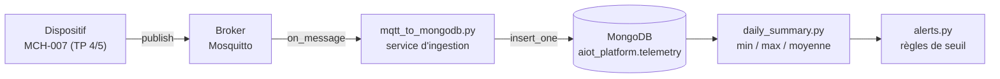

# TP 7 — Persister la télémétrie avec MongoDB et l'analyser

Énoncé complet : [[Fascicule de TP - 12 laboratoires.pdf]], pages 33 à 39 · durée 2 h · cours : [[Résumé - IoT#Module 5 — Construire un dispositif AIoT virtuel|module 5]] et [[Résumé - IoT#Module 6 — Cloud AWS pour l'IoT|cycle de vie de la donnée]] · avant : [[TP 6 - Sécuriser MQTT (TLS, mots de passe, ACL)]] · suite : [[TP 8 - API REST avec FastAPI]]

> [!abstract] En une phrase
> Un petit service écoute le broker et **range chaque message dans MongoDB** ; on calcule ensuite un résumé par jour et on déclenche des alertes.

## Pourquoi une base de données ?

MQTT transporte les messages mais **ne garde rien** : si personne n'écoute, la mesure est perdue, et impossible de revoir l'historique ou une tendance. MongoDB sert de **mémoire** au système. Il stocke des documents JSON, exactement le format de notre télémétrie, et accepte de nouveaux champs sans migration.



Le dispositif ne sait même pas que MongoDB existe : c'est le service d'ingestion, simple abonné MQTT, qui fait le lien. On peut arrêter, changer ou dupliquer la base sans toucher au dispositif.

## Étape 1 — Lancer MongoDB

Le plus simple et le plus portable, avec Docker :

```sh
docker run -d --name aiot-mongodb -p 27017:27017 -v mongo-data:/data/db mongo:latest
pip install pymongo
```

`-p 27017:27017` expose le port de MongoDB ; `-v mongo-data:/data/db` range les données dans un **volume** qui survit à l'arrêt du conteneur. Sans Docker : installer **MongoDB Community Server** depuis mongodb.com ; le service démarre lui aussi sur le port 27017.

## Étape 2 — Le document stocké

Base `aiot_platform`, collection `telemetry`, **un document par message** :

```text
{
  _id: ObjectId('6aee45d76c9fbf186b574d8e'),
  device_id: 'MCH-007',
  timestamp: ISODate('2026-11-06T21:19:20.000Z'),     <- une vraie date, pas du texte
  state: 'RUNNING',
  message: 'Normal operation',
  readings: { temperature: 72.21, vibration: 2.08, pressure: 6.25, energy: 1.43 },
  status: { warning: false, fault: false },
  ingested_at: ISODate('2026-11-06T21:19:20.456Z'),
  source: 'mqtt_ingestion_service',
  schema_version: '1.0'
}
```

`ingested_at` (moment de l'insertion) et `source` aident à diagnostiquer les retards ; `schema_version` permet de faire évoluer le format plus tard.

## Étape 3 — Tester la connexion

```python
# test_connexion.py
from pymongo import MongoClient

client = MongoClient("mongodb://localhost:27017/")
db = client["aiot_platform"]
collection = db["telemetry"]
collection.create_index("timestamp")          # accélère les recherches par date

print(client.list_database_names())
print("Connecté à MongoDB")
```

```text
['admin', 'aiot_platform', 'config', 'local']
Connecté à MongoDB
```

La base `aiot_platform` apparaît dès la création de l'index : MongoDB crée bases et collections au premier usage.

## Étape 4 — Le service d'ingestion MQTT vers MongoDB

```python
# mqtt_to_mongodb.py
import json
from datetime import datetime, timezone

import paho.mqtt.client as mqtt
from pymongo import MongoClient

collection = MongoClient("mongodb://localhost:27017/")["aiot_platform"]["telemetry"]
collection.create_index("timestamp")

TOPIC = "factory/production-line-2/machine/MCH-007/telemetry"


def to_document(data):
    """JSON reçu -> document MongoDB (schéma de l'étape 2)."""
    doc = dict(data)
    # Le timestamp arrive en TEXTE : on le convertit en vraie date (ISODate),
    # sinon les filtres par date ($gte, $lt...) ne trouveront rien.
    doc["timestamp"] = datetime.fromisoformat(data["timestamp"].replace("Z", "+00:00"))
    doc["status"] = {"warning": data.get("state") == "WARNING",
                     "fault": data.get("state") == "FAULT"}
    doc["ingested_at"] = datetime.now(timezone.utc)
    doc["source"] = "mqtt_ingestion_service"
    doc["schema_version"] = "1.0"
    return doc


def on_connect(client, userdata, flags, reason_code, properties):
    client.subscribe(TOPIC, qos=1)        # dans on_connect : réabonné après une reconnexion


def on_message(client, userdata, message):
    try:
        data = json.loads(message.payload.decode())
        result = collection.insert_one(to_document(data))
    except (json.JSONDecodeError, KeyError, ValueError) as exc:
        print("Message ignoré (format invalide) :", exc)
        return
    print(f"Télémétrie stockée, _id : {result.inserted_id} [{data.get('state')}]")


client_mqtt = mqtt.Client(mqtt.CallbackAPIVersion.VERSION2, client_id="mongodb-ingestion")
client_mqtt.on_connect = on_connect
client_mqtt.on_message = on_message
client_mqtt.connect("localhost", 1883, 60)

print("Service d'ingestion en écoute...")
try:
    client_mqtt.loop_forever()
except KeyboardInterrupt:
    print("\nService d'ingestion arrêté.")
```

`loop_forever()` bloque et traite les messages un par un : c'est tout ce que fait ce service.

> [!warning] Le piège du timestamp en texte
> Le fascicule insère directement le JSON reçu (`collection.insert_one(data)`). Le `timestamp` est alors stocké comme **chaîne de caractères**, et l'agrégation de l'étape 6 (`timestamp >= il y a 24 h`) compare du texte à une date : elle ne trouve **rien**. Test refait avec un document dont la date est d'aujourd'hui : le champ est stocké en `str`, et le `$match` sur les dernières 24 h renvoie **0 document**.
>
> D'où la conversion `datetime.fromisoformat(...)` dans `to_document`. (C'est aussi pour ça que le TP 3 envoie l'heure en UTC.)

## Étape 5 — Faire tourner la chaîne complète

```sh
python device_two_way.py      # terminal 1 : le dispositif du TP 5 (ou device_mqtt.py du TP 4)
python mqtt_to_mongodb.py     # terminal 2 : l'ingestion
```

Terminal 2 (pour voir passer des WARNING et des FAULT, on a publié quelques mesures des scénarios du TP 3) :

```text
Service d'ingestion en écoute...
Télémétrie stockée, _id : 6aee45d76c9fbf186b574d8e [RUNNING]
Télémétrie stockée, _id : 6aee45d76c9fbf186b574d8f [RUNNING]
Télémétrie stockée, _id : 6aee45d76c9fbf186b574d92 [WARNING]
Télémétrie stockée, _id : 6aee45d76c9fbf186b574d93 [WARNING]
Télémétrie stockée, _id : 6aee45d86c9fbf186b574d97 [FAULT]
Télémétrie stockée, _id : 6aee45d86c9fbf186b574d98 [FAULT]
Télémétrie stockée, _id : 6aee45d86c9fbf186b574d99 [RUNNING]
Message ignoré (format invalide) : Expecting value: line 1 column 1 (char 0)
```

La dernière ligne : un message qui n'était pas du JSON est ignoré, le service continue.

Vérifier dans la base, avec **MongoDB Compass** (connexion `mongodb://localhost:27017`, base `aiot_platform`, collection `telemetry`, onglet *Indexes*) ou en ligne de commande :

```sh
docker exec -it aiot-mongodb mongosh aiot_platform
```

```js
db.telemetry.countDocuments()
db.telemetry.find().sort({ timestamp: -1 }).limit(1)             // le dernier message
db.telemetry.getIndexes()                                         // _id_ et timestamp_1
db.telemetry.aggregate([{ $group: { _id: "$state", n: { $sum: 1 } } }])   // nombre par état
```

## Étape 6 — Le résumé quotidien

On veut, pour chaque machine, la température min, max et moyenne des dernières 24 heures. MongoDB calcule cela lui-même avec un **pipeline d'agrégation** : une suite d'étapes, comme en SQL.

| Étape MongoDB | Équivalent SQL | Rôle |
|---|---|---|
| `$match` | `WHERE timestamp >= …` | ne garder que les dernières 24 h |
| `$group` | `GROUP BY device_id` | un résultat par machine, avec `$min`, `$max`, `$avg`, `$sum` |

```python
# daily_summary.py
from datetime import datetime, timedelta, timezone

from pymongo import MongoClient

db = MongoClient("mongodb://localhost:27017/")["aiot_platform"]
now = datetime.now(timezone.utc)
since = now - timedelta(days=1)          # fenêtre : les dernières 24 h
today = now.strftime("%Y-%m-%d")

pipeline = [
    {"$match": {"timestamp": {"$gte": since}}},            # WHERE timestamp >= since
    {"$group": {                                            # GROUP BY device_id
        "_id": "$device_id",
        "min_temperature": {"$min": "$readings.temperature"},
        "max_temperature": {"$max": "$readings.temperature"},
        "avg_temperature": {"$avg": "$readings.temperature"},
        "count": {"$sum": 1},
    }},
]

for r in db["telemetry"].aggregate(pipeline):
    summary = {"device_id": r["_id"], "date": today,
               "min_temperature": r["min_temperature"],
               "max_temperature": r["max_temperature"],
               "avg_temperature": r["avg_temperature"],
               "count": r["count"]}
    # Un seul résumé par (machine, jour) : on remplace celui qui existe déjà
    db["daily_summary"].replace_one({"device_id": r["_id"], "date": today}, summary, upsert=True)
    print(f"{r['_id']} ({today}) : min={r['min_temperature']:.1f} "
          f"max={r['max_temperature']:.1f} avg={r['avg_temperature']:.1f} (n={r['count']})")
```

```text
$ python daily_summary.py
MCH-007 (2026-11-06) : min=71.9 max=91.2 avg=78.2 (n=13)
$ python daily_summary.py
MCH-007 (2026-11-06) : min=71.9 max=91.2 avg=78.2 (n=13)
```

> [!warning] Le piège du `_id` en double
> Le fascicule fait `daily_summary.insert_one(r)`, où `r["_id"]` vaut `"MCH-007"`. La première exécution passe ; **la deuxième du même jour plante**, car deux documents ne peuvent pas avoir le même `_id` :
> ```text
> pymongo.errors.DuplicateKeyError: E11000 duplicate key error ... dup key: { _id: "MCH-007" }
> ```
> `replace_one(filtre, document, upsert=True)` remplace le résumé s'il existe, et le crée sinon (*upsert* = update + insert). On peut relancer le script autant de fois qu'on veut.

## Étape 7 — Les alertes

```python
# alerts.py
from pymongo import MongoClient

ALERT_THRESHOLDS = {
    "Bottle Filling Machine": {"temperature": 88.0},
}


def check_alerts(daily_summary_collection):
    alerts = []
    for summary in daily_summary_collection.find():
        device_type = "Bottle Filling Machine"      # à lire depuis un registre de dispositifs
        threshold = ALERT_THRESHOLDS.get(device_type, {}).get("temperature")
        if threshold and summary["max_temperature"] > threshold:
            alerts.append(f"ALERTE {summary['device_id']} : {summary['max_temperature']:.1f} °C "
                          f"> {threshold} °C le {summary['date']}")
    return alerts


if __name__ == "__main__":
    db = MongoClient("mongodb://localhost:27017/")["aiot_platform"]
    alerts = check_alerts(db["daily_summary"])
    print("\n".join(alerts) if alerts else "Aucune alerte.")
```

```text
ALERTE MCH-007 : 91.2 °C > 88.0 °C le 2026-11-06
```

Pour un rapport chaque nuit, on planifie les deux scripts avec `cron` (`crontab -e`), en donnant le Python de l'environnement virtuel (cron ne l'active pas) :

```text
5 0 * * *  cd /home/<vous>/iot/tp07 && ../.venv/bin/python daily_summary.py && ../.venv/bin/python alerts.py
```

`5 0 * * *` = tous les jours à 0 h 05.

## À retenir

- MQTT transporte, **MongoDB mémorise**. Un service d'ingestion abonné fait le lien et découple le dispositif de la base.
- Stocker les dates en **vraies dates** (ISODate), pas en texte, sinon les requêtes par période échouent.
- Indexer `timestamp` : presque toutes les requêtes IoT filtrent ou trient par date.
- Le pipeline d'agrégation (`$match`, `$group`) calcule **dans la base**, comme `WHERE` / `GROUP BY` en SQL.
- `replace_one(..., upsert=True)` rend un script relançable sans doublons.

## Questions du fascicule

1. Pourquoi indexer le champ `timestamp` plutôt qu'un autre champ ?
2. Que se passerait-il si le service d'ingestion s'arrêtait pendant quelques minutes ?
3. Pourquoi utiliser un pipeline d'agrégation MongoDB plutôt qu'une boucle Python pour calculer les agrégats ?
4. Comment adapteriez-vous `alerts.py` pour envoyer un email plutôt qu'un simple `print()` ?

> [!question]- Réponses
> 1. Presque toutes les requêtes IoT portent sur le temps : les 24 dernières heures, la dernière mesure, l'historique trié. Sans index, MongoDB lit **tous** les documents (des millions au bout de quelques semaines) ; avec l'index, il va directement à la bonne période. Un index composé `(device_id, timestamp)` est encore mieux pour les requêtes par machine.
> 2. Les messages publiés pendant l'arrêt sont **perdus** : aucun abonné ne les reçoit, et le broker ne garde rien par défaut. Parades : une **session persistante** (identifiant fixe + `clean_session=False` : le broker met de côté les messages QoS 1 et 2 pour l'abonné absent), un tampon local sur le dispositif ou la passerelle edge, ou un service de flux qui conserve les données (Kinesis au TP 10, Kafka).
> 3. Le calcul se fait **dans le serveur de base de données**, près des données, en profitant des index : seul le résultat (un document par machine) traverse le réseau, au lieu de tous les documents. C'est plus rapide et ça tient la charge quand le volume grandit.
> 4. Avec `smtplib` de la bibliothèque standard, appelé seulement s'il y a des alertes, et lancé chaque nuit par `cron`. Les identifiants viennent de variables d'environnement, jamais du code :
>    ```python
>    import os
>    import smtplib
>    from email.message import EmailMessage
>
>    def send_alerts_by_email(alerts):
>        msg = EmailMessage()
>        msg["Subject"] = f"[AIoT] {len(alerts)} alerte(s)"
>        msg["From"] = "aiot@example.com"
>        msg["To"] = "maintenance@example.com"
>        msg.set_content("\n".join(alerts))
>        with smtplib.SMTP("smtp.example.com", 587) as smtp:
>            smtp.starttls()
>            smtp.login(os.environ["SMTP_USER"], os.environ["SMTP_PASSWORD"])
>            smtp.send_message(msg)
>    ```
