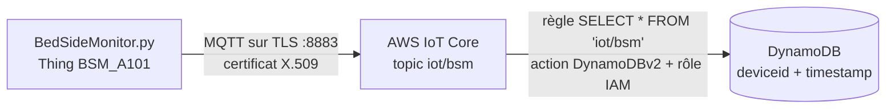

# TP 9 — AWS IoT Core + DynamoDB : du dispositif au cloud

Énoncé complet : [[Fascicule de TP - 12 laboratoires.pdf]], pages 47 à 50 · durée 2 h · cours : [[Résumé - IoT#Module 6 — Cloud AWS pour l'IoT|module 6]] · avant : [[TP 8 - API REST avec FastAPI]] · suite : [[TP 10 - Flux temps réel avec Kinesis]]

> [!abstract] En une phrase
> Un moniteur de chevet simulé (`BedSideMonitor`) publie ses mesures vers **AWS IoT Core**, qui joue le rôle du broker ; une **règle** les recopie automatiquement dans une table **DynamoDB**.

## Le principe

C'est la même chaîne qu'aux TP 4 et 7, mais chaque brique est un service AWS géré :

| Aux TP 4 à 7 (local) | Ici (AWS) |
|---|---|
| broker Mosquitto | **AWS IoT Core** (broker MQTT géré) |
| mot de passe + TLS (TP 6) | **certificat X.509** propre à chaque dispositif + **policy** |
| service d'ingestion Python (TP 7) | **règle** IoT Core : `SELECT * FROM 'iot/bsm'`, sans code |
| MongoDB | **DynamoDB** (base NoSQL serverless) |



> [!warning] Avant de commencer
> - Un compte AWS (le niveau gratuit suffit pour IoT Core et DynamoDB) et **une seule région** pour tout le TP (ex. `eu-north-1`, Stockholm) : une ressource créée dans une autre région est invisible.
> - À la fin : **tout supprimer** (voir l'étape 9), sinon des frais peuvent apparaître.

```sh
pip install AWSIoTPythonSDK awsiotsdk boto3
```

## Étape 1 — Type et groupe de dispositifs

Console AWS IoT Core :

1. *Manage → All devices → Thing types → Create thing type* : nom `BedSideMonitor`.
2. *Manage → All devices → Thing groups → Create thing group → static* : nom `Hospital` (on peut faire une hiérarchie `Hospital > Department_01`).

Le type décrit **quel genre** d'objet c'est ; le groupe permet d'agir sur **plusieurs objets à la fois** (droits, mises à jour).

## Étape 2 — La policy (les droits du dispositif)

*Manage → Security → Policies → Create policy* :

| Champ | Valeur (TP) |
|---|---|
| Policy effect | Allow |
| Policy action | `*` (toutes les actions IoT) |
| Policy resource | `*` |

> [!tip]- Pour aller plus loin : une policy au moindre privilège
> En production, un dispositif n'a droit qu'à son identifiant client et à son topic (`<compte>` = numéro du compte AWS) :
> ```json
> {
>   "Version": "2012-10-17",
>   "Statement": [
>     {"Effect": "Allow", "Action": "iot:Connect",
>      "Resource": "arn:aws:iot:eu-north-1:<compte>:client/client001"},
>     {"Effect": "Allow", "Action": "iot:Publish",
>      "Resource": "arn:aws:iot:eu-north-1:<compte>:topic/iot/bsm"}
>   ]
> }
> ```
> C'est l'équivalent de l'ACL du TP 6.

## Étape 3 — Le Thing et ses certificats

1. *Manage → All devices → Things → Create things → Create single thing* : nom **`BSM_A101`**, type `BedSideMonitor`, groupe `Hospital`.
2. Certificat : *Auto-generate a new certificate (recommended)*.
3. Attacher la **policy** de l'étape 2.
4. **Télécharger les 4 fichiers** et les mettre à côté du script :

| Fichier | Rôle |
|---|---|
| `xxxx-certificate.pem.crt` | le certificat du dispositif (son identité) |
| `xxxx-private.pem.key` | sa clé privée (secrète) |
| `xxxx-public.pem.key` | sa clé publique (non utilisée par le script) |
| `AmazonRootCA1.pem` | le certificat racine d'Amazon, pour vérifier le serveur |

> [!warning] Dernière chance pour la clé privée
> AWS ne permet de télécharger la clé privée **qu'à cet écran**. Si on le ferme sans elle, il faut créer un nouveau certificat.

## Étape 4 — Le simulateur BedSideMonitor

Le fascicule utilise un script fourni par l'enseignant. Si vous ne l'avez pas, cette version fait la même chose (mêmes options `-e -r -c -k -id -t`) et peut aussi, sans `-e`, publier sur le broker Mosquitto local pour tester d'abord :

```python
# BedSideMonitor.py
"""Moniteur de chevet simulé : SPO2, température et rythme cardiaque, chaque seconde.

AWS   : python BedSideMonitor.py -e <endpoint> -r AmazonRootCA1.pem -c <xxx>-certificate.pem.crt
                                 -k <xxx>-private.pem.key -id client001 -t iot/bsm
Local : python BedSideMonitor.py -id client001 -t iot/bsm     (sans -e : broker Mosquitto local)
"""
import argparse
import json
import random
import time
from datetime import datetime, timezone

DEVICE_ID = "BSM_A101"          # = le nom du Thing créé dans AWS IoT Core

parser = argparse.ArgumentParser()
parser.add_argument("-e", "--endpoint")
parser.add_argument("-r", "--rootCA")
parser.add_argument("-c", "--cert")
parser.add_argument("-k", "--key")
parser.add_argument("-id", "--clientId", default="client001")
parser.add_argument("-t", "--topic", default="iot/bsm")
args = parser.parse_args()

if args.endpoint:            # AWS IoT Core : MQTT sur TLS (port 8883), authentification X.509
    from AWSIoTPythonSDK.MQTTLib import AWSIoTMQTTClient
    client = AWSIoTMQTTClient(args.clientId)
    client.configureEndpoint(args.endpoint, 8883)
    client.configureCredentials(args.rootCA, args.key, args.cert)
    client.connect()
    publish = lambda payload: client.publish(args.topic, payload, 1)
else:                        # broker Mosquitto local
    import paho.mqtt.client as mqtt
    client = mqtt.Client(mqtt.CallbackAPIVersion.VERSION2, client_id=args.clientId)
    client.connect("localhost", 1883)
    client.loop_start()
    publish = lambda payload: client.publish(args.topic, payload, qos=1)


def vital(normal, abnormal, ndigits=1):
    low, high = abnormal if random.random() < 0.1 else normal   # 1 fois sur 10 : valeur anormale
    return round(random.uniform(low, high), ndigits)


try:
    while True:
        vitals = {"SPO2": vital((93, 99), (84, 89)),
                  "Temperature": vital((36.2, 37.6), (38.3, 39.5)),
                  "HeartRate": vital((65, 95), (110, 135), None)}      # None : nombre entier
        for datatype, value in vitals.items():
            message = json.dumps({
                "deviceid": DEVICE_ID,
                # à la microseconde : deux mesures n'ont jamais la même clé dans DynamoDB
                "timestamp": datetime.now(timezone.utc).strftime("%Y-%m-%d %H:%M:%S.%f"),
                "datatype": datatype,
                "value": value,
            })
            publish(message)
            print(f"Published topic {args.topic}: {message}")
        time.sleep(1)
except KeyboardInterrupt:
    print("\nMoniteur arrêté.")
```

Le `deviceid` du message doit être le **nom du Thing** (`BSM_A101`) : c'est ce qui relie les données au dispositif enregistré.

## Étape 5 — Se connecter à AWS

L'adresse du broker AWS de votre compte : console IoT Core → *Settings* → **Device data endpoint** (de la forme `a2qdlk1319yncw-ats.iot.eu-north-1.amazonaws.com`).

```sh
python BedSideMonitor.py -e a2qdlk1319yncw-ats.iot.eu-north-1.amazonaws.com \
  -r AmazonRootCA1.pem -c xxxx-certificate.pem.crt -k xxxx-private.pem.key \
  -id client001 -t iot/bsm
```

```text
Published topic iot/bsm: {"deviceid": "BSM_A101", "timestamp": "2026-11-06 21:30:32.971773", "datatype": "SPO2", "value": 96.3}
Published topic iot/bsm: {"deviceid": "BSM_A101", "timestamp": "2026-11-06 21:30:32.971939", "datatype": "Temperature", "value": 36.7}
Published topic iot/bsm: {"deviceid": "BSM_A101", "timestamp": "2026-11-06 21:30:32.972042", "datatype": "HeartRate", "value": 86}
```

Vérifier côté AWS : *Test → MQTT test client*, s'abonner à `iot/bsm` : les messages JSON arrivent en direct. C'est l'équivalent de `mosquitto_sub`.

Si la connexion échoue : mauvais endpoint ou mauvaise région, certificat non activé, ou policy non attachée au certificat.

## Étape 6 — La table DynamoDB

Console DynamoDB → *Create table* :

| Paramètre | Valeur |
|---|---|
| Table name | `bsm_telemetry` |
| Partition key | `deviceid` (String) |
| Sort key | `timestamp` (String) |

La **clé primaire** est le couple `deviceid` + `timestamp`. La clé de partition regroupe les mesures d'un même moniteur ; la clé de tri les range dans l'ordre du temps.

> [!warning] Deux mesures, même clé = une seule ligne
> Si deux messages ont le même `deviceid` et le même `timestamp`, le second **écrase** le premier. Avec un horodatage à la seconde, les trois mesures (SPO2, température, rythme) émises dans la même seconde ne laisseraient qu'une ligne. D'où l'horodatage à la **microseconde** dans le script.

## Étape 7 — Le rôle IAM et la règle

IoT Core est un service AWS : pour écrire dans DynamoDB **à votre place**, il lui faut une autorisation, donnée par un **rôle IAM**.

1. *Message routing → Rules → Create rule* : nom `bsm_to_dynamodb`.
2. Requête SQL de la règle :
   ```sql
   SELECT * FROM 'iot/bsm'
   ```
3. Action : **DynamoDBv2** (« Split message into multiple columns »), table `bsm_telemetry`.
4. Rôle : *Create new role* (`IoTCoreToDynamoDBRole`) : la console lui donne la permission `dynamodb:PutItem` sur cette table. (On peut aussi le créer avant dans IAM → *Roles* → cas d'usage *IoT*.)

Avec DynamoDBv2, **chaque champ du JSON devient une colonne** : le message doit donc contenir `deviceid` et `timestamp`, les deux clés de la table.

## Étape 8 — Valider le pipeline

Relancer le simulateur, puis DynamoDB → table `bsm_telemetry` → *Explore table items* :

```text
deviceid   timestamp                    datatype     value
BSM_A101   2026-11-06 21:30:32.971773   SPO2         96.3
BSM_A101   2026-11-06 21:30:32.971939   Temperature  36.7
BSM_A101   2026-11-06 21:30:32.972042   HeartRate    86
BSM_A101   2026-11-06 21:30:33.972330   SPO2         97.4
BSM_A101   2026-11-06 21:30:33.974072   Temperature  36.5
...
```

Une ligne par mesure, sans avoir écrit une seule ligne de code d'ingestion : la règle fait le travail du `mqtt_to_mongodb.py` du TP 7.

## Étape 9 — Tout nettoyer (obligatoire)

Supprimer : la **règle**, le **rôle IAM**, la **table DynamoDB**, le **Thing**, le **certificat** (le désactiver d'abord), la **policy**, le groupe et le type.

> [!example]- Variante testée sans compte AWS (émulateur local)
> Pour tester toute la chaîne sans compte, on remplace AWS par **moto** (un faux AWS local) et la règle IoT Core par un petit script abonné au broker Mosquitto.
> ```sh
> pip install "moto[server]" boto3 paho-mqtt
> moto_server -p 4566                                   # terminal à part : le faux AWS
> export AWS_ENDPOINT_URL=http://localhost:4566 AWS_DEFAULT_REGION=eu-north-1 \
>        AWS_ACCESS_KEY_ID=test AWS_SECRET_ACCESS_KEY=test   # boto3 parle alors à moto
> ```
> ```python
> # create_table.py  (équivalent de « DynamoDB > Create table »)
> import sys
>
> import boto3
>
> name = sys.argv[1]
> dynamodb = boto3.client("dynamodb")
> dynamodb.create_table(
>     TableName=name,
>     KeySchema=[{"AttributeName": "deviceid", "KeyType": "HASH"},       # partition key
>                {"AttributeName": "timestamp", "KeyType": "RANGE"}],    # sort key
>     AttributeDefinitions=[{"AttributeName": "deviceid", "AttributeType": "S"},
>                           {"AttributeName": "timestamp", "AttributeType": "S"}],
>     BillingMode="PAY_PER_REQUEST",
> )
> dynamodb.get_waiter("table_exists").wait(TableName=name)
> print(f"Table {name} prête : deviceid (partition) + timestamp (tri)")
> ```
> ```python
> # iot_rule_emulator.py  (remplace la règle IoT Core quand on n'a pas de compte AWS)
> import json
> import sys
> from decimal import Decimal
>
> import boto3
> import paho.mqtt.client as mqtt
>
> ACTION = sys.argv[1]                  # "dynamodb" (TP9) ou "kinesis" (TP10)
> table = boto3.resource("dynamodb").Table("bsm_telemetry")
> kinesis = boto3.client("kinesis")
>
>
> def on_message(client, userdata, message):          # SELECT * FROM 'iot/bsm'
>     record = json.loads(message.payload, parse_float=Decimal)   # DynamoDB refuse les float
>     if ACTION == "dynamodb":
>         table.put_item(Item=record)
>     else:
>         kinesis.put_record(StreamName="bsm-telemetry-stream", Data=message.payload,
>                            PartitionKey=record["deviceid"])
>     print(f"[règle] {message.topic} -> {ACTION}")
>
>
> client = mqtt.Client(mqtt.CallbackAPIVersion.VERSION2, client_id=f"rule-{ACTION}")
> client.on_message = on_message
> client.on_connect = lambda c, userdata, flags, rc, props: c.subscribe("iot/bsm", qos=1)
> client.connect("localhost", 1883)
> client.loop_forever()
> ```
> ```python
> # scan_table.py  (équivalent de « Explore table items »)
> import sys
>
> import boto3
>
> items = boto3.resource("dynamodb").Table(sys.argv[1]).scan()["Items"]
> for item in sorted(items, key=lambda i: i["timestamp"])[:9]:
>     print(item["deviceid"], item["timestamp"], f"{item['datatype']:<12}", item["value"],
>           item.get("anomaly", ""))
> print(f"... {len(items)} élément(s) dans {sys.argv[1]}")
> ```
> ```sh
> python create_table.py bsm_telemetry
> python iot_rule_emulator.py dynamodb          # terminal à part
> python BedSideMonitor.py -id client001 -t iot/bsm
> python scan_table.py bsm_telemetry
> ```
> ```text
> Table bsm_telemetry prête : deviceid (partition) + timestamp (tri)
> BSM_A101 2026-11-06 21:30:32.971773 SPO2         96.3
> BSM_A101 2026-11-06 21:30:32.971939 Temperature  36.7
> BSM_A101 2026-11-06 21:30:32.972042 HeartRate    86
> ... 12 élément(s) dans bsm_telemetry
> ```

## Défi : Smart Healthcare

> [!tip]- Pistes
> - Ajouter une option `-d/--deviceid` au script et lancer **trois** moniteurs (`BSM_G101`, `BSM_G102`, `BSM_G103`).
> - Agréger les mesures **par minute** dans une seconde table, avec une clé composée `deviceid_datatype` (ex. `BSM_G101_SPO2`) + `timestamp` (la minute) : moyenne, min, max.
> - Des règles d'alerte par type de mesure (SPO2 hors de 90–100, rythme hors de 75–85) avec un compteur `trigger_count` : n'alerter qu'après plusieurs dépassements de suite, pour éviter les fausses alertes dues au bruit.
> - Une table d'alertes horodatées, consultable sans relire les données brutes. La détection en temps réel se fait plus naturellement en flux : c'est le [[TP 10 - Flux temps réel avec Kinesis|TP 10]].

## À retenir

- AWS IoT Core = broker MQTT géré ; chaque dispositif est un **Thing** avec son **certificat X.509** et sa **policy**.
- La connexion se fait en MQTT sur TLS (port 8883) avec 3 fichiers : certificat, clé privée, CA racine Amazon.
- Une **règle** (`SELECT … FROM 'topic'`) route les messages vers un service AWS, sans code ; elle agit via un **rôle IAM**.
- DynamoDB : clé de partition (`deviceid`) + clé de tri (`timestamp`) ; même clé = écrasement.
- Toujours nettoyer les ressources à la fin.

## Questions du fascicule

1. À quoi sert le Device Shadow d'un Thing AWS IoT Core ?
2. Pourquoi utilise-t-on `deviceid` + `timestamp` comme clé primaire dans DynamoDB ?
3. Quel est le rôle exact du rôle IAM dans la règle de routage ?

> [!question]- Réponses
> 1. C'est un **document JSON gardé dans le cloud** qui représente l'état du dispositif : `reported` (le dernier état envoyé par le dispositif) et `desired` (l'état voulu par les applications). Les applications le lisent et l'écrivent **même quand le dispositif est hors ligne** ; à sa reconnexion, le dispositif reçoit la différence (`delta`) et s'aligne.
> 2. La clé de partition `deviceid` regroupe les mesures de chaque moniteur (et répartit les moniteurs sur les serveurs de DynamoDB) ; la clé de tri `timestamp` les **ordonne dans le temps** dans chaque groupe. Ça rend efficace la requête la plus courante : « les mesures de BSM_A101 entre t1 et t2 ». Le couple doit être unique.
> 3. La règle est exécutée par le **service** IoT Core, pas par vous. Le rôle IAM est une identité que IoT Core a le droit d'endosser (relation de confiance avec `iot.amazonaws.com`) et qui porte la permission `dynamodb:PutItem` sur **cette** table seulement : moindre privilège. Sans lui, l'action échoue faute d'autorisation.
