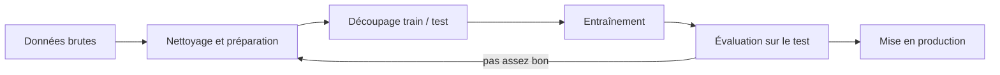

# Apprentissage supervisé

Le **machine learning** consiste à apprendre un modèle à partir d'exemples, au lieu d'écrire les règles à la main.

## Les trois familles

| Famille | Données | But | Exemples |
|---|---|---|---|
| Supervisé | exemples **étiquetés** $(x, y)$ | prédire $y$ pour un nouveau $x$ | prix d'une maison, spam ou non |
| Non supervisé | $x$ sans étiquette | trouver une structure | groupes de clients (k-means) |
| Par renforcement | un agent et des récompenses | maximiser la récompense | jeux, robotique |

En supervisé :

- **Régression** : $y$ est un nombre (prix, température).
- **Classification** : $y$ est une classe (spam / non spam, chiffre de 0 à 9).

## La démarche



> [!warning] Le jeu de test est sacré
> On ne l'utilise **qu'une fois**, à la fin. Toute décision prise en le regardant (choix du modèle, des réglages) fausse l'évaluation. Pour régler les hyperparamètres, on utilise la **validation croisée** sur le jeu d'entraînement.

## Régression linéaire

On cherche un hyperplan $\hat y = w_0 + w_1 x_1 + \dots + w_p x_p$ qui minimise l'**erreur quadratique moyenne** :

$$\text{MSE} = \frac{1}{n} \sum_{i=1}^{n} (y_i - \hat y_i)^2$$

Les poids $w$ se calculent par la méthode des moindres carrés ou par **descente de gradient** : on avance pas à pas dans la direction qui fait baisser l'erreur, $w \leftarrow w - \eta \, \nabla \text{MSE}(w)$, où $\eta$ est le taux d'apprentissage.

## Classification

### k plus proches voisins (k-NN)

Pour classer un point, on regarde les $k$ points d'entraînement les plus proches et on prend la classe majoritaire. Aucun entraînement, mais des prédictions lentes sur de gros volumes. **Il faut normaliser** les variables, sinon celle qui a la plus grande échelle domine la distance.

### Régression logistique

Malgré son nom, c'est un classifieur : elle prédit une **probabilité** avec la fonction sigmoïde $\sigma(z) = \frac{1}{1 + e^{-z}}$, puis on coupe à 0,5.

### Arbres de décision et forêts aléatoires

Un **arbre** pose une suite de questions (« rayon > 15 ? »). Il est facile à lire mais sur-apprend vite. Une **forêt aléatoire** combine des centaines d'arbres entraînés sur des sous-échantillons différents et les fait voter : c'est beaucoup plus robuste.

## Sous-apprentissage et sur-apprentissage

| | Erreur train | Erreur test | Remède |
|---|---|---|---|
| Sous-apprentissage (*underfitting*) | élevée | élevée | modèle plus riche, meilleures variables |
| Bon modèle | faible | faible | — |
| Sur-apprentissage (*overfitting*) | très faible | élevée | plus de données, régularisation, modèle plus simple |

## Évaluer un classifieur

Matrice de confusion, avec « spam » comme classe positive :

| | Prédit positif | Prédit négatif |
|---|---|---|
| **Réellement positif** | VP (vrai positif) | FN (faux négatif) |
| **Réellement négatif** | FP (faux positif) | VN (vrai négatif) |

- **Exactitude** (*accuracy*) $= \frac{VP + VN}{\text{total}}$ — trompeuse quand les classes sont déséquilibrées.
- **Précision** $= \frac{VP}{VP + FP}$ — parmi ce que j'annonce positif, combien le sont vraiment ?
- **Rappel** $= \frac{VP}{VP + FN}$ — parmi les vrais positifs, combien en ai-je trouvé ?
- **F1** $= 2 \cdot \frac{\text{précision} \cdot \text{rappel}}{\text{précision} + \text{rappel}}$

> [!exemple] Détection de fraude
> 1 % des transactions sont frauduleuses. Un modèle qui répond toujours « pas de fraude » a 99 % d'exactitude… et un rappel de 0. On regarde donc le **rappel** et le **F1**.

## Avec scikit-learn

```python
from sklearn.datasets import load_breast_cancer
from sklearn.model_selection import train_test_split
from sklearn.pipeline import make_pipeline
from sklearn.preprocessing import StandardScaler
from sklearn.neighbors import KNeighborsClassifier
from sklearn.metrics import classification_report

X, y = load_breast_cancer(return_X_y=True)
X_train, X_test, y_train, y_test = train_test_split(X, y, test_size=0.2, stratify=y, random_state=42)

model = make_pipeline(StandardScaler(), KNeighborsClassifier(n_neighbors=5))
model.fit(X_train, y_train)
print(classification_report(y_test, model.predict(X_test)))
```

Le même travail se fait en R dans [[Analyse de données avec R]], et à très grande échelle avec Spark MLlib — voir [[Chapitre 1 - Hadoop, MapReduce et Spark]].

> [!abstract] À retenir
> Données → train / test → entraîner sur le train → évaluer **une seule fois** sur le test. Surveiller le sur-apprentissage. Choisir la métrique selon le problème. Fiche : [[Résumé - Machine Learning]].
