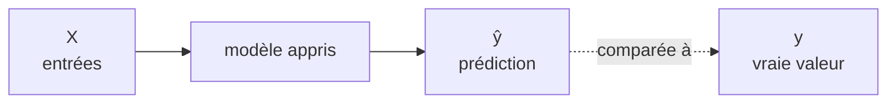
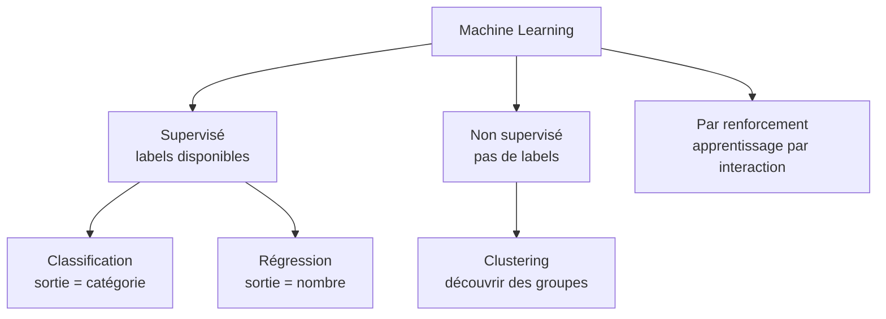
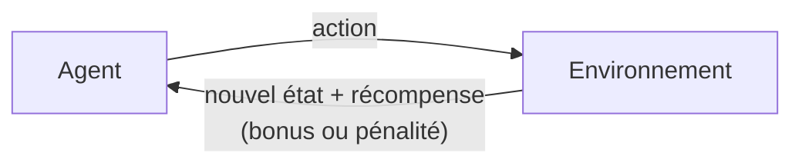
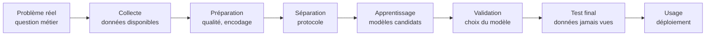

# Résumé — Chapitre 1 : Introduction au Machine Learning et démarche expérimentale

Support : [[Chapitre 1 - Introduction au Machine Learning et démarche expérimentale.pdf]] (30 diapositives) · Dr. Ing. Ones Sidhom · suite : [[Résumé - Chapitre 2 - k-NN]]

Le fil rouge du chapitre : **problème réel → données → apprentissage → généralisation**. On apprend sur des exemples, mais ce qui compte, c'est de bien prédire sur des exemples **qu'on n'a jamais vus**.

## 1. Qu'est-ce que le Machine Learning ?

*Diapositives 2 et 3*

> [!definition] Machine Learning
> Une approche de l'IA qui permet à un système d'**apprendre automatiquement à partir de données** afin de produire des **prédictions** ou des décisions sur de **nouveaux exemples**. En une phrase : un système apprend à améliorer son comportement à partir d'exemples.



| Symbole | Sens |
|---|---|
| $X$ | les données d'entrée utilisées par le modèle |
| $y$ | la **vérité terrain** : la cible réelle |
| $\hat{y}$ (« y chapeau ») | la sortie **produite par le modèle** |
| modèle | une fonction **apprise à partir des exemples** |

Tout l'apprentissage vise une chose : **que $\hat{y}$ soit proche de $y$**.

## 2. Anatomie d'un dataset

*Diapositives 4 à 6*

| Patient | Âge | Taille tumeur | Texture | Classe |
|---|---|---|---|---|
| P1 | 45 | 1,8 | 0,42 | Bénigne |
| P2 | 63 | 4,7 | 0,81 | Maligne |
| P3 | 38 | 1,2 | 0,35 | Bénigne |
| P4 | 57 | 3,9 | 0,70 | Maligne |

| Élément | Dans le tableau | Exemple |
|---|---|---|
| **Instance** | une ligne | le patient P2 |
| **Features** (caractéristiques) | les colonnes d'entrée | âge, taille de la tumeur, texture |
| **Label** (étiquette) | la dernière colonne, celle à prédire | Maligne |

Le modèle **reçoit les features et apprend à prédire le label**. On range donc les données en deux morceaux :

- la **matrice $X$** : une ligne par instance, une colonne par feature (ici 4 lignes × 3 colonnes) ;
- le **vecteur $y$** : un label par instance (ici 4 valeurs).

> [!remarque] L'identifiant n'est pas une feature
> La colonne « Patient » (P1, P2…) disparaît dans $X$ (diapositive 6) : un numéro de dossier ne dit rien sur la tumeur. Le laisser, c'est risquer que le modèle apprenne des numéros au lieu de la médecine.

## 3. Les trois grandes familles

*Diapositive 7*



> [!remarque] « Pas de données » pour le renforcement
> La diapositive résume le renforcement par « pas de données ». Plus précisément : il n'y a **pas de jeu de données fourni à l'avance**. L'agent fabrique ses propres expériences en agissant (état, action, récompense), voir la section 6.

## 4. L'apprentissage supervisé

*Diapositives 8 à 17*

Le modèle est entraîné sur des données **étiquetées** : chaque exemple vient avec sa sortie connue. On dispose de **couples** $(X, y)$ :

| $X$ (entrée) | $y$ (sortie connue) |
|---|---|
| un email | spam ou non |
| une image médicale | maligne ou bénigne |
| la surface d'une maison | son prix |
| une transaction | fraude ou non |

Le modèle apprend le **lien entre les entrées et la sortie**. Le label sert de **référence pour calculer l'erreur** pendant l'apprentissage.

### Classification

La sortie appartient à un **ensemble fini de catégories**.

| Binaire (2 classes) | Multiclasse (plus de 2) |
|---|---|
| spam / non spam · maligne / bénigne | chiffre 0, 1, 2… 9 · type de document |

### Classification binaire : la règle de seuil

- Par convention, l'étiquette **0** = **classe négative**, l'étiquette **1** = **classe positive**.
- Le modèle donne un **score** (une confiance ou une probabilité entre 0 et 1), puis on applique une **règle de seuil** :

$$\text{score} \geq \text{seuil} \;\Rightarrow\; \text{classe positive} \qquad \text{score} < \text{seuil} \;\Rightarrow\; \text{classe négative}$$

| Email | Score | Seuil | Décision |
|---|---|---|---|
| email 1 | 0,23 | 0,5 | négative : **non spam** |
| email 2 | 0,78 | 0,5 | positive : **spam** |

> [!tip] Le seuil n'est pas forcément 0,5
> 0,5 est le choix par défaut. Baisser le seuil fait déclarer « positif » plus souvent : on rate moins de vrais positifs (moins de tumeurs malignes manquées) mais on déclenche plus de fausses alertes. Le bon seuil dépend du coût de chaque erreur.

### La frontière de décision

*Diapositive 12*

Chaque instance est un **point** dont la position vient de ses features (avec 2 features : un point dans un plan). La **frontière de décision** découpe cet espace en **zones** : le côté de la frontière où tombe un point donne la classe prédite.

### Du binaire au multiclasse

*Diapositives 13 à 15*

Un algorithme conçu pour 2 classes peut traiter $N$ classes de deux façons :

| | **Un contre tous** (One-vs-All, One-vs-Rest) | **Un contre un** (One-vs-One) |
|---|---|---|
| Principe | un modèle par classe : « ma classe » contre « toutes les autres » | un modèle pour **chaque paire** de classes |
| Nombre de modèles | $N$ | $\frac{N(N-1)}{2}$ |
| Décision finale | la classe dont le **score est le plus élevé** (max) | la classe qui a **le plus de votes** |
| Avec 3 classes | 3 modèles : A contre reste, B contre reste, C contre reste | 3 modèles : A–B, A–C, B–C |
| Avec 4 classes | 4 modèles | 6 modèles |
| Avec 10 classes (chiffres) | 10 modèles | 45 modèles |

> [!exemple] Le vote un contre un de la diapositive 15
> 4 classes A, B, C, D → 6 duels : A–B, A–C, A–D, B–C, B–D, C–D. Chaque duel donne un vote au gagnant. Résultat : A = 1, B = 0, **C = 3**, D = 2 (6 votes au total, un par duel). **C** gagne : il a remporté ses trois duels.

### La régression

*Diapositives 16 et 17*

La sortie recherchée est une **valeur numérique continue** : le prix d'une maison (350 000 DT), une température (28,4 °C), la durée d'hospitalisation d'un patient. Sur la diapositive 16, le modèle est une droite qui suit le nuage « surface → prix ».

| Question | Classification | Régression |
|---|---|---|
| Sortie | une catégorie | une valeur numérique |
| Exemple médical | maligne / bénigne | durée d'hospitalisation |
| Exemple immobilier | zone de prix | prix exact estimé |
| Erreur typique | classe incorrecte | écart numérique |

## 5. L'apprentissage non supervisé

*Diapositives 18 à 20*

Les données **n'ont pas de labels** : le modèle doit **découvrir** seul des structures ou des patterns.


Exemple : 10 000 clients sans catégories ; on cherche des **profils naturellement similaires**. Le modèle ne prédit pas une cible connue : il révèle **une organisation plausible** des données.

> [!important] Clustering ≠ classification
> Le **clustering** *découvre* des groupes. La **classification** utilise des classes *déjà connues*.

| Supervisé | Non supervisé |
|---|---|
| labels disponibles | pas de labels |
| **prédire** une cible | **découvrir** une structure |
| classification ou régression | clustering principalement |

> [!question]- Les deux questions de la diapositive 20
> - « On a 10 000 patients, on veut **découvrir des profils** » : **non supervisé** (clustering). Personne n'a défini les profils à l'avance.
> - « On a 10 000 patients, on veut les **grouper selon leur maladie** » : **supervisé** (classification), à condition que la maladie de chaque patient soit connue : c'est le label. Le mot « grouper » est un piège : ce qui compte, c'est la présence ou non des labels.

## 6. L'apprentissage par renforcement

*Diapositive 21*

Un **agent** apprend **par interaction** à choisir les actions les plus avantageuses.



1. L'agent **prend une action**.
2. L'environnement **réagit** et change d'état.
3. L'agent reçoit une **récompense** : bonus (+) ou pénalité (−).

Objectif : **maximiser la récompense** totale, donc apprendre une **stratégie utile à long terme**, pas seulement la meilleure action immédiate. Exemple : un robot dans une grille gagne +1 en atteignant le but et −1 en heurtant l'obstacle ; il finit par apprendre le chemin qui contourne l'obstacle.

## 7. La démarche expérimentale

*Diapositives 22 à 25*



> [!warning] La règle d'or du chapitre
> Le modèle ne doit **jamais** être jugé uniquement sur les données utilisées pour apprendre.

### Train / validation / test

Exemple de découpage (diapositive 23) : **70 % train · 15 % validation · 15 % test**. Ces proportions ne sont **pas une règle universelle** : elles dépendent de la taille du dataset et du protocole.

| Ensemble | Rôle | Métaphore |
|---|---|---|
| **Training set** | le modèle voit ces données et **apprend ses paramètres** | étudier le cours |
| **Validation set** | on **compare les configurations** et on **choisit les hyperparamètres** | les examens blancs |
| **Test set** | utilisé **une seule fois, à la fin** : il **estime la performance future** | l'examen final |

> [!remarque] Paramètres et hyperparamètres
> Les **paramètres** sont appris par le modèle sur le train (par exemple la pente et l'ordonnée d'une droite de régression). Les **hyperparamètres** sont choisis par nous avant l'apprentissage (le $k$ du k-NN, le $C$ du SVM) : c'est le rôle de la validation. Si on choisissait les hyperparamètres sur le test, le test deviendrait un examen blanc de plus, et on n'aurait plus d'estimation honnête.

### Pourquoi ne pas tester sur les données d'entraînement ?

*Diapositive 25*

Un élève qui a **mémorisé** les copies d'examen connues obtient **99,8 %** sur ces copies, mais **71 %** sur de nouvelles questions : sa compréhension est faible. Un modèle peut faire exactement pareil. Un bon protocole l'empêche de **confondre apprentissage et mémorisation**.

## 8. La généralisation

*Diapositives 26 à 30*

> [!definition] Généralisation
> Un modèle **généralise** lorsqu'il fonctionne sur des données **jamais vues** pendant l'entraînement. C'est l'objectif réel : de bonnes performances sur de **nouvelles observations du même problème**.

| | **Underfitting** (sous-apprentissage) | **Bon compromis** | **Overfitting** (sur-apprentissage) |
|---|---|---|---|
| Le modèle… | est **trop simple** pour capturer la structure des données | capture la structure | apprend **trop précisément** le train, **bruit compris** |
| Erreur train | **élevée** | faible | **très faible** |
| Erreur validation / test | **élevée** | faible | **élevée** |
| Causes | modèle trop contraint · features insuffisantes · apprentissage trop court | | modèle trop complexe pour la quantité de données |
| Analogie | ne pas avoir assez étudié | avoir compris | avoir appris par cœur un ancien examen : bon score seulement si les mêmes questions reviennent |

> [!warning] Plus de données ne règle pas tout
> Ajouter des données ne corrige pas toujours un modèle sous-adapté : s'il est **incapable d'exprimer** la structure (une droite face à une courbe en U), il restera mauvais. Il faut un modèle plus riche ou de meilleures features.

L'illustration ci-dessous reprend les diapositives 27 à 29 avec de vraies données : 12 points d'entraînement tirés d'une courbe en U avec du bruit, et 300 points de validation jamais vus.

![[ml-ch1-sous-sur-apprentissage.png]]

- **Degré 1** (une droite) : trop simple, les deux erreurs sont élevées (1,84 et 1,90).
- **Degré 2** : la vraie forme ; erreurs faibles et proches (0,20 et 0,30).
- **Degré 9** : la courbe passe presque par les 12 points (erreur train 0,09) mais oscille entre eux et s'envole au bord : l'erreur de validation remonte à 1,62.

La courbe du bas résume la diapositive 29 : quand la complexité augmente, **l'erreur train baisse toujours**, l'**erreur de validation** baisse puis **remonte**. Le bon modèle est au **minimum de la validation**, pas au minimum du train.

### Performance train contre performance test

*Diapositive 30, valeurs lues sur le graphique (approximatives)*

| Modèle | Train | Test | Diagnostic |
|---|---|---|---|
| A | ≈ 68 % | ≈ 66 % | underfitting : les deux sont faibles |
| B | ≈ 80 % | ≈ 78 % | progresse |
| C | ≈ 93 % | ≈ **83 %** | **meilleur test : c'est lui qu'on garde** |
| D | ≈ **100 %** | ≈ 71 % | overfitting : parfait sur le train, mauvais sur le nouveau |

**Train** = performance sur les données vues. **Test** = approximation de la performance future. On choisit sur la seconde.

## 9. En pratique avec scikit-learn

*Complément, hors diapositives : la démarche du chapitre en Python, exécutée (Python 3.14, scikit-learn 1.9).*

### Découper en train / validation / test

`train_test_split` ne fait qu'un découpage en deux ; pour obtenir 70 / 15 / 15, on l'appelle deux fois. Le jeu de données est le **Breast Cancer Wisconsin**, fourni avec scikit-learn : 569 tumeurs décrites par 30 features, exactement le cas de la diapositive 4.

```python
# ch1_decoupage.py
from sklearn.datasets import load_breast_cancer
from sklearn.model_selection import train_test_split

X, y = load_breast_cancer(return_X_y=True)     # 569 tumeurs, 30 features
print("X :", X.shape, "| y :", y.shape)

# 1er découpage : 70 % train, 30 % mis de côté
X_train, X_reste, y_train, y_reste = train_test_split(
    X, y, test_size=0.30, stratify=y, random_state=42)
# 2e découpage : les 30 % mis de côté, moitié validation, moitié test
X_val, X_test, y_val, y_test = train_test_split(
    X_reste, y_reste, test_size=0.50, stratify=y_reste, random_state=42)

print("train :", len(X_train), "| validation :", len(X_val), "| test :", len(X_test))
print("part de bénignes :", round(y.mean(), 2), round(y_train.mean(), 2),
      round(y_val.mean(), 2), round(y_test.mean(), 2))
```

```text
X : (569, 30) | y : (569,)
train : 398 | validation : 85 | test : 86
part de bénignes : 0.63 0.63 0.62 0.63
```

- `stratify=y` garde la même proportion de chaque classe dans les trois morceaux (63 % de bénignes partout).
- `random_state=42` rend le découpage reproductible.
- Attention : dans ce jeu de données, **0 = maligne** et **1 = bénigne**, l'inverse de l'habitude « 1 = classe positive = maladie ».

### Sous- et sur-apprentissage en chiffres

Le code qui a produit les quatre premiers chiffres de la figure :

```python
# ch1_complexite.py
import numpy as np
from sklearn.linear_model import LinearRegression
from sklearn.metrics import mean_squared_error
from sklearn.pipeline import make_pipeline
from sklearn.preprocessing import PolynomialFeatures, StandardScaler

rng = np.random.default_rng(0)
vraie_courbe = lambda x: 0.15 * (x - 5) ** 2 + 1.2        # une forme en U, comme les diapositives

# 12 points pour apprendre, 300 points jamais vus pour valider
x_train = rng.uniform(0, 10, 12)
y_train = vraie_courbe(x_train) + rng.normal(0, 0.5, 12)   # + bruit de mesure
x_val = rng.uniform(0, 10, 300)
y_val = vraie_courbe(x_val) + rng.normal(0, 0.5, 300)

for degre in [1, 2, 5, 9]:                                 # complexité croissante
    modele = make_pipeline(StandardScaler(), PolynomialFeatures(degre), LinearRegression())
    modele.fit(x_train.reshape(-1, 1), y_train)
    err_train = mean_squared_error(y_train, modele.predict(x_train.reshape(-1, 1)))
    err_val = mean_squared_error(y_val, modele.predict(x_val.reshape(-1, 1)))
    print(f"degré {degre} : erreur train {err_train:5.2f} | erreur validation {err_val:5.2f}")
```

```text
degré 1 : erreur train  1.84 | erreur validation  1.90
degré 2 : erreur train  0.20 | erreur validation  0.30
degré 5 : erreur train  0.17 | erreur validation  0.40
degré 9 : erreur train  0.09 | erreur validation  1.62
```

L'erreur est la **MSE** (erreur quadratique moyenne) : la moyenne de $(y - \hat{y})^2$. Les chiffres changent avec le tirage des points, mais l'allure est toujours la même ; sur d'autres tirages, l'erreur de validation du degré 9 dépasse même 100.

## À retenir

- Le ML apprend une fonction $X \to \hat{y}$ à partir d'exemples ; on veut $\hat{y}$ proche de $y$.
- Une ligne = une **instance**, une colonne = une **feature**, la cible = le **label**. Données rangées en matrice $X$ et vecteur $y$.
- **Supervisé** (labels : classification ou régression), **non supervisé** (pas de labels : clustering), **renforcement** (un agent apprend par récompenses).
- Classification binaire = score + **seuil**. Multiclasse : **un contre tous** ($N$ modèles, score max) ou **un contre un** ($N(N-1)/2$ modèles, vote).
- Protocole : **train** pour apprendre, **validation** pour choisir, **test** une seule fois à la fin.
- **Underfitting** : train et test mauvais. **Overfitting** : train excellent, test mauvais. On choisit la complexité au **minimum de l'erreur de validation**.

## Questions de révision

1. Définir $X$, $y$ et $\hat{y}$. Que cherche-t-on à obtenir pendant l'apprentissage ?
2. Dans le tableau des patients, quelles colonnes forment $X$, laquelle forme $y$, et pourquoi la colonne « Patient » n'est-elle pas une feature ?
3. Donner la règle de seuil d'un classifieur binaire. Avec un seuil de 0,5, un score de 0,61 donne quelle classe ?
4. Combien de modèles faut-il pour 5 classes en un contre tous ? En un contre un ? Comment décide-t-on dans chaque cas ?
5. Prédire la durée d'hospitalisation : classification ou régression ? Et prédire si elle dépassera une semaine ?
6. Quelle est la différence entre clustering et classification ?
7. Décrire la boucle de l'apprentissage par renforcement.
8. À quoi sert chacun des trois ensembles train, validation, test ? Pourquoi ne doit-on pas choisir les hyperparamètres sur le test ?
9. Un modèle obtient 99 % sur le train et 70 % sur le test. Diagnostic ? Et 65 % sur le train, 64 % sur le test ?
10. Sur la courbe erreur / complexité, où se trouve le meilleur modèle, et pourquoi pas tout à droite ?

> [!question]- Réponses
> 1. $X$ : les features (entrées) ; $y$ : la vraie valeur (vérité terrain) ; $\hat{y}$ : la valeur prédite par le modèle. On cherche à ce que $\hat{y}$ soit **le plus proche possible de $y$**, et surtout sur des données nouvelles.
> 2. $X$ = âge, taille de la tumeur, texture ; $y$ = classe. « Patient » est un identifiant : il distingue les lignes mais n'apporte aucune information sur la tumeur, et le modèle pourrait apprendre des numéros au lieu de règles utiles.
> 3. score ≥ seuil → classe positive (1), sinon négative (0). 0,61 ≥ 0,5 → **classe positive**.
> 4. Un contre tous : **5** modèles, on garde la classe au **score maximal**. Un contre un : $5 \times 4 / 2 =$ **10** modèles, on garde la classe qui a **le plus de votes**.
> 5. La durée (un nombre de jours) : **régression**. « Plus d'une semaine : oui / non » : **classification binaire**. La même donnée peut donner les deux types de problèmes selon la question posée.
> 6. Le clustering **découvre** des groupes dans des données **sans labels** (non supervisé) ; la classification **apprend** à reconnaître des classes **connues à l'avance** grâce aux labels (supervisé).
> 7. L'agent agit → l'environnement change d'état et renvoie une récompense (bonus ou pénalité) → l'agent ajuste sa stratégie pour maximiser la récompense totale à long terme.
> 8. Train : apprendre les paramètres. Validation : comparer les configurations et choisir les hyperparamètres. Test : estimer une seule fois la performance future. Si on choisit sur le test, on l'utilise pour décider : il n'est plus « jamais vu », et le score annoncé devient optimiste.
> 9. 99 % / 70 % : **overfitting** (mémorisation, écart énorme). 65 % / 64 % : **underfitting** (les deux sont faibles et proches : le modèle est trop simple ou les features insuffisantes).
> 10. Au **minimum de l'erreur de validation**, dans la zone de complexité moyenne. Tout à droite, l'erreur train est minimale mais l'erreur de validation remonte : le modèle a appris le bruit et généralise mal.
