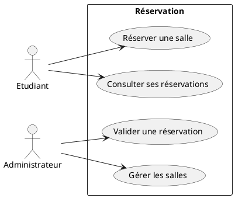
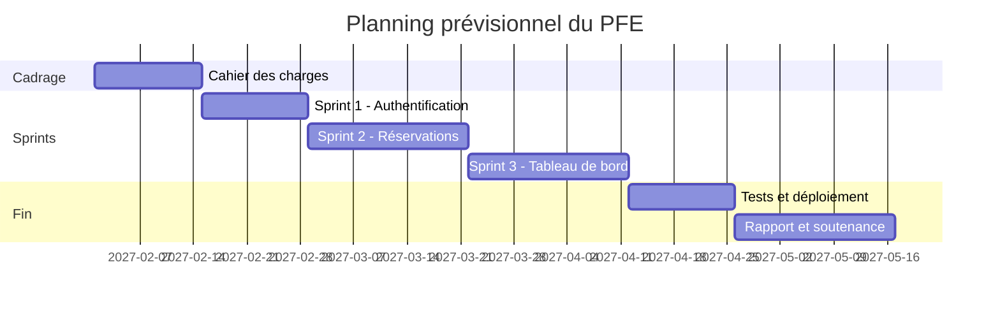

# TP 1 — Rédiger le cahier des charges

**Objectif** : produire, pour ton sujet de PFE (ou un sujet fictif), un cahier des charges, un premier backlog et un planning de sprints, prêts à être validés par ton encadrant. Notions du [[Chapitre 1 - Méthodologie du PFE]].

> [!tip] Pas encore de sujet ?
> Prendre par exemple : « une plateforme de réservation des salles et du matériel de l'université, avec une application mobile et un tableau de bord ».

## Étape 1 — Contexte et existant

- [ ] Décrire le contexte et la **problématique** en un paragraphe
- [ ] Décrire comment le besoin est traité aujourd'hui (papier, Excel, ancienne application…)
- [ ] Comparer 2 ou 3 solutions existantes dans un tableau : fonctionnalités, prix, limites

## Étape 2 — Besoins

- [ ] Lister les **acteurs** (ex. étudiant, enseignant, administrateur)
- [ ] Écrire au moins 8 **besoins fonctionnels** (« Le système doit permettre à … de … »)
- [ ] Écrire au moins 4 **besoins non fonctionnels**, tous **mesurables** (performance, sécurité, disponibilité, ergonomie)
- [ ] Dessiner le **diagramme de cas d'utilisation** global (draw.io, StarUML ou PlantUML)

Avec PlantUML (à coller sur [planttext.com](https://www.planttext.com)) :

## Étape 3 — Backlog

- [ ] Transformer les besoins en **user stories** (« En tant que…, je veux… afin de… »)
- [ ] Donner à chacune une **priorité** (MoSCoW : *Must*, *Should*, *Could*, *Won't*) et une estimation en points (1, 2, 3, 5, 8)
- [ ] Écrire les **critères d'acceptation** de 3 stories

| ID | User story | Priorité | Points |
|---|---|---|---|
| US1 | En tant qu'étudiant, je veux me connecter avec mon email universitaire afin d'accéder à mes réservations. | Must | 3 |
| US2 | En tant qu'étudiant, je veux voir les salles libres sur un créneau afin de réserver rapidement. | Must | 5 |
| US3 | … | | |

## Étape 4 — Choix techniques et planning

- [ ] Proposer une architecture (front, back, base de données, déploiement) et **justifier** chaque choix en une phrase
- [ ] Regrouper les stories en 4 ou 5 **sprints** de 2 à 3 semaines
- [ ] Construire le diagramme de Gantt (GanttProject, Excel, ou le `gantt` de Mermaid ci-dessous)

## Étape 5 — Relecture

- [ ] Échanger avec un binôme : chaque besoin est-il clair et **testable** ?
- [ ] Envoyer le document à l'encadrant pour validation

## À rendre

Le cahier des charges (PDF, 5 à 10 pages) avec le diagramme de cas d'utilisation, le backlog et le Gantt.
